# Java八股\_扩展版本

# Java基础

## Java 面向对象有哪四个特性？

封装，继承，多态，抽象

## String、StringBuffer、StringBuilder 的区别？

**可变性**

`String` 是不可变的

`StringBuilder` 与 `StringBuffer` 都继承自 `AbstractStringBuilder` 类，在 `AbstractStringBuilder` 中也是使用字符数组保存字符串，不过没有使用 `final` 和 `private` 关键字修饰，最关键的是这个 `AbstractStringBuilder` 类还提供了很多修改字符串的方法比如 `append` 方法。

**线程安全性**

`String` 中的对象是不可变的，也就可以理解为常量，线程安全。`AbstractStringBuilder` 是 `StringBuilder` 与 `StringBuffer` 的公共父类，定义了一些字符串的基本操作，如 `expandCapacity`、`append`、`insert`、`indexOf` 等公共方法。`StringBuffer` 对方法加了同步锁或者对调用的方法加了同步锁，所以是线程安全的。`StringBuilder` 并没有对方法进行加同步锁，所以是非线程安全的。

**性能****  **

每次对 `String` 类型进行改变的时候，都会生成一个新的 `String` 对象，然后将指针指向新的 `String` 对象。`StringBuffer` 每次都会对 `StringBuffer` 对象本身进行操作，而不是生成新的对象并改变对象引用。相同情况下使用 `StringBuilder` 相比使用 `StringBuffer` 仅能获得 10%\~15% 左右的性能提升，但却要冒多线程不安全的风险。

**对于三者使用的总结：**

- 操作少量的数据: 适用 `String`

- 单线程操作字符串缓冲区下操作大量数据: 适用 `StringBuilder`

- 多线程操作字符串缓冲区下操作大量数据: 适用 `StringBuffer`

## 多态的目的，解决了什么问题

在Java中，多态性是面向对象编程中的一个重要概念，其目的是为了实现代码的灵活性和可扩展性，解决了以下几个问题：

1. 实现代码重用：多态性可以让不同类的对象对相同的消息做出不同的响应，这样就可以通过统一的接口来调用不同类的方法，实现了代码的重用。

2. 提高代码的可扩展性：通过多态性，可以方便地向现有的系统中引入新的类，而无需修改现有的代码。这样就提高了系统的可扩展性，使得系统更容易适应新的需求和变化。

```Plain Text
Zoo zoo = new Zoo();
zoo.makeAnimalSpeak(new Dog()); // 输出 Dog barks，Dog继承于父类Zoo
zoo.makeAnimalSpeak(new Cat()); // 输出 Cat meows，Cat继承于父类Zoo
```

3. 简化代码的维护：多态性可以降低代码之间的耦合度，使得各个类之间的关系更加灵活，因此当需要修改或扩展系统功能时，可以尽量避免对已有代码的修改，从而简化了代码的维护。

```TypeScript
interface Animal {
    void eat();
}

class Dog implements Animal {
    public void eat() {
        System.out.println("Dog eats bones");
    }
}

class Cat implements Animal {
    public void eat() {
        System.out.println("Cat eats fish");
    }
}

class Zoo {
    public void feed(Animal a) {
        a.eat(); // 调用者无需关心具体是哪种动物，增加老虎这一动物时，只需要增加一个类继承于eat这一接口
    }
}

```

多态性使得代码更加灵活，能够更好地适应变化，同时也提高了代码的可读性和可维护性。通过多态性，可以使得程序设计更加符合面向对象的原则，使得系统更易于扩展和维护。

## 继承和多态

**继承**是面向对象编程中的一个重要概念。它允许一个类（称为子类）继承另一个类（称为父类）的属性和方法。通过继承，子类可以重用父类的代码，同时也可以添加自己的属性和方法。继承的主要目的是实现代码的复用和扩展。例如，在Java中，我们可以使用`extends`关键字来实现继承。

**多态**是指同一个方法在不同对象上具有不同的表现形式。多态性允许我们在父类中定义一个方法，而在子类中实现不同的版本。这样，我们可以通过父类的引用来调用子类的方法，实现动态绑定。多态的实现主要依赖于方法的重写（Override）和接口的实现。在Java中，多态通常通过方法重写和接口实现来实现。

## Exception 和 Error 有什么区别

1. `Error`类和`Exception`类都是继承`Throwable`类

2. `Error`（错误）是系统中的错误，程序员是不能改变的和处理的，是在程序编译时出现的错误，只能通过修改程序才能修正。一般是指与虚拟机相关的问题，如系统崩溃，虚拟机错误，内存空间不足，方法调用栈溢等。对于这类错误的导致的应用程序中断，仅靠程序本身无法恢复和和预防，遇到这样的错误，建议让程序终止。

3. `Exception`（异常）表示程序可以处理的异常，可以捕获且可能恢复。遇到这类异常，应该尽可能处理异常，使程序恢复运行，而不应该随意终止异常。

`Exception`又分为两类:

`CheckedException`：（编译时异常） 需要用`try——catch`显示的捕获，对于可恢复的异常使用`CheckedException`。

`UnCheckedException`（`RuntimeException`）：（运行时异常）不需要捕获，对于程序错误（不可恢复）的异常使用`RuntimeException`。

**常见的****`RuntimeException`****异常:**

- `illegalArgumentException`：此异常表明向方法传递了一个不合法或不正确的参数。

- `illegalStateException`：在不合理或不正确时间内唤醒一方法时出现的异常信息。换句话说，即 Java 环境或 Java 应用不满足请求操作。

- `NullpointerException`：空指针异常（我目前遇见的最多的）

- `IndexOutOfBoundsException`：索引超出边界异常

**常见的CheckedException异常:**

我们在编写程序过程中`try——catch`捕获到的异常都是`CheckedException`。

io包中的IOExecption及其子类，都是`CheckedException`。


## java创建对象的几种方式

java有5种方式来创建对象

1. 使用 `new` 关键字（最常用）

```Java
*ObjectName* obj = **new*** ObjectName();*
```

2. 使用反射的`Class`类的`newInstance`\(\)方法：

```Java
*ObjectName* obj = *ObjectName*.**class.**newInstance();
```

3. 使用反射的`Constructor`类的`newInstance`\(\)方法：

```Java
*ObjectName* obj = *ObjectName*.**class.**getConstructor.newInstance();
```

4. 使用对象克隆clone\(\)方法：

```Java
*ObjectName* obj = obj.clone();
```

5. 使用反序列化（`ObjectInputStream`）的`readObject`\(\)方法

```Java
try (ObjectInputStream ois = new ObjectInputStream(new FileInputStream(FILE_NAME))) {
        ObjectName obj = ois.readObject();
}
```

## == 与 equals

`==` 对于基本类型和引用类型的作用效果是不同的：

- 对于基本数据类型来说，`==` 比较的是值。

- 对于引用数据类型来说，`==` 比较的是对象的内存地址。

> 因为 Java 只有值传递，所以，对于 == 来说，不管是比较基本数据类型，还是引用数据类型的变量，其本质比较的都是值，只是引用类型变量存的值是对象的地址。
> 
> 

**`equals()`** 不能用于判断基本数据类型的变量，只能用来判断两个对象是否相等。`equals()`方法存在于`Object`类中，而`Object`类是所有类的直接或间接父类，因此所有的类都有`equals()`方法。

`Object` 类 `equals()` 方法：

```typescript
public boolean equals(Object obj) {
     return (this == obj);
}
```

`equals()` 方法存在两种使用情况：

- **类没有重写 ****`equals()`****方法**：通过`equals()`比较该类的两个对象时，等价于通过“==”比较这两个对象，使用的默认是 `Object`类`equals()`方法。

- **类重写了 ****`equals()`****方法**：一般我们都重写 `equals()`方法来比较两个对象中的属性是否相等；若它们的属性相等，则返回 true\(即，认为这两个对象相等\)。

举个例子（这里只是为了举例。实际上，你按照下面这种写法的话，像 IDEA 这种比较智能的 IDE 都会提示你将 `==` 换成 `equals()` ）：

```javascript
String a = new String("ab"); // a 为一个引用
String b = new String("ab"); // b为另一个引用,对象的内容一样
String aa = "ab"; // 放在常量池中
String bb = "ab"; // 从常量池中查找
System.out.println(aa == bb);// true
System.out.println(a == b);// false
System.out.println(a.equals(b));// true
System.out.println(42 == 42.0);// true
```

`String` 中的 `equals` 方法是被重写过的，因为 `Object` 的 `equals` 方法是比较的对象的内存地址，而 `String` 的 `equals` 方法比较的是对象的值。

当创建 `String` 类型的对象时，虚拟机会在常量池中查找有没有已经存在的值和要创建的值相同的对象，如果有就把它赋给当前引用。如果没有就在常量池中重新创建一个 `String` 对象。

`String`类`equals()`方法：

```java
public boolean equals(Object anObject) {
    if (this == anObject) {
        return true;
    }
    if (anObject instanceof String) {
        String anotherString = (String)anObject;
        int n = value.length;
        if (n == anotherString.value.length) {
            char v1[] = value;
            char v2[] = anotherString.value;
            int i = 0;
            while (n-- != 0) {
                if (v1[i] != v2[i])
                    return false;
                i++;
            }
            return true;
        }
    }
    return false;
}
```

## hashCode\(\) 有什么用

`hashCode()` 的作用是获取哈希码（`int` 整数），也称为散列码。这个哈希码的作用是确定该对象在哈希表中的索引位置。


`hashCode()` 定义在 JDK 的 `Object` 类中，这就意味着 Java 中的任何类都包含有 `hashCode()` 函数。另外需要注意的是：`Object` 的 `hashCode()` 方法是本地方法，也就是用 C 语言或 C\+\+ 实现的。

我们以“`HashSet` 如何检查重复”为例子来说明为什么要有 `hashCode`？

`hashCode()` 和 `equals()`都是用于比较两个对象是否相等。

**那为什么 JDK 还要同时提供这两个方法呢？**

这是因为在一些容器（比如 `HashMap`、`HashSet`）中，有了 `hashCode()` 之后，判断元素是否在对应容器中的效率会更高（参考添加元素进`HashSet`的过程）！

我们在前面也提到了添加元素进`HashSet`的过程，如果 `HashSet` 在对比的时候，同样的 `hashCode` 有多个对象，它会继续使用 `equals()` 来判断是否真的相同。也就是说 `hashCode` 帮助我们大大缩小了查找成本。

**那为什么不只提供 ****`hashCode()`**** 方法呢？**

这是因为两个对象的`hashCode` 值相等并不代表两个对象就相等。

**那为什么两个对象有相同的 ****`hashCode`**** 值，它们也不一定是相等的？**

因为 `hashCode()` 所使用的哈希算法也许刚好会让多个对象传回相同的哈希值。越糟糕的哈希算法越容易碰撞，但这也与数据值域分布的特性有关（所谓哈希碰撞也就是指的是不同的对象得到相同的 `hashCode` \)。

总结下来就是：

- 如果两个对象的`hashCode` 值相等，那这两个对象不一定相等（哈希碰撞）。

- 如果两个对象的`hashCode` 值相等并且`equals()`方法也返回 `true`，我们才认为这两个对象相等。

- 如果两个对象的`hashCode` 值不相等，我们就可以直接认为这两个对象不相等。

## 为什么重写 equals\(\) 时必须重写 hashCode\(\) 方法？

因为两个相等的对象的 `hashCode` 值必须是相等。也就是说如果 `equals` 方法判断两个对象是相等的，那这两个对象的 `hashCode` 值也要相等。

如果重写 `equals()` 时没有重写 `hashCode()` 方法的话就可能会导致 `equals` 方法判断是相等的两个对象，`hashCode` 值却不相等。

**思考**：重写 `equals()` 时没有重写 `hashCode()` 方法的话，使用 `HashMap` 可能会出现什么问题。

**总结**：

- `equals` 方法判断两个对象是相等的，那这两个对象的 `hashCode` 值也要相等。

- 两个对象有相同的 `hashCode` 值，他们也不一定是相等的（哈希碰撞）。

## integer的缓存

在Java中，`Integer`是一个常用的包装类型，用于表示整数值。为了提高性能和节省内存，Java提供了一个`Integer`缓存池（Integer Cache），用于缓存一定范围内的`Integer`对象。`Integer`缓存池默认缓存`-128`到`127`之间的整数对象。这个范围是固定的，不能通过配置改变。

## 哈希冲突有哪些解决办法

1. 开放定址法：我们在遇到哈希冲突时，去寻找一个新的空闲的哈希地址。

举例：就是当我们去教室上课，发现该位置已经存在人了，所以我们应该寻找新的位子坐下，这就是开放定址法的思路。如何寻找新的位置就通过以下几种方法实现。

- 线性探测法

当我们的所需要存放值的位置被占了，我们就往后面一直加1并对m取模直到存在一个空余的地址供我们存放值，取模是为了保证找到的位置在0\~m\-1的有效空间之中。

公式：h\(x\)=\(Hash\(x\)\+i\)mod \(Hashtable\.length\);（i会逐渐递增加1）


- 平方探测法

当我们的所需要存放值的位置被占了，会前后寻找而不是单独方向的寻找。

公式：h\(x\)=\(Hash\(x\) \+i\)mod \(Hashtable\.length\);（i依次为\+\(i^2\)和\-\(i^2\)


2. 再哈希法：同时构造多个不同的哈希函数，等发生哈希冲突时就使用第二个、第三个……等其他的哈希函数计算地址，直到不发生冲突为止。虽然不易发生聚集，但是增加了计算时间。

3. 链地址法：将所有哈希地址相同的记录都链接在同一链表中。

公式：h\(x\)=xmod\(Hashtable\.length\);


## 讲一讲幂等，讲一讲订单这种场景幂等解决方案

**对于同一个系统，在同样条件下，****一次请求和重复多次请求对资源的影响是一致的****，就称该操作为幂等的**。比如说如果有一个接口是幂等的，当传入相同条件时，其效果必须是相同的。

特别是对于现在分布式系统下的 RPC 或者 Restful 接口互相调用的情况下，很容易出现由于网络错误等等各种原因导致调用的时候出现异常而需要重试，这时候就必须保证接口的幂等性，否则重试的结果将与第一次调用的结果不同，如果有个接口的调用链 A\-\>B\-\>C\-\>D\-\>E，在 D\-\>E 这一步发生异常重试后返回了错误的结果，A,B,C也会受到影响，这将会是灾难性的。

### **实现幂等性的方案**

#### 去重表

**利用数据库的特性来实现幂等。通常是在表上构建一个唯一索引，那么只要某一个数据构建完毕，后面再次操作也无法成功写入。**

常见的业务就是博客系统点赞功能，一个用户对一个博文点赞后，就把用户 id 与 博文 id 绑定，后续该用户点赞同一个博文就无法插入了。或是在金融系统中，给用户创建金融账户，一个用户肯定不能有多个账户，就在账户表中增加唯一索引来存储用户 id，这样即使重复操作用户也只能拥有一个账户。

#### 状态标识

状态标识是很常见的幂等设计方式，**主要思路就是通过状态标识的变更，保证业务中每个流程只会在对应的状态下执行，如果标识已经进入下一个状态，这时候来了上一个状态的操作就不允许变更状态，保证了业务的幂等性。**

状态标识经常用在业务流程较长，修改数据较多的场景里。最经典的例子就是订单系统，假如一个订单要经历 创建订单 \-\>  订单支付\\取消 \-\> 账户计算 \-\> 通知商户 这四个步骤。那么就有可能一笔订单支付完成后去账户里扣除对应的余额，消耗对应的优惠券。但是由于网络等原因返回了错误信息，这时候就会重新再次去进行账户计算步骤造成数据错误。

所以为了保证整个订单流程的幂等性，可以在订单信息中增加一个状态标识，一旦完成了一个步骤就修改对应的状态标识。比如订单支付成功后，就把订单标识为修改为支付成功，现在再次调用订单支付或者取消接口，会先判断订单状态标识，如果是已经支付过或者取消订单，就不会再次支付了。

#### Token 机制

Token 机制应该是适用范围最广泛的一种幂等设计方案了，具体实现方式也很多样化。**但是核心思想就是每次操作都生成一个唯一 Token 凭证，服务器通过这个唯一凭证保证同样的操作不会被执行两次**。这个 Token 除了字面形式上的唯一字符串，也可以是多个标志的组合（比如上面提到的状态标志），甚至可以是时间段标识等等。

举个例子，在论坛中发布一个新帖子，这是一个典型的 Post 新增操作，要怎样防止用户多次点击提交导致产生多个同样的帖子呢。可以让用户提交的时候带一个唯一 Token，服务器只要判断该 Token 存在了就不允许提交，便能保证幂等性。

上面这个例子比较容易理解，但是业务比较简单。由于 Token 机制适用较广，所以其设计中要注意的要求也会根据业务不同而不同。

Token 在何时生成，怎么生成？这是该机制的核心，就拿上面论坛系统来说，如果你在用户提交帖子的时候才生成 Token，那用户每次点提交都会生成新的 Token 然后都能提交成功，就不是幂等的了。必须在用户提交内容之前，比如进入编辑页面的时候生成 Token，用户在提交的时候内容带着 Token 一起提交，对于同一个页面无论用户提交多少次，就至多能成功一次。**所以 Token 生成的时机必须保证能够使该操作具多次执行都是相同的效果才行**。使用 Token 机制就要求开发者对业务流程有较好的理解。

## 泛型擦除

Java 的泛型是伪泛型，这是因为 Java 在编译期间，所有的泛型信息都会被擦掉，这也就是通常所说类型擦除 。编译器会在编译期间会动态地将泛型 T 擦除为 Object 或将 T extends xxx 擦除为其限定类型 xxx 。泛型本质上其实还是编译器的行为，为了保证引入泛型机制但不创建新的类型，减少虚拟机的运行开销，编译器通过擦除将泛型类转化为一般类。


泛型是 Java 在编译期提供的一种类型参数机制，用于增强代码的类型安全性和复用性。Java 泛型的实现是通过“类型擦除”完成的，即泛型信息在编译后被擦除，变成原始类型，JVM 在运行时无法感知泛型类型。这种机制兼容旧版本代码，但也带来了一些限制，比如不能使用泛型进行 instanceof 判断，不能 new 泛型对象等。

## 反射机制

反射（Reflection）是指程序在运行时可以获取类的信息（例如类名、属性、方法、构造函数等），并且可以在运行时动态地操作类或对象的属性、方法、构造函数等。Java 反射机制提供了一组类（如 Class、Method、Field、Constructor 等）来实现反射操作。

#### 反射实战

**知道具体类的情况下可以使用：**

```Plain Text
Class alunbarClass = TargetObject.class;
```

但是我们一般是不知道具体类的，基本都是通过遍历包下面的类来获取 Class 对象，通过此方式获取 Class 对象不会进行初始化

1. **通过 ****`Class.forName()`****传入类的全路径获取：**

```Plain Text
Class alunbarClass1 = Class.forName("cn.javaguide.TargetObject");
```

2. **通过对象实例****`instance.getClass()`****获取：**

```Plain Text
TargetObject o = new TargetObject();Class alunbarClass2 = o.getClass();
```

3. **通过类加载器****`xxxClassLoader.loadClass()`****传入类路径获取:**

```Plain Text
ClassLoader.getSystemClassLoader().loadClass("cn.javaguide.TargetObject");
```

通过类加载器获取 Class 对象不会进行初始化，意味着不进行包括初始化等一系列步骤，静态代码块和静态对象不会得到执行

## String s=“a”\+“b” 会创建几个对象？

- 在Java中，字符串拼接操作 `"a" + "b"` 在编译时会被优化为 `"ab"`。这是因为 `"a"` 和 `"b"` 都是常量，编译器可以在编译时直接计算出结果。

- 因此，`"a" + "b"` 实际上会被优化为一个字符串字面量 `"ab"`，而不会在运行时创建新的对象。

**最终结果**:

- 如果 `"ab"` 之前不存在于字符串常量池中，那么会创建一个新的字符串对象 `"ab"`。

- 如果 `"ab"` 已经存在于字符串常量池中，则直接引用已有的对象，不会创建新的对象。

## String s = new String\("abc"\) 创建了几个对象，s是表示什么，创建的对象分别存放在哪里

会创建 1 或 2 个字符串对象。

- 字符串常量池中不存在 "abc"：会创建 2 个 字符串对象。一个在字符串常量池中，由 `ldc` 指令触发创建。一个在堆中，由 `new String()` 创建，并使用常量池中的 "abc" 进行初始化。

- 字符串常量池中已存在 "abc"：会创建 1 个 字符串对象。该对象在堆中，由 `new String()` 创建，并使用常量池中的 "abc" 进行初始化。

## 抽象类和接口的区别是什么？

#### 定义与关键字

1. 抽象类：使用abstract关键字定义，表示该类是抽象的，不能被实例化。抽象类中可以包含抽象方法（即没有具体实现的方法）和非抽象方法（即有具体实现的方法）。

2. 接口：使用interface关键字定义，是一种特殊的类，用于规定一组方法，但不提供这些方法的具体实现。接口中的所有方法默认都是抽象的，直到被实现类实现。

#### 继承与实现

1. 抽象类：使用extends关键字来继承。一个类只能继承一个抽象类（单继承）。抽象类中的抽象方法必须在子类中实现，除非子类也是抽象类。

2. 接口：使用implements关键字来实现。一个类可以实现多个接口（多继承）。接口中的方法必须在实现类中提供具体实现，除非实现类也是抽象类。

#### 成员定义

1. 抽象类：

    - 可以包含普通成员变量（即实例变量）和静态成员变量

    - 可以包含构造方法，用于初始化子类对象时调用。

    - 可以包含抽象方法（没有具体实现）和非抽象方法（有具体实现）。

    - 可以使用任意访问修饰符（如public、protected、private等）来修饰成员变量和方法。


抽象类就像“有点功能的模板”，

- 可以给子类提供默认的变量和方法

- 也可以要求子类必须实现某些抽象方法

- 它和普通类的唯一区别：不能 new 实例


2. 接口：

    - 只能包含静态常量（使用public static final修饰，但在声明时可以省略这些修饰符）。

    - 不能包含构造方法，因为接口不能被实例化。

    - 接口中的所有方法默认都是public的，且不能有具体实现（在JDK 8及以后，接口中可以包含default方法和static方法，但这些方法必须有具体实现）。

    - 不能包含实例变量和构造函数。

#### 使用场景与目的

1. 抽象类：主要用于表示类之间的层次结构关系，以及提取公共属性和方法。当多个类中存在相同的属性和方法时，可以将这些公共部分抽取到一个抽象类中，然后由子类继承这个抽象类。抽象类还用于定义模板方法模式，其中抽象方法由子类实现，而非抽象方法则提供了一些通用逻辑。

2. 接口：主要用于定义一组规范或契约，确保实现该接口的类都遵循相同的行为模式。接口通常用于实现多态性，允许不同的实现类以相同的方式被调用。此外，接口还用于实现解耦和降低类之间的依赖关系。

## Java的io模型

### BIO

BIO 属于**同步阻塞 IO 模型 。**

同步阻塞 IO 模型中，应用程序发起 read 调用后，会一直阻塞，直到内核把数据拷贝到用户空间。

在客户端连接数量不高的情况下，是没问题的。但是，当面对十万甚至百万级连接的时候，传统的 BIO 模型是无能为力的。因此，我们需要一种更高效的 I/O 处理模型来应对更高的并发量。

### NIO

Java 中的 NIO 可以看作是 I/O 多路复用模型。也有很多人认为，Java 中的 NIO 属于同步非阻塞 IO 模型

同步非阻塞 IO 模型中，应用程序会一直发起 read 调用，等待数据从内核空间拷贝到用户空间的这段时间里，线程依然是阻塞的，直到在内核把数据拷贝到用户空间。

相比于同步阻塞 IO 模型，同步非阻塞 IO 模型确实有了很大改进。通过轮询操作，避免了一直阻塞。

> 同步非阻塞 IO，发起一个 read 调用，如果数据没有准备好，这个时候应用程序可以不阻塞等待，而是切换去做一些小的计算任务，然后很快回来继续发起 read 调用，也就是轮询。这个
> 轮询不是持续不断发起的，会有间隙, 这个间隙的利用就是同步非阻塞 IO 比同步阻塞 IO 高效的地方。
> 
> 

但是，这种 IO 模型同样存在问题：应用程序不断进行 I/O 系统调用轮询数据是否已经准备好的过程是十分消耗 CPU 资源的。这个时候，I/O 多路复用模型 就上场了。

IO 多路复用模型中，线程首先发起 select 调用，询问内核数据是否准备就绪，等内核把数据准备好了，用户线程再发起 read 调用。read 调用的过程（数据从内核空间 \-\> 用户空间）还是阻塞的。

> 目前支持 IO 多路复用的系统调用，有 select，epoll 等等。select 系统调用，目前几乎在所有的操作系统上都有支持。
> 
> - select 调用：内核提供的系统调用，它支持一次查询多个系统调用的可用状态。几乎所有的操作系统都支持。
> 
> - epoll 调用：linux 2\.6 内核，属于 select 调用的增强版本，优化了 IO 的执行效率。
> 
> 

IO 多路复用模型，通过减少无效的系统调用，减少了对 CPU 资源的消耗。

Java 中的 NIO ，有一个非常重要的选择器 \( Selector \) 的概念，也可以被称为 多路复用器。通过它，只需要一个线程便可以管理多个客户端连接。当客户端数据到了之后，才会为其服务。

### AIO

AIO 也就是 NIO 2。Java 7 中引入了 NIO 的改进版 NIO 2,它是异步 IO 模型。

异步 IO 是基于事件和回调机制实现的，也就是应用操作之后会直接返回，不会堵塞在那里，当后台处理完成，操作系统会通知相应的线程进行后续的操作。


## Java的NIO模型

这部分直接看JavaGuide，我总结的不是很好：[Java NIO 核心知识总结](https://javaguide.cn/java/io/nio-basis.html)

## java 的io流体现了什么设计模式

1. Buffer 的装饰器模式 **装饰器（Decorator）模式** 可以在不改变原有对象的情况下拓展其功能。**装饰器模式**通过组合替代继承来扩展原始类的功能，在一些继承关系比较复杂的场景（IO 这一场景各种类的继承关系就比较复杂）更加实用。

2. **适配器（Adapter Pattern）模式** 主要用于接口互不兼容的类的协调工作，你可以将其联想到我们日常经常使用的电源适配器。适配器模式中存在被适配的对象或者类称为**适配者\(Adaptee\)** ，作用于适配者的对象或者类称为**适配器\(Adapter\)** 。适配器分为对象适配器和类适配器。类适配器使用继承关系来实现，对象适配器使用组合关系来实现。IO 流中的字符流和字节流的接口不同，它们之间可以协调工作就是基于适配器模式来做的，更准确点来说是对象适配器。通过适配器，我们可以将字节流对象适配成一个字符流对象，这样我们可以直接通过字节流对象来读取或者写入字符数据。

## 子类重写父类的方法，返回值能不能不一样

在Java中，子类重写父类的方法时，返回类型必须与父类方法的返回**类型相同**，或者是其返回类型的**子类型**

**编译器会直接报错，通常会出现类似以下的错误信息：**

```Plain Text
method does not override or implement a method from a supertype
```

或者：

```Plain Text
return type is incompatible with [父类名].[方法名]
```

## java当中重载和重写的区别

1. **核心定义与发生位置：**

    - 重载 \(Overloading\)： 发生在同一个类内部。它指的是定义多个方法名称相同，但参数列表不同（参数类型、数量、顺序至少一项不同）的方法。

    - 重写 \(Overriding\)： 发生在具有继承关系的父子类之间。它指的是子类中定义了一个与父类中方法名称、参数列表完全相同\*\*的方法，用于提供该方法在子类中的特定实现。

2. 关键目的：

    - 重载： 主要是为了提供处理不同类型或数量数据的便利性，可以看作是同一个功能的不同版本。它增强了方法的灵活性。

    - 重写： 主要是为了修改或扩展从父类继承来的方法的行为，使其更符合子类的具体需求。它是实现多态性（运行时多态）的基础。

3. 对方法签名的要求：

    - 重载： 必须改变方法的参数列表（类型、数量、顺序）。不能仅仅通过改变返回类型、访问修饰符或抛出异常来构成重载。

    - 重写： 必须保持与父类方法完全相同的方法签名\*\*（方法名 \+ 参数列表）。

4. 对返回类型的要求：

    - 重载： 返回类型可以不同，没有强制要求。

    - 重写： 返回类型必须相同，或者是父类方法返回类型的子类型（这称为协变返回类型\*\*，Java 1\.5\+ 支持）。不能返回一个更宽泛的类型。

5. 对访问修饰符的要求：

    1. 重载： 访问修饰符可以任意修改（`public`, `protected`, `default`, `private`），没有特殊限制

    2. 重写： 子类方法的访问权限不能比父类方法更严格\*\*。例如：父类方法是 `public`，子类重写方法也必须是 `public`。父类方法是 `protected`，子类重写方法可以是 `protected` 或 `public`，但不能是 `default` 或 `private`。

6. 对异常声明的要求：

    1. 重载： 可以声明新的、不同的检查型异常（checked exceptions），或者不声明异常，或者声明更少的异常，没有特殊限制。

    2. 重写： 子类方法不能抛出比父类方法声明更宽泛（更多）的检查型异常\*\*。可以抛出：相同的异常。父类方法所声明异常的子类异常。不抛出任何检查型异常。运行时异常（`RuntimeException` 及其子类）不受此限制，可以随时抛出。

7. 对 `static`, `final`, `private` 方法的影响：

    1. 重载： 可以重载静态方法（`static`）、实例方法、构造方法（构造方法的重载非常常见）。

    2. 重写：不能重写 `static` 方法。尝试在子类中定义一个与父类 `static` 方法签名相同的 `static` 方法，称为方法隐藏（Method Hiding），不是重写。不能重写 `final` 方法。不能重写 `private` 方法（因为 `private` 方法在子类中不可见）。

8. 绑定时机（多态性的体现）：

    - 重载： 在编译时（Compile\-Time）根据传递的参数类型、数量、顺序决定具体调用哪个方法。称为静态绑定或早期绑定。它是编译时多态。

    - 重写： 在运行时（Run\-Time）根据对象的实际类型（new 的是哪个子类）来决定调用哪个方法实现。称为动态绑定或晚期绑定。它是运行时多态。

9. 继承关系：

    1. 重载： 不要求有继承关系，发生在同一个类内。

    2. 重写： 必须有继承关系（`extends` 或 `implements`，接口方法实现本质也是一种重写）。

## 静态方法可以调用非静态属性吗

在Java中，静态方法不能直接调用非静态属性（实例变量）。原因和具体规则如下：

**📌 核心原因**

1. 生命周期不同步

    - 静态方法在**类加载时就初始化**（不需要对象实例）

    - 非静态属性在对**象实例化时才分配内存**（需要`new`关键字创建对象）

2. 访问权限冲突
静态方法属于类级别，而非静态属性属于对象级别。直接访问会导致错误


# java集合

## ConcurrentHashMap是悲观锁还是乐观锁?

既有乐观锁也有悲观锁。参考文档：[ConcurrentHashMap 源码分析](https://javaguide.cn/java/collection/concurrent-hash-map-source-code.html#_2-concurrenthashmap-1-8)

## arraylist和linkedlist

1. **是否保证线程安全：** `ArrayList` 和 `LinkedList` 都是不同步的，也就是不保证线程安全；

2. **底层数据结构：** `ArrayList` 底层使用的是 **`Object`**** 数组**；`LinkedList` 底层使用的是 **双向链表** 数据结构

3. **插入和删除是否受元素位置的影响：**

    - `ArrayList` 采用数组存储，所以插入和删除元素的时间复杂度受元素位置的影响。 比如：执行`add(E e)`方法的时候， `ArrayList` 会默认在将指定的元素追加到此列表的末尾，这种情况时间复杂度就是 O\(1\)。但是如果要在指定位置 i 插入和删除元素的话（`add(int index, E element)`），时间复杂度就为 O\(n\)。因为在进行上述操作的时候集合中第 i 和第 i 个元素之后的\(n\-i\)个元素都要执行向后位/向前移一位的操作。

    - `LinkedList` 采用链表存储，所以在头尾插入或者删除元素不受元素位置的影响（`add(E e)`、`addFirst(E e)`、`addLast(E e)`、`removeFirst()`、 `removeLast()`），时间复杂度为 O\(1\)，如果是要在指定位置 `i` 插入和删除元素的话（`add(int index, E element)`，`remove(Object o)`,`remove(int index)`）， 时间复杂度为 O\(n\) ，因为需要先移动到指定位置再插入和删除。

4. **是否支持快速随机访问：** `LinkedList` 不支持高效的随机元素访问，而 `ArrayList`（实现了 `RandomAccess` 接口） 支持。快速随机访问就是通过元素的序号快速获取元素对象\(对应于`get(int index)`方法\)。

5. **内存空间占用：** `ArrayList` 的空间浪费主要体现在在 list 列表的结尾会预留一定的容量空间，而 LinkedList 的空间花费则体现在它的每一个元素都需要消耗比 ArrayList 更多的空间（因为要存放直接后继和直接前驱以及数据）。

## Java中的线程安全的集合是什么？

concurrenthashmap是线程安全的

## Hashtable与HashMap的区别

**Hashtable是实现Map接口的双列集合**，底层基于`数组+链表`的数据结构实现的，无序且键和值都不允许存储null值，`Hashtable是线程安全的`\(是基于synchronized实现\)

- 线程安全： HashMap 是非线程安全的，Hashtable 是线程安全的；Hashtable 内部的方法大都经过 synchronized 修饰。

- 效率： 因为线程安全的问题，HashMap 要比 Hashtable 效率高一点。另外，Hashtable 基本被淘汰，不要在代码中使用它；（如果你要保证线程安全的话就使用ConcurrentHashMap ）；

- 对 Null 键 和 Null 值的支持： HashMap 中，`只能有一个键为null ，可以有一个或多个键所对应的值为 null`。但是在 Hashtable 中 put 进的`键值都不能为null`，否则会抛`NullPointerException`异常。

- 初始容量大小和每次扩容大小的不同： 

    - 创建时如果不指定容量初始值，`Hashtable 默认的初始大小为11`，之后每次扩充，容量变为`原来的2n+1`。`HashMap 默认的初始化大小为16`,之后每次扩充，容量变为`原来的2倍`。

    - 创建时如果给定了容量初始值，那么 Hashtable 会直接使用你给定的大小，而 HashMap 会将其扩充为2的幂次方大小。也就是说 HashMap 总是使用2的幂作为哈希表的大小。

- 底层数据结构： JDK1\.8 以后的 HashMap 在解决哈希冲突时有了较大的变化，当链表长度大于阈值（默认为8）时，将链表转化为红黑树，以减少搜索时间。`Hashtable 没有这样的机制。`

## list和set的区别


## 如果要进行大量的增加和删除使用arraylist好还是linkedlist好？

linkedlist不需要移动元素而其他的需要移动元素

## hashset和hashmap的区别

`HashSet` 底层就是基于 `HashMap` 实现的。（`HashSet` 的源码非常非常少，因为除了 `clone()`、`writeObject()`、`readObject()`是 `HashSet` 自己不得不实现之外，其他方法都是直接调用 `HashMap` 中的方法。

## concurrenthashmap深入了解

建议这里看下JavaGuide的总结，全页重点：[ConcurrentHashMap 源码分析](https://javaguide.cn/java/collection/concurrent-hash-map-source-code.html)

## hashmap为什么容量是2的幂次方

1. 因为\(n\-1\)\&hash，在n为2的 幂前提下和hash%n是一样的，优化了取模运算

2. **为了使每一个桶发生哈希冲突的概率相同，从而避免某些桶大量发生哈希冲突，而某些桶不发生哈希冲突的情况，浪费资源\. 只有数组长度是2的幂次方倍才能够确保数组中的每一个位置发生hash冲突的概率是相同的，数组长度减一的二进制码必须全部是1，否则会出现部分位置永远不会发生hash冲突而造成资源浪费**

## HashMap为什么是线程不安全的


## hashmap扩容机制

在看下面内容之前先看下JavaGuide的全文对hashMap的总结：[HashMap 源码分析](https://javaguide.cn/java/collection/hashmap-source-code.html)


## currentHashMap如何保证线程安全的？为什么要将红黑树转化成链表？

ConcurrentHashMap是JUC包中的一个类，概括来说就是一个能够使元素同步的HashMap。在JDK1\.7和JDK1\.8中，ConcurrentHashMap的实现方式差别很大。

#### JDK1\.7中的ConcurrentHashMap

HashTable解决线程安全问题是通过将整个散列表加锁来实现的，这样做效率较低。JDK1\.7下ConcurrentHashMap的解决思想将散列表分别多个段，进而使用分段锁，来降低锁的粒度（锁粒度越小事务的并行度越高）。可以参考下图：


ConcurrentHashMap内部维护一个**Segment**\(段\)数组，该Segment数组中的每一个元素是一个HashEntry数组，而HashEntry的结构与HashMap基本一致。

**Segment继承了Reentrantlock**意味着每个Segment对象就是一把锁，而每个Segment对象内部都存储着一个HashEntry数组，也就是说该HashEntry数组中的数据同步依赖于该Segment对象这一把锁，这就形成了**分段锁**。

设ConcurrentHashMap中的Segment数组的长度为n，相较于HashTable，也就是说ConcurrentHashMap将散列表分成了n段，那么性能就提升了n倍。**但实际上，ConcurrentHashMap本身还对锁进行了优化，使得性能达到了n倍以上**。 是怎么优化的呢？

设现在线程A正在修改一个HashEntry数组中的数据，此时线程B也想尝试在HashEntry数组中进行put操作，但是这时候线程A已经独占了这个锁，所以线程B只能等待或者重试，但与其让线程B干等或不断重试，ConcurrentHashMap改为让线程B在重试的过程当中提前依据put操作中的key和value去完成HashEntry键值对节点的创建。

其实这里存在一个问题，如果线程B在获取到锁时发现锁被占用，它在等待过程中先进行了HashEntry键值对节点的初始化之后，获取到了锁，此时发现了在原本的散列表中已经存在了当前key的键值对节点，那我们这个新创建的HashEntry键值节点对不就浪费了吗？其实这是一种 “预创建” 的思想，与其让线程在原地干等，还不如让它先去把可能需要用到的工作（在这里指创建一个HashEntry键值对节点）做了，以防在后面发现了不存在当前key的键值对时可以直接使用该新建的HashEntry键值对节点。

在JDK1\.7中ConcurrentHashMap的扩容方面，Segment数组一旦初始化后就不会再进行扩容，而HashEntry是可以进行扩容的，扩容原理与HashMap一致，且该扩容操作是在put方法中发生的，而put操作已经被使用锁保证了线程安全，所以也保证了扩容的线程安全。

**对JDK1\.7中ConcurrentHashMap的总结：**

1. 使用分段锁，Segment继承于Reentrantlock，将每个Segment对象作为锁，每个Segment对象中有一个HashEntry数组

2. Segment数组经初始化后不再扩容，HashEntry数组可扩容

3. 使用预创建的思想，当线程要进行put操作而获取锁时发现锁被占用，会先进行对节点的创建，以避免线程处于空闲状态

4. 扩容是在HashEntry中的put方法中进行，而当前HashEntry已经使用了Segment对象作为锁来确保线程安全，进而确保了扩容的线程安全

#### JDK1\.8中的ConcurrentHashMap

HashMap在JDK1\.8版本中引入了红黑树的结构，在JDK1\.8版本的ConcurrentHashMap中也引入了红黑树的结构。


**当冲突链表个数增大到 8 个时，就会将链表转化为红黑树结构，以提高查询效率。当红黑树节点个数小于 6 个时，就会将红黑树转化回链表的结构。**

在结构上，JDK1\.8中的ConcurrentHashMap由JDK1\.7中的Segment数组 \+ HashEntry数组 \+ 链表 进化为 Node数组 \+ 链表 / 红黑树 的结构。其中Node数组中的每一个Node对象也即存储了键值对的信息。

在解决线程安全方面，简单来说，相较于JDK1\.7，JDK1\.8不再使用分段加锁的操作，而是直接在散列表的每一个头节点上进行加锁，进一步缩小了锁的粒度。同时在JDK1\.7中是使用继承了Reentrantlock的Segment对象作为锁来进行加锁操作，而JDK1\.8中是直接在节点上使用CAS或者Synchronized关键字修饰来进行并发控制。

下面讲JDK1\.8中ConcurrentHashMap的put操作与get操作。

在此之前，需要注意：ConcurrentHashMap中键值对的key和value不能为null，因为如果key和value可以为null，会出现二义性问题。

当通过一个key获取到的value为null时，我们没法知道是不存在这个键值对还是存在value为null的键值对，这就产生了二义性问题。

在HashMap中，当获取到的value为null，我们可以通过containsKey方法来判断是否存在这个键值对。

但是在ConcurrentHashMap中，当获取到的value为null，我们再去调用containsKey方法，但这个过程没法确保是否刚好有别的线程把查询的对象加入到集合中或者把它删除掉，所以为了避免二义性问题，ConcurrentHashMap不允许key和value为null。

**在put操作中的流程：**

1. 判断key和value是否为null，如果是则报错。

2. 判断当前ConcurrentHashMap是否需要进行初始化，如果当前ConcurrentHashMap为空，则使用CAS进行初始化

3. 依据当前key定位出Node的位置，如果当前位置为空，则使用CAS在当前位置尝试加入Node，失败则进行自旋保证成功

4. 如果当前位置不为空，判断当前位置是否有其它线程正在进行扩容，如果有则当前线程进入协助扩容阶段

5. 如果当前位置不为空且无其它线程在进行扩容，则使用synchronized关键字对当前位置的头节点加锁后，进行数据修改

6. 如果当前位置的节点是链表结构，则遍历链表找是否有key相同的元素，有则修改value，无则在最后插入新链表节点，然后判断当前链表中的节点个数是否超过了树化阈值（这个阈值是TREEIFY\_THRESHOLD，是相对链表节点个数而言，值为8），如果超过，则考虑将链表转化为红黑树

7. 如果当前链表中的节点个数超过了树化阈值，会调动treeifyBin方法，然后看当前散列表数组的大小是否小于最小树化阈值（这个阈值是MIN\_TREEIFY\_CAPACITY，是相对散列表个数而言，值为64），如果小于它，则不进行改造为红黑树，而是将散列表数组容量扩大为两倍，然后重新调节节点位置

8. 如果当前位置的节点是红黑树结构，则按照红黑树的插入规则进行新节点的插入

9. 新节点插入之后节点数量 \+ 1，判断ConcurrentHashMap是否需要进行扩容

**在get操作中的流程：**

1. 根据 hash 值计算位置。

2. 查找到指定位置，如果头节点就是要找的，直接返回它的 value\.

3. 如果头节点 hash 值小于 0 ，说明此处正在扩容或者此处是红黑树，查找之。

4. 如果是链表，遍历查找之。

**什么时候会发生扩容？**

1. 新增节点后链表节点数达到了8个但是散列表数组长度小于64，这时不会选择将链表转化为红黑树而是将散列表数组大小变为2倍，调用tryPresize方法。

2. 新增节点后当前数组中的总元素个数达到了扩容阈值，则进行扩容，调用transfer方法。

3. 当调用了putAll方法时，发现当前容量不足以存放所有的元素，则进行扩容。

**对JDK1\.8中ConcurrentHashMap的总结：**

1. 引入了红黑树的数据结构，且不再使用分段锁，改用Node数组

2. 直接在散列表的每个头节点上使用CAS进行创建头节点或者使用synchronized关键字加锁

3. 扩容时可能会有多个线程参与扩容

4. key和value不能为null，目的是在于避免二义性问题

# JVM

## 讲一下JVM

（**在回答这个问题时候可以系统的说一下jvm然后说一下它的功能，比如内存管理，类加载，垃圾收集这些，然后再从垃圾收集扩展到垃圾收集器cms，g1，zgc这些）**

JVM是Java平台的核心组成部分之一，它是一个在计算机上运行Java字节码的虚拟机。JVM充当了Java应用程序和底层操作系统之间的中间层，提供了跨平台的特性，使得Java程序可以在不同的操作系统和硬件上运行。

1. 类加载过程：[类加载过程详解](https://javaguide.cn/java/jvm/class-loading-process.html)

2. 内存管理：[Java内存区域详解（重点）](https://javaguide.cn/java/jvm/memory-area.html)

3. 垃圾收集算法：[JVM垃圾回收详解（重点）](https://javaguide.cn/java/jvm/jvm-garbage-collection.html#%E5%9E%83%E5%9C%BE%E6%94%B6%E9%9B%86%E7%AE%97%E6%B3%95)

4. 垃圾收集器：[垃圾收集器](https://scn6apkfnf8w.feishu.cn/docx/CDoMd0LxWoiTEYxvhLCcnW1InNh)

## 讲讲JVM的类加载过程

[类加载过程详解 \| JavaGuide](https://javaguide.cn/java/jvm/class-loading-process.html#%E7%B1%BB%E5%8A%A0%E8%BD%BD%E8%BF%87%E7%A8%8B)

## 讲讲双亲委派模型

每当一个类加载器接收到加载请求时，它会先将请求转发给父类加载器。在父类加载器没有找到所请求的类的情况下，该类加载器才会尝试去加载。

简单总结一下双亲委派模型的执行流程：

- 在类加载的时候，系统会首先判断当前类是否被加载过。已经被加载的类会直接返回，否则才会尝试加载（每个父类加载器都会走一遍这个流程）。

- 类加载器在进行类加载的时候，它首先不会自己去尝试加载这个类，而是把这个请求委派给父类加载器去完成（调用父加载器 `loadClass()`方法来加载类）。这样的话，所有的请求最终都会传送到顶层的启动类加载器 `BootstrapClassLoader` 中。

- 只有当父加载器反馈自己无法完成这个加载请求（它的搜索范围中没有找到所需的类）时，子加载器才会尝试自己去加载（调用自己的 `findClass()` 方法来加载类）。

- 如果子类加载器也无法加载这个类，那么它会抛出一个 `ClassNotFoundException` 异常。

拓展一下：

**JVM 判定两个 Java 类是否相同的具体规则**：JVM 不仅要看类的全名是否相同，还要看加载此类的类加载器是否一样。只有两者都相同的情况，才认为两个类是相同的。即使两个类来源于同一个 `Class` 文件，被同一个虚拟机加载，只要加载它们的类加载器不同，那这两个类就必定不相同。

## 双亲委派机制好处（或作用）

1. 避免类的重复加载：在 JVM 中，每个类都由一个唯一的全限定名和一个对应的类加载器确定，类加载器根据全限定名和类路径来确定类的位置。因此，在一个 JVM 实例中，如果有两个类加载器分别加载了同一个类，JVM 会认为这两个类是不同的，从而导致类型转换异常等问题。通过双亲委派机制，类加载器在加载类之前会先委托给自己的父类加载器去加载，从而保证一个类在 JVM 中只会有一份，并且由其父类加载器所加载。

2. 安全性考虑：Java 核心类库（如 java\.lang 包下的类）都是由启动类加载器加载的，其他的类都是由其它类加载器加载的。这样，我们就可以保证 Java 核心类库的安全性，因为不同的应用程序无法改变这些类的实现。另外，也可以在类加载过程中做一些安全性检查。

3. 模块化开发：在实际应用中，我们经常需要在一个程序中使用多个第三方库，这些库可能会存在同名类。如果使用了双亲委派机制，就可以保证不同的类加载器只会加载自己的类，从而避免了类名冲突的问题。

## java虚拟机内存模型, 一个对象什么时候会进入老年代

1. **年龄阈值达标**

对象在新生代经历多次 GC 后，年龄超过阈值（默认15次）。

2. **大对象直接分配**

超过阈值的大对象（如数组），直接在老年代分配（避免新生代频繁 GC）。

3. **动态年龄判定**

Survivor 区中相同年龄的对象大小总和超过 Survivor 空间的 50%，年龄大于等于该年龄的对象直接进入老年代。

## Java内存模型元空间有什么作用？为什么要有元空间

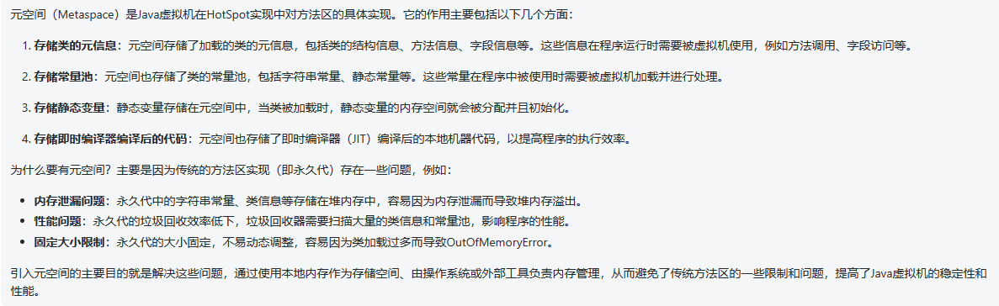

## 元空间和方法区有什么区别？

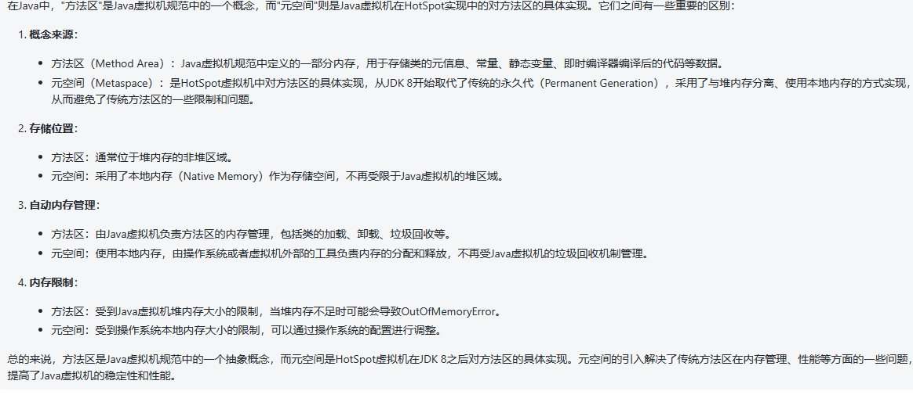

## 垃圾回收

[垃圾收集器](https://scn6apkfnf8w.feishu.cn/docx/CDoMd0LxWoiTEYxvhLCcnW1InNh)

[JVM垃圾回收详解（重点） \| JavaGuide](https://javaguide.cn/java/jvm/jvm-garbage-collection.html)

## 为什么要用分代收集呢

当前虚拟机的垃圾收集都采用分代收集算法，根据对象存活周期的不同将内存分为几块。一般将 Java 堆分为新生代和老年代，这样我们就可以根据各个年代的特点选择合适的垃圾收集算法。

比如在新生代中，每次收集都会有大量对象死去，所以可以选择“复制”算法，只需要付出少量对象的复制成本就可以完成每次垃圾收集。而老年代的对象存活几率是比较高的，而且没有额外的空间对它进行分配担保，所以我们必须选择“标记\-清除”或“标记\-整理”算法进行垃圾收集。

## 怎么样去识别垃圾

在我看来回答这个问题应该从可达性分析的角度回答

**可达性分析：**

从根对象开始遍历，对象被根对象直接或间接引用，则为 “可达”；否则为 “不可达”（垃圾）。

## 对象的创建过程

#### 类加载检查

虚拟机遇到一条 new 指令时，首先将去检查这个指令的参数是否能在常量池中定位到这个类的符号引用，并且检查这个符号引用代表的类是否已被加载过、解析和初始化过。如果没有，那必须先执行相应的类加载过程。

#### 分配内存

在**类加载检查**通过后，接下来虚拟机将为新生对象**分配内存**。对象所需的内存大小在类加载完成后便可确定，为对象分配空间的任务等同于把一块确定大小的内存从 Java 堆中划分出来。**分配方式**有 **“指针碰撞”** 和 **“空闲列表”** 两种，**选择哪种分配方式由 Java 堆是否规整决定，而 Java 堆是否规整又由所采用的垃圾收集器是否带有压缩整理功能决定**。

**内存分配的两种方式** （补充内容）：

- 指针碰撞： 

    - 适用场合：堆内存规整（即没有内存碎片）的情况下。

    - 原理：用过的内存全部整合到一边，没有用过的内存放在另一边，中间有一个分界指针，只需要向着没用过的内存方向将该指针移动对象内存大小位置即可。

    - 使用该分配方式的 GC 收集器：Serial, ParNew

- 空闲列表： 

    - 适用场合：堆内存不规整的情况下。

    - 原理：虚拟机会维护一个列表，该列表中会记录哪些内存块是可用的，在分配的时候，找一块儿足够大的内存块儿来划分给对象实例，最后更新列表记录。

    - 使用该分配方式的 GC 收集器：CMS

#### 初始化零值

内存分配完成后，虚拟机需要将分配到的内存空间都初始化为零值（不包括对象头），这一步操作保证了对象的实例字段在 Java 代码中可以不赋初始值就直接使用，程序能访问到这些字段的数据类型所对应的零值。

#### 设置对象头

初始化零值完成之后，**虚拟机要对对象进行必要的设置**，例如这个对象是哪个类的实例、如何才能找到类的元数据信息、对象的哈希码、对象的 GC 分代年龄等信息。 **这些信息存放在对象头中。** 另外，根据虚拟机当前运行状态的不同，如是否启用偏向锁等，对象头会有不同的设置方式。

#### 执行 init 方法

在上面工作都完成之后，从虚拟机的视角来看，一个新的对象已经产生了，但从 Java 程序的视角来看，对象创建才刚开始，`<init>` 方法还没有执行，所有的字段都还为零。所以一般来说，执行 new 指令之后会接着执行 `<init>` 方法，把对象按照程序员的意愿进行初始化，这样一个真正可用的对象才算完全产生出来。

## 数组越界会发生什么

**数组索引越界异常**

## 栈溢出会对其他进程造成影响吗

不会，主要原因是进程之间的空间不是共享的。

如果要是问**线程崩溃，进程一定会崩溃吗，就要看下下面这个链接了**

[5\.7 线程崩溃了，进程也会崩溃吗？](https://xiaolincoding.com/os/4_process/thread_crash.html#%E4%B8%BA%E4%BB%80%E4%B9%88%E7%BA%BF%E7%A8%8B%E5%B4%A9%E6%BA%83%E4%B8%8D%E4%BC%9A%E5%AF%BC%E8%87%B4-jvm-%E8%BF%9B%E7%A8%8B%E5%B4%A9%E6%BA%83)

## 了解类加载器吗？类加载器的类型有哪些

实现通过类的权限定名获取该类的二进制字节流的代码块叫做类加载器。

主要有以下四种类加载器:

1. 启动类加载器\(Bootstrap ClassLoader\)用来加载java核心类库，无法被java程序直接引用。

2. 扩展类加载器\(extensions class loader\):它用来加载 Java 的扩展库。Java 虚拟机的实现会提供一个扩展库目录。该类加载器在此目录里面查找并加载 Java 类。

3. 系统类加载器（system class loader）：它根据 Java 应用的类路径（CLASSPATH）来加载 Java类。一般来说，Java 应用的类都是由它来完成加载的。可以通过ClassLoader\.getSystemClassLoader\(\)来获取它。

4. 用户自定义类加载器，通过继承 java\.lang\.ClassLoader类的方式实现。

## 变量存在堆还是栈的条件？方法内局部变量存放位置。

1. 栈（Stack）：存储**方法内的局部变量**（包括基本类型和对象引用）

2. 堆（Heap）：存储对象实例和静态变量

3. 方法区（Method Area）：存储类信息、常量池、静态变量（JDK8 后位于 Metaspace 元空间）

## OOM发生的区域

1. **Java 虚拟机栈**

可能发生 OOM 或 StackOverflowError：

- `StackOverflowError`：线程请求的栈深度 \> 虚拟机允许的最大深度（如递归太深）。

- `OutOfMemoryError`：如果线程创建过多，且内存不足（如 `-Xss` 设置过小或线程数太多），无法为新线程创建栈。

2. **本地方法栈**

- 可能发生 OOM：与虚拟机栈类似，调用 native 方法时栈空间不足。

3. **Java 堆**

- 作用：存放对象实例、数组等，是垃圾回收（GC）的主要区域。

- 线程共享。

- **最常发生 OOM 的区域！**

    - 典型错误：`java.lang.OutOfMemoryError: Java heap space`

    - 原因：

        - 内存泄漏（如静态集合不断添加对象）。

        - 对象生命周期过长。

        - 堆空间设置过小（`-Xmx` 设置不足）。

        - 突发大量对象创建（如大文件解析、缓存未控制）。

4. **方法区**

- 在 Java 8 之前：使用 永久代 实现。

- 在 Java 8 及以后：使用 元空间实现，元空间在本地内存中分配。

**OOM 情况：**

- Java 7 及之前：

    - `java.lang.OutOfMemoryError: PermGen space`

    - 原因：加载类过多（如动态生成类、反射、OSGi、JSP 重复加载）。

- Java 8\+（元空间）：

    - `java.lang.OutOfMemoryError: Metaspace`

    - 原因：类加载器未正确卸载、动态生成大量类（如 CGLIB、ASM、Groovy 等）。

# Java并发

## 并发编程的三大特性

**原子性、可见性、有序性**

**原子性**

原子性指临界区域的代码执行不可分割，必须完整执行。例如，线程A将变量i从1修改为2时，若此时其他线程介入，会导致数据错误。通过锁机制（如synchronized）可确保操作不可中断，保证数据完整性

**可见性**

可见性指一个线程对共享变量的修改能被其他线程及时感知。例如，使用volatile关键字或锁机制可确保变量修改对其他线程生效，避免因缓存不一致导致的数据错误

**有序性**

有序性指程序执行顺序与代码顺序一致，防止编译器优化或硬件乱序执行导致逻辑错误。锁机制（如synchronized）通过锁定代码块可维持操作顺序

## 乐观锁是怎样实现的？

乐观锁一般会使用版本号机制或 CAS 算法实现

### 版本号机制

一般是在数据表中加上一个数据版本号 `version` 字段，表示数据被修改的次数。当数据被修改时，`version` 值会加一。当线程 A 要更新数据值时，在读取数据的同时也会读取 `version` 值，在提交更新时，若刚才读取到的 version 值为当前数据库中的 `version` 值相等时才更新，否则重试更新操作，直到更新成功。

**举一个简单的例子**：假设数据库中帐户信息表中有一个 version 字段，当前值为 1 ；而当前帐户余额字段（ `balance` ）为 $100 。

1. 操作员 A 此时将其读出（ `version`=1 ），并从其帐户余额中扣除 $50（ $100\-$50 ）。

2. 在操作员 A 操作的过程中，操作员 B 也读入此用户信息（ `version`=1 ），并从其帐户余额中扣除 $20 （ $100\-$20 ）。

3. 操作员 A 完成了修改工作，将数据版本号（ `version`=1 ），连同帐户扣除后余额（ `balance`=$50 ），提交至数据库更新，此时由于提交数据版本等于数据库记录当前版本，数据被更新，数据库记录 `version` 更新为 2 。

4. 操作员 B 完成了操作，也将版本号（ `version`=1 ）试图向数据库提交数据（ `balance`=$80 ），但此时比对数据库记录版本时发现，操作员 B 提交的数据版本号为 1 ，数据库记录当前版本也为 2 ，不满足 “ 提交版本必须等于当前版本才能执行更新 “ 的乐观锁策略，因此，操作员 B 的提交被驳回。

这样就避免了操作员 B 用基于 `version`=1 的旧数据修改的结果覆盖操作员 A 的操作结果的可能。

### CAS 算法

CAS 的全称是 **Compare And Swap（比较与交换）** ，用于实现乐观锁，被广泛应用于各大框架中。CAS 的思想很简单，就是用一个预期值和要更新的变量值进行比较，两值相等才会进行更新。

CAS 是一个原子操作，底层依赖于一条 CPU 的原子指令。

> **原子操作** 即最小不可拆分的操作，也就是说操作一旦开始，就不能被打断，直到操作完成。
> 
> 

CAS 涉及到三个操作数：

- **V**：要更新的变量值\(Var\)

- **E**：预期值\(Expected\)

- **N**：拟写入的新值\(New\)

当且仅当 V 的值等于 E 时，CAS 通过原子方式用新值 N 来更新 V 的值。如果不等，说明已经有其它线程更新了 V，则当前线程放弃更新。

**举一个简单的例子**：线程 A 要修改变量 i 的值为 6，i 原值为 1（V = 1，E=1，N=6，假设不存在 ABA 问题）。

1. i 与 1 进行比较，如果相等， 则说明没被其他线程修改，可以被设置为 6 。

2. i 与 1 进行比较，如果不相等，则说明被其他线程修改，当前线程放弃更新，CAS 操作失败。

当多个线程同时使用 CAS 操作一个变量时，只有一个会胜出，并成功更新，其余均会失败，但失败的线程并不会被挂起，仅是被告知失败，并且允许再次尝试，当然也允许失败的线程放弃操作。

## 乐观锁和悲观锁及其适用场景

#### 悲观锁

悲观锁总是假设最坏的情况，认为共享资源每次被访问的时候就会出现问题\(比如共享数据被修改\)，所以每次在获取资源操作的时候都会上锁，这样其他线程想拿到这个资源就会阻塞直到锁被上一个持有者释放。也就是说，**共享资源每次只给一个线程使用，其它线程阻塞，用完后再把资源转让给其它线程**。

像 Java 中`synchronized`和`ReentrantLock`等独占锁就是悲观锁思想的实现。

高并发的场景下，激烈的锁竞争会造成线程阻塞，大量阻塞线程会导致系统的上下文切换，增加系统的性能开销。并且，悲观锁还可能会存在死锁问题（线程获得锁的顺序不当时），影响代码的正常运行。

#### 乐观锁

乐观锁总是假设最好的情况，认为共享资源每次被访问的时候不会出现问题，线程可以不停地执行，无需加锁也无需等待，只是在提交修改的时候去验证对应的资源（也就是数据）是否被其它线程修改了（具体方法可以使用版本号机制或 CAS 算法）。

在 Java 中`java.util.concurrent.atomic`包下面的原子变量类（比如`AtomicInteger`、`LongAdder`）就是使用了乐观锁的一种实现方式 CAS 实现的。

高并发的场景下，乐观锁相比悲观锁来说，不存在锁竞争造成线程阻塞，也不会有死锁问题，在性能上往往会更胜一筹。但是，如果冲突频繁发生（写占比非常多的情况），会频繁失败并重试，这样同样会非常影响性能，导致 CPU 飙升。

不过，大量失败重试的问题也是可以解决的，像我们前面提到的 `LongAdder`以空间换时间的方式就解决了这个问题。

理论上来说：

- 悲观锁通常多用于写比较多的情况（多写场景，竞争激烈），这样可以避免频繁失败和重试影响性能，悲观锁的开销是固定的。不过，如果乐观锁解决了频繁失败和重试这个问题的话（比如`LongAdder`），也是可以考虑使用乐观锁的，要视实际情况而定。

- 乐观锁通常多用于写比较少的情况（多读场景，竞争较少），这样可以避免频繁加锁影响性能。不过，乐观锁主要针对的对象是单个共享变量（参考`java.util.concurrent.atomic`包下面的原子变量类）。

## threadlocal 原理

**javaGuide上的ThreadLocal: ****   **[ThreadLocal 详解](https://javaguide.cn/java/concurrent/threadlocal.html)

**什么是ThreadLocal：**

首先，它是一个数据结构，有点像HashMap，可以保存"key : value"键值对，但是一个ThreadLocal只能保存一个，并且各个线程的数据互不干扰。

**ThreadLocal和Synchonized：**

两者都用于解决多线程并发访问。但是ThreadLocal与synchronized有本质的区别。Synchronized用于线程间的数据共享，而ThreadLocal则用于线程间的数据隔离。`Synchronized`是利用锁的机制，使变量或代码块在某一时该只能被一个线程访问。而ThreadLocal为每一个线程都提供了变量的副本，使得每个线程在某一时间访问到的并不是同一个对象，这样就隔离了多个线程对数据的数据共享。而Synchronized却正好相反，它用于在多个线程间通信时能够获得数据共享。

**ThreadLocal中的key和value**

ThreadLocal实例的弱引用对象会作为key存放在ThreadLocalMap中，然后set方法加入的值就作为ThreadLocalMap中的value，一个线程中可以new多个ThreadLocal用于存放多个值，这些值在线程内是共享的

**ThreadLocal内存泄漏**

但是有些时候使用ThreadLocal是会发生内存泄漏的，而为什么会发生内存泄漏呢？下面是我理解的一些答案：

如果ThreadLocal没有外部强引用，那么在发生垃圾回收的时候，ThreadLocal就必定会被回收，而ThreadLocal又作为Map中的key，ThreadLocal被回收就会导致一个key为null的entry，外部就无法通过key来访问这个entry，垃圾回收也无法回收，这就造成了内存泄漏

**解决方案**

解决办法是每次使用完ThreadLocal都调用它的remove\(\)方法清除数据，或者按照JDK建议将ThreadLocal变量定义成private static，这样就一直存在ThreadLocal的强引用，也就能保证任何时候都能通过ThreadLocal的弱引用访问到Entry的value值，进而清除掉。

## AQS 原理、构建了哪些锁

这里可以全文理解背诵JavaGuide的部分：[AQS 详解](https://javaguide.cn/java/concurrent/aqs.html)

## 死锁的必要条件有哪些

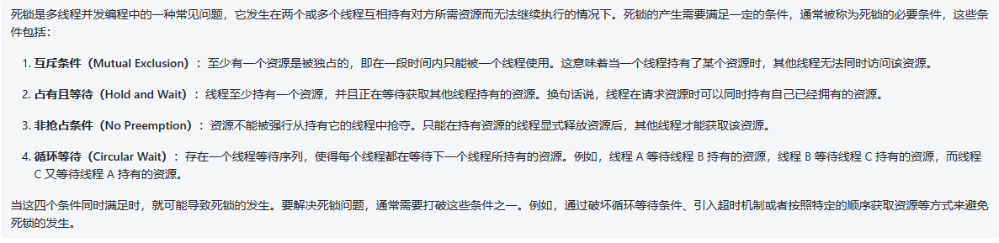

## 线程池的参数都有哪些

java多线程开发时，常常用到线程池技术，下面是对创建java线程池时的七个参数的详细解释。


从源码中可以看出，线程池的构造函数有7个参数，分别是corePoolSize、maximumPoolSize、keepAliveTime、unit、workQueue、threadFactory、handler。

1. **corePoolSize 线程池核心线程大小** 线程池中会维护一个最小的线程数量，即使这些线程处于空闲状态，他们也不会被销毁，除非设置了allowCoreThreadTimeOut。这里的最小线程数量即是corePoolSize。任务提交到线程池后，首先会检查当前线程数是否达到了corePoolSize，如果没有达到的话，则会创建一个新线程来处理这个任务。

2. **maximumPoolSize 线程池最大线程数量 **当前线程数达到corePoolSize后，**如果继续有任务被提交到线程池，会将任务缓存到工作队列（后面会介绍）中。如果队列也已满，则会去创建一个新线程来出来这个处理**。线程池不会无限制的去创建新线程，它会有一个最大线程数量的限制，这个数量即由maximunPoolSize指定。

3. **keepAliveTime 空闲线程存活时间  **一个线程如果处于空闲状态，并且当前的线程数量大于corePoolSize，那么在指定时间后，这个空闲线程会被销毁，这里的指定时间由keepAliveTime来设定

4. **unit 空闲线程存活时间单位 **keepAliveTime的计量单位

5. **workQueue 工作队列 **新任务被提交后，会先进入到此工作队列中，任务调度时再从队列中取出任务。jdk中提供了四种工作队列：

    - **ArrayBlockingQueue\.**   基于数组的有界阻塞队列，按FIFO排序。新任务进来后，会放到该队列的队尾，有界的数组可以防止资源耗尽问题。当线程池中线程数量达到corePoolSize后，再有新任务进来，则会将任务放入该队列的队尾，等待被调度。如果队列已经是满的，则创建一个新线程，如果线程数量已经达到maxPoolSize，则会执行拒绝策略。

    - **LinkedBlockingQueue\. **基于链表的无界阻塞队列（其实最大容量为Interger\.MAX），按照FIFO排序。由于该队列的近似无界性，当线程池中线程数量达到corePoolSize后，再有新任务进来，会一直存入该队列，而基本不会去创建新线程直到maxPoolSize（很难达到Interger\.MAX这个数），因此使用该工作队列时，参数maxPoolSize其实是不起作用的。

    - **SynchronousQueue** 一个不缓存任务的阻塞队列，生产者放入一个任务必须等到消费者取出这个任务。也就是说新任务进来时，不会缓存，而是直接被调度执行该任务，如果没有可用线程，则创建新线程，如果线程数量达到maxPoolSize，则执行拒绝策略。

    - **PriorityBlockingQueue**具有优先级的无界阻塞队列，优先级通过参数Comparator实现。

6. **threadFactory 线程工厂 **创建一个新线程时使用的工厂，可以用来设定线程名、是否为daemon线程等等

7. **handler 拒绝策略 **当工作队列中的任务已到达最大限制，并且线程池中的线程数量也达到最大限制，这时如果有新任务提交进来，该如何处理呢。这里的拒绝策略，就是解决这个问题的，jdk中提供了4种拒绝策略：

    - **CallerRunsPolicy**该策略下，在调用者线程中直接执行被拒绝任务的run方法，除非线程池已经shutdown，则直接抛弃任务。

    - **AbortPolicy**该策略下，直接丢弃任务，并抛出RejectedExecutionException异常。

    - **DiscardPolicy**该策略下，直接丢弃任务，什么都不做。

    - **DiscardOldestPolicy**该策略下，抛弃进入队列最早的那个任务，然后尝试把这次拒绝的任务放入队列

## volatile关键字的作用和原理

#### 关键字作用

- volatile 保证可见性 一旦一个共享变量（类的成员变量、类的静态成员变量）被volatile修饰之后，那么就具备了两层语义：保证了不同线程对这个变量进行操作时的可见性，即一个线程修改了某个变量的值，这新值对其他线程来说是立即可见的。禁止进行指令重排序。

- volatile 不能确保原子性    

    ```java
    public class VolatileVisibility {
    
        public static volatile int i =0;
    
        public static void increase(){
            i++;//读数据和操作数据是两次操作
        }
    }      
    ```

#### volatile原理

> “观察加入volatile关键字和没有加入volatile关键字时所生成的汇编代码发现，加入volatile关键字时，会多出一个lock前缀指令”
> 
> 

lock前缀指令实际上相当于一个内存屏障（也称内存栅栏），内存屏障会提供3个功能：

1. 它确保指令重排序时不会把其后面的指令排到内存屏障之前的位置，也不会把前面的指令排到内存屏障的后面；即在执行到内存屏障这句指令时，在它前面的操作已经全部完成；

2. 它会强制将对缓存的修改操作立即写入主存；

3. 如果是写操作，它会导致其他CPU中对应的缓存行无效。

## Java 并发容器

> 着重回答`ConcurrentHashMap`**和**`CopyOnWriteArrayList`
> 
> 

#### ConcurrentHashMap

我们知道 `HashMap` 不是线程安全的，在并发场景下如果要保证一种可行的方式是使用 `Collections.synchronizedMap()` 方法来包装我们的 `HashMap`。但这是通过使用一个全局的锁来同步不同线程间的并发访问，因此会带来不可忽视的性能问题。

所以就有了 `HashMap` 的线程安全版本—— `ConcurrentHashMap` 的诞生。

在 JDK1\.7 的时候，`ConcurrentHashMap` 对整个桶数组进行了分割分段\(`Segment`，分段锁\)，每一把锁只锁容器其中一部分数据，多线程访问容器里不同数据段的数据，就不会存在锁竞争，提高并发访问率。

到了 JDK1\.8 的时候，`ConcurrentHashMap` 已经摒弃了 `Segment` 的概念，而是直接用 `Node` 数组\+链表\+红黑树的数据结构来实现，并发控制使用 `synchronized` 和 CAS 来操作。（JDK1\.6 以后 `synchronized` 锁做了很多优化）整个看起来就像是优化过且线程安全的 `HashMap`，虽然在 JDK1\.8 中还能看到 `Segment` 的数据结构，但是已经简化了属性，只是为了兼容旧版本。

#### CopyOnWriteArrayList

在 JDK1\.5 之前，如果想要使用并发安全的 `List` 只能选择 `Vector`。而 `Vector` 是一种老旧的集合，已经被淘汰。`Vector` 对于增删改查等方法基本都加了 `synchronized`，这种方式虽然能够保证同步，但这相当于对整个 `Vector`加上了一把大锁，使得每个方法执行的时候都要去获得锁，导致性能非常低下。

JDK1\.5 引入了 `Java.util.concurrent`（JUC）包，其中提供了很多线程安全且并发性能良好的容器，其中唯一的线程安全 `List` 实现就是 `CopyOnWriteArrayList` 。

对于大部分业务场景来说，读取操作往往是远大于写入操作的。由于读取操作不会对原有数据进行修改，因此，对于每次读取都进行加锁其实是一种资源浪费。相比之下，我们应该允许多个线程同时访问 `List` 的内部数据，毕竟对于读取操作来说是安全的。

这种思路与 `ReentrantReadWriteLock` 读写锁的设计思想非常类似，即读读不互斥、读写互斥、写写互斥（只有读读不互斥）。`CopyOnWriteArrayList` 更进一步地实现了这一思想。为了将读操作性能发挥到极致，`CopyOnWriteArrayList` 中的读取操作是完全无需加锁的。更加厉害的是，写入操作也不会阻塞读取操作，只有写写才会互斥。这样一来，读操作的性能就可以大幅度提升。

`CopyOnWriteArrayList` 线程安全的核心在于其采用了 **写时复制（Copy\-On\-Write）** 的策略，从 `CopyOnWriteArrayList` 的名字就能看出了。

当需要修改（ `add`，`set`、`remove` 等操作） `CopyOnWriteArrayList` 的内容时，不会直接修改原数组，而是会先创建底层数组的副本，对副本数组进行修改，修改完之后再将修改后的数组赋值回去，这样就可以保证写操作不会影响读操作了。

#### **源码分析部分**

ConcurrentHashMap:[ConcurrentHashMap 源码分析](https://javaguide.cn/java/collection/concurrent-hash-map-source-code.html)

CopyOnWriteArrayList:[CopyOnWriteArrayList 源码分析](https://javaguide.cn/java/collection/copyonwritearraylist-source-code.html)

## 介绍一下future和completedfuture

JavGuide当中的介绍：[Java并发常见面试题总结（下）](https://javaguide.cn/java/concurrent/java-concurrent-questions-03.html#future)

[CompletableFuture用法详解 \- 知乎 \(zhihu\.com\)](https://zhuanlan.zhihu.com/p/344431341)

[异步编程利器：CompletableFuture详解 ｜Java 开发实战 \- 掘金 \(juejin\.cn\)](https://juejin.cn/post/6970558076642394142)

## Synchronized的底层原理

`synchronized` 是 Java 中的一个关键字，翻译成中文是同步的意思，主要解决的是多个线程之间访问资源的同步性，可以保证被它修饰的方法或者代码块在任意时刻只能有一个线程执行。

在 Java 早期版本中，`synchronized` 属于 **重量级锁**，效率低下。这是因为监视器锁（monitor）是依赖于底层的操作系统的 `Mutex Lock` 来实现的，Java 的线程是映射到操作系统的原生线程之上的。如果要挂起或者唤醒一个线程，都需要操作系统帮忙完成，而操作系统实现线程之间的切换时需要从用户态转换到内核态，这个状态之间的转换需要相对比较长的时间，时间成本相对较高。

`synchronized` 同步代码块的实现是通过 `monitorenter` 和 `monitorexit` 指令，其中 `monitorenter` 指令指向同步代码块的开始位置，`monitorexit` 指令则指明同步代码块的结束位置。当执行 `monitorenter` 指令时，线程试图获取锁也就是获取 `monitor`\(`monitor`对象存在于每个java对象的对象头中，`synchronized` 锁便是通过这种方式获取锁的，也是为什么\]ava中任意对象可以作为锁的原因\)的持有权。

其内部包含一个计数器，当计数器为0则可以成功获取，获取后将锁计数器设为1也就是加1。相应的在执行 `monitorexit` 指令后，将锁计数器设为0，表明锁被释放。如果获取对象锁失败，那当前线程就要阻塞等待，直到锁被另外一个线程释放为止

`synchronized` 修饰的方法并没有 `monitorenter` 指令和 `monitorexit` 指令，取代的确实是`ACC SYNCHRONIZED` 标识，该标识指明了该方法是一个同步方法，JVM 通过该 `ACC SYNCHRONIZED`访问标志来辨别一个方法是否声明为同步方法，从而执行相应的同步调用。

## 创建线程的三种方式

- 继承`Thread`类；

- 实现`Runnable`接口；

- 实现`Callable`接口；

- 使用`ExecutorService`线程池。

**延伸：**

**Runnable和Callable的核心区别:**

Runnable和Callable的核心区别体现在**返回值支持、异常处理机制和执行方式**三个方面。

1. 返回值差异

    1. Runnable：`run()`方法返回类型为`void`，无法直接返回计算结果。

    2. Callable：`call()`方法通过泛型定义返回值类型（如`Callable<Integer>`），执行结果可通过`Future.get()`异步获取。

2. 异常处理机制

    1. Runnable：

        - `run()`方法不允许抛出受检异常（Checked Exceptions），必须在方法内部通过try\-catch处理异常。

    2. Callable：

        - `call()`方法可显式抛出受检异常，调用方需通过`Future.get()`捕获`ExecutionException`，并通过`e.getCause()`获取原始异常信息。

3. 执行方式对比

    1. Runnable：

        - 可直接通过`new Thread(runnable).start()`启动线程。

        - 也可提交至`ExecutorService`执行。

    2. Callable：

        - 必须通过`ExecutorService.submit()`提交任务，返回`Future`对象管理结果和状态。

        - 典型用法：`Future<String> future = executor.submit(callableTask); String result = future.get()`（注意此调用会阻塞主线程）

4. 用法例子

    1. Runnalbe

        ```Plain Text
        Runnable logTask = () -> System.out.println("日志记录完成");
        new Thread(logTask).start();
        ```

    2. Callable

        ```SQL
        Callable<Integer> calcTask = () -> {
            TimeUnit.SECONDS.sleep(2);
            return 100 + 200;  // 返回计算结果
        };
        
        ExecutorService executor = Executors.newCachedThreadPool();
        Future<Integer> future = executor.submit(calcTask);
        
        System.out.println("等待计算结果...");
        Integer result = future.get();  // 阻塞直到获取结果
        System.out.println("计算结果: " + result);
        ```

线程池中的`submit()`和`execute()`方法区别：

**参数类型**

- execute\(\)‌：只能接收`Runnable`任务，无法提交有返回值的任务。

- submit\(\)‌：可接收`Runnable`和`Callable`任务，`Callable`任务执行后可通过返回的`Future`对象获取结果。

**返回值**

- execute\(\)‌：无返回值（void），无法获取任务执行状态或结果。

- submit\(\)‌：返回一个`Future`对象，可通过该对象查询任务状态、取消任务或获取执行结果/异常。 

**异常处理**

- execute\(\)‌：任务中的未捕获异常会直接抛出到调用线程（通常为主线程）。 

- submit\(\)‌：异常被封装在`Future.get()`方法中抛出，需主动捕获或处理。 

**任务队列策略**

- execute\(\)‌：任务被添加到阻塞队列并保留执行顺序。 

- submit\(\)‌：任务添加到队列尾部，按顺序执行。 

## countdownlatch和cyclicbarrier的区别

JavaGuide的AQS：[AQS 详解](https://javaguide.cn/java/concurrent/aqs.html#countdownlatch-%E5%80%92%E8%AE%A1%E6%97%B6%E5%99%A8)

**CountDownLatch**用一个给定的计数器来初始化，该计数器的操作是原子操作，即同时只能有一个线程去操作该计数器。调用该类await方法的线程会一直处于阻塞状态，直到其他线程调用countDown方法使当前计数器的值变为零，每次调用countDown计数器的值减1。当计数器值减至零时，所有因调用await\(\)方法而处于等待状态的线程就会继续往下执行。

这种现象只会出现一次，因为计数器不能被重置，如果业务上需要一个可以重置计数次数的版本，可以考虑使用CycliBarrier。

在某些业务场景中，程序执行需要等待某个条件完成后才能继续执行后续的操作；典型的应用如并行计算，当某个处理的运算量很大时，可以将该运算任务拆分成多个子任务，等待所有的子任务都完成之后，父任务再拿到所有子任务的运算结果进行汇总。

**CyclicBarrier**也是一个同步辅助类，它允许一组线程相互等待，直到到达某个公共屏障点（common barrier point）。通过它可以完成多个线程之间相互等待，只有当每个线程都准备就绪后，才能各自继续往下执行后面的操作。类似于CountDownLatch，它也是通过计数器来实现的。当某个线程调用await方法时，该线程进入等待状态，且计数器加1，当计数器的值达到设置的初始值时，所有因调用await进入等待状态的线程被唤醒，继续执行后续操作。

**CountDownLatch与CyclicBarrier的区别**

- CountDownLatch主要是实现了1个或N个线程需要等待其他线程完成某项操作之后才能继续往下执行操作，描述的是1个线程或N个线程等待其他线程的关系。

- CyclicBarrier主要是实现了多个线程之间相互等待，直到所有的线程都满足了条件之后各自才能继续执行后续的操作，描述的多个线程内部相互等待的关系。

- CountDownLatch是一次性的，而CyclicBarrier则可以被重置而重复使用。

**CountdownLatch 使用场景**

CountdownLatch可以当做一个计数器来使用,比如某线程需要等待其他几个线程都执行过某个时间节点后才能继续执行 我们来模拟一个场景,某公司一共有十个人,门卫要等十个人都来上班以后,才可以休息

**CyclicBarrier 使用场景**

十名运动员各自准备比赛,需要等待所有运动员都准备好以后,裁判才能说开始然后所有运动员一起跑

## cas的底层原理

（回答一下原理\+实现方式（通过原子指令实现））

CAS并发原语体现在Java语言中就是sun\.misc\.Unsafe类的各个方法。调用UnSafe类中的CAS方法，JVM会帮我们实现出CAS汇编指令，通过它实现了原子操作，再次强调，由于CAS是一种系统原语，原语属于操作系统用于范畴，是由若干条指令组成，用于完成某个功能的一个过程，并且原语的执行必须是连续的，在执行过程中不允许被中断，也就是说CAS是一条CPU的原子指令，不会造成所谓的数据不一致的问题，也就是说CAS是线程安全的。

## synchronize的上锁粒度（对象/类），如果上在方法上呢？

上锁粒度有两种，一个是实例对象，一个是类对象

修饰一个代码块： 一个线程正在访问一个对象中的 synchronized\(this 或 其他对象\) 同步代码块时，其他试图访问该对象（要是同一个对象）的线程将被阻塞。

修饰一个普通方法： 在方法的前面加 synchronized，public synchronized void method\(\)，此方法等于修饰整个方法代码块。

修饰一个静态的方法：public synchronized static void method\(\)，静态方法是属于类的，同样的，synchronized 修饰的静态方法锁定的是这个类的所有对象。

修饰一个类：synchronized\(ClassName\.class\)，synchronized 作用于一个类时，是给这个类加锁，该类的所有对象都将加同一把锁。

## Synchronized的锁升级过程

#### 锁升级过程

synchronized锁升过程：偏向锁\-》轻量级锁\-》重量级锁。


#### 锁升级流程

synchronized锁升级的具体流程如图2所示。


##### 2\.1 偏向锁\-\>轻量级锁

线程A请求synchronized对象，比较同步块对象存储的线程S ID与线程A ID是否相同，如果相同，那么执行同步块，无需使用CAS加锁或解锁；如果不同，那么检查synchronized对象中记录的线程S是否存活，如果线程S未存活，那么synchronized对象被重置为无锁状态，线程A通过竞争将其设置为偏向锁，此时，synchronized对象头中存储线程A的ID，如果线程S存活，那么查找线程S的栈帧信息，如果线程S仍要继续持有该synchronized对象，那么暂停线程S，撤销偏向锁，升级为轻量级锁，如果线程S不再使用该synchronized对象，将synchronized对象设为无锁状态，重新偏向线程A。

##### 2\.2 轻量级锁\-\>重量级锁

线程A获取轻量级锁时先将synchronized对象头Mark Word复制一份到线程A在栈帧中创建的存储锁记录空间（即DispalcedMarkWord），然后使用CAS将对象头中的内容替换为线程A存储的所记录（DisplacedMarkWord）地址。如果线程A复制对象头时，线程B也准备获取锁，复制对象头到线程B的锁记录空间，当线程B进行CAS时发现，线程A已经将对象头替换，线程B的CAS失败，线程B尝试使用自旋等待线程A释放锁。如果线程B自旋次数到了上限，线程A仍没有释放锁，线程B仍在自选等待，此时，线程C又来竞争锁对象，轻量级锁会膨胀为重量级锁。重量级锁将未获得锁的线程阻塞，不消耗CPU，防止CPU空运行。

#### 为什么synchronized需要锁升级的这个过程（扩展）

`synchronized` 的锁升级过程（主要是偏向锁\-\>轻量级锁\-\>重量级锁）是 **JVM 为了在保证线程安全的前提下，针对不同强度的锁竞争场景进行深度性能优化而设计的核心机制**。它**避免了在无竞争或低竞争时直接使用重量级锁的巨大开销**，通过更轻量级的同步手段（偏向锁、CAS\+自旋）大幅提升性能，只在真正必要（高竞争）时才切换到开销更大但能避免 CPU 浪费的重量级锁。这是一种典型的“按需付费”的性能优化策略。虽然偏向锁在现代 Java 版本中逐渐淡出，但轻量级锁到重量级锁的升级逻辑仍然是 `synchronized` 高效实现的关键所在。

#### 锁升级过程（是2的不一样的表达方式，相对更加清晰）

1. **初始状态：无锁 \(Unlocked\)**

- 对象头 \(Mark Word\)： 存储对象的哈希码（`identity_hashcode`）、分代年龄（`age`）、锁标志位（`lock_flag`，通常为 `01`）等信息。

- 触发升级条件： 当有线程第一次尝试通过 `synchronized` 获取该对象的锁时（且 JVM 启用了偏向锁）。

---

2. **偏向锁 \(Biased Locking\)**

- 目标： 优化同一个线程反复获取同一把锁的场景。

- 升级过程：

    1. 检查偏向锁状态： 线程首次进入 `synchronized` 块时，JVM 检查对象头的 Mark Word：

        - 锁标志位是否为 `01`（表示可偏向）。

        - 偏向线程 ID 是否为空或指向当前线程。

        - 偏向时间戳（epoch）是否有效。

    2. CAS 设置偏向信息： 如果检查通过，JVM 使用 CAS 操作尝试将 Mark Word 中的：

        - 线程 ID 设置为当前线程 ID。

        - 偏向锁标志位 设置为 `1`。

        - epoch 设置为有效值。

    3. 成功获取偏向锁： 如果 CAS 成功，锁进入 偏向模式。对象头 Mark Word 结构变为：`[线程ID | epoch | 分代年龄 | 1 | 01]`。

- 后续同一线程加锁： 该线程再次进入 `synchronized` 块时，只需检查 Mark Word：

    - 线程 ID 指向自己 \-\> 直接通行，无任何同步开销（零成本）。

- 触发升级条件：

    - 撤销偏向锁： 当另一个线程尝试获取这个锁时（发生竞争）。

    - 批量重偏向/撤销： JVM 优化机制，当某个类的偏向锁撤销次数超过阈值，会尝试将该类所有实例的偏向锁批量重偏向到新线程或批量撤销回无锁/轻量级锁状态。

    - 调用 `hashCode()`： 偏向锁状态下调用对象的 `hashCode()` 会强制撤销偏向锁（因为 Mark Word 需要存储哈希码，无法同时存储线程 ID）。

- 撤销过程：

    - 暂停持有偏向锁的线程（`stop the world`，非常短暂）。

    - 检查原持有偏向锁的线程状态：

        - 如果线程已退出同步块或已死亡，则将 Mark Word 设置为无锁状态（`01`），然后唤醒暂停的线程。竞争线程接下来会尝试获取轻量级锁。

        - 如果线程仍在同步块内，则将 Mark Word 升级为指向该线程栈帧中轻量级锁记录的指针（锁标志位变为 `00`），升级为轻量级锁，然后唤醒暂停的线程。

---

3. **轻量级锁 \(Lightweight Locking / Thin Lock\)**

- 目标： 优化线程交替执行、竞争不激烈（锁持有时间短）的场景。

- 升级过程 \(加锁\)：

    1. 创建锁记录： 线程在进入 `synchronized` 块前，在当前线程的栈帧中创建一个名为 锁记录 \(Lock Record\) 的空间。

    2. 复制 Mark Word： 将当前对象头的 Mark Word 复制到锁记录中（称为 `Displaced Mark Word`）。

    3. CAS 尝试替换： JVM 使用 CAS 操作尝试将对象头 Mark Word 替换为指向这个锁记录的指针。

        - 成功： 如果 CAS 成功，表明该线程获得了轻量级锁。对象头 Mark Word 结构变为：`[指向锁记录的指针 | 00]`（`00` 是轻量级锁标志位）。

        - 失败： CAS 失败意味着至少有两个线程在竞争同一个锁。

            - 检查是否重入： 先检查对象头的 Mark Word 是否指向当前线程的栈帧。

                - 如果是，说明是锁重入，创建新的锁记录（但 `Displaced Mark Word` 设为 `null`），记录重入计数。

                - 如果不是，说明发生了竞争。

            - 自旋尝试： 当前线程不会立即阻塞，而是进行自适应自旋（次数由 JVM 动态调整，基于之前该锁的自旋成功情况）尝试再次 CAS 获取锁。

- 触发升级条件：

    - 自旋失败： 自旋一定次数后仍未获得锁。

    - 等待线程超过阈值： 等待的线程数量增多（JVM 实现相关）。

    - 重入过多： 虽然重入不会直接升级，但复杂的重入情况可能影响决策。

- 升级过程 \(升级到重量级锁\)：

    1. JVM 将对象头的 Mark Word 修改为指向一个 Monitor 对象（重量级锁对象，存在于堆中）的指针。

    2. 锁标志位设置为 `10`。

    3. 阻塞当前线程： 未能获得锁的线程被操作系统挂起（阻塞），放入与该 Monitor 关联的 EntryList 等待队列。

    4. 持有轻量级锁的线程在退出同步块时，会尝试用 CAS 将 `Displaced Mark Word` 写回对象头。如果此时对象头已被修改（指向 Monitor），CAS 会失败，该线程也会触发锁升级并释放 Monitor，唤醒等待线程。

- 解锁过程：

    - 使用 CAS 操作将 `Displaced Mark Word` 写回对象头。

    - 如果 CAS 成功，锁被成功释放（回到无锁或可偏向状态）。

    - 如果 CAS 失败，表明锁在持有期间发生了竞争且已升级为重量级锁。此时需要释放关联的 Monitor 对象，并唤醒 EntryList 中的等待线程。

---

4. 重量级锁 \(Heavyweight Locking / Mutex Lock\)

- 目标： 应对激烈竞争、线程持有锁时间长的场景。

- 结构：

    - 对象头 Mark Word 存储指向堆中一个 Monitor 对象（也称为管程或互斥量）的指针。锁标志位为 `10`。

    - Monitor 对象： 包含几个关键部分：

        - `_owner`：指向当前持有锁的线程。

        - `_EntryList`：存储所有阻塞等待获取锁的线程。

        - `_WaitSet`：存储调用了 `Object.wait()` 方法的线程。

        - 计数器（`_count` / `_recursions`）：记录锁的重入次数。

- 操作：

    - 加锁： 线程尝试获取 Monitor。

        - 如果 `_owner` 为空，CAS 将 `_owner` 设为自己，获取成功。

        - 如果 `_owner` 是自己，重入计数器递增。

        - 否则，线程被阻塞并加入 `_EntryList`。

    - 解锁： 持有锁的线程退出同步块时：

        - 重入计数器递减。

        - 当计数器为 0 时，将 `_owner` 置为 `null`。

        - 从 `_EntryList` 中唤醒一个线程（非公平）或所有线程（公平策略由 JVM/OS 决定）来竞争锁。

- 特点：

    - 开销最大： 涉及用户态到内核态的切换、线程上下文切换、线程阻塞和唤醒。

    - 避免 CPU 空转： 线程阻塞不消耗 CPU 时间片，适合竞争激烈的长临界区。

    - 由操作系统管理： 依赖于操作系统的互斥锁实现。


## 如果核心线程数已满，那么新任务是进入队列等待还是直接创建线程执行？

**队列满\+核心线程数满了才创建新线程**

## 线程池相关问题

[线程池相关问题](https://scn6apkfnf8w.feishu.cn/docx/Ei3Jdincco03zbxA3zJcrLzBn8b)

## **什么是轻量级锁、重量级锁**

**轻量级锁：**

轻量级锁是JDK 1\.6之后加入的新型锁机制，它名字中的“轻量级”是和传统上使用操作系统互斥量来实现的进程间互斥的“重量级”锁相对而言的。**轻量级锁的加锁和解锁逻辑都是在用户态代码**来完成的，不需要内核态的参与，效率较高。

**重量级锁：**

重量级锁是通过操作系统互斥量（mutex）来实现的，这种锁会让线程的调用者进入阻塞，然后被操作系统挂起，在争夺锁的过程中会引起线程的上下文切换，开销较大。

**实现原理**：

- 当一个线程尝试获取锁失败时，JVM会先自旋等待一段时间，看看锁是否可以被成功获取。

- 如果等待超时或自旋次数超出预设值，就会转为重量级锁，阻塞当前线程，等待锁被释放。

## synchronized的优化

在Java中，`synchronized`关键字用于实现线程同步，确保同一时刻只有一个线程可以执行同步代码块或方法。虽然`synchronized`机制简单易用，但其性能在某些情况下可能不尽如人意。常见的优化手段：

1. 减少锁的粒度

- 优化说明：锁的粒度越小，竞争就越少，从而提高并发性。

- 优化方式：

    - 用较小的代码块代替同步整个方法，只在必要的操作上进行同步。

    - 分析哪些共享资源需要锁定，缩减锁定范围。

2. 使用`volatile`关键字

- 优化说明：`volatile`提供了一种轻量级的同步机制，用于变量的可见性保证。

- 适用场景：适合于状态的标志（如停止标志），而不是原子性操作。

3. 双重检查锁（Double\-Checked Locking）

- 优化说明：常用于实现线程安全的单例模式，在第一次检查时不需要同步。

[设计模式](https://scn6apkfnf8w.feishu.cn/docx/ILkwdacUyoFtD3xf6MkcKAAKnje#share-IjOddsu0yo9RRcxhxLWcNn6lnnc)

## 锁自旋，是乐观锁发生可能性大还是悲观锁可能性大

锁自旋更**常见于乐观锁**的实现中（尤其是CAS操作），而在悲观锁中虽然也存在（如JDK内部的锁优化）

**自旋的本质**：当线程尝试获取锁失败时，不立即放弃CPU进入阻塞状态，而是循环重试一段时间。目的是避免昂贵的线程上下文切换开销。

**乐观锁（如CAS） → 自旋是核心机制**

- 工作方式：
通过`Compare-And-Swap`\(CAS\)等原子指令尝试修改数据。失败时立即重试（自旋）直到成功或达到阈值。

- 自旋必要性：
乐观锁假设冲突概率低，短暂自旋的成本低于线程挂起/唤醒的开销。
✅ 自旋是乐观锁的固有行为

**悲观锁（synchronized/ReentrantLock） → 自旋是优化手段**

- 工作方式：
直接假设会发生冲突，先加锁再操作。JDK在内部做了优化：

    - 轻量级锁（Thin Lock）：先尝试自旋获取锁（避免阻塞）

    - 适应性自旋（Adaptive Spinning）：根据历史成功率动态调整自旋次数

- 自旋定位：
仅在竞争不激烈且临界区极短时作为性能优化，失败后立即转入阻塞队列。
⚠️ 自旋是悲观锁的可选策略（非必需）


# MySql

## MySql的引擎有什么,各种引擎的特点

innodb，MyISAM, **Memory**

特点：

- MyISAM  它不支持事务，也不支持外键，尤其是访问速度快，对事务完整性没有要求或者以SELECT、INSERT为主的应用基本都可以使用这个引擎来创建表。

- InnoDB存储引擎提供了具有提交、回滚和崩溃恢复能力的事务安全。但是对比MyISAM的存储引擎，InnoDB写的处理效率差一些并且会占用更多的磁盘空间以保留数据和索引

- 使用存在内存中的内容来创建表。MEMORY类型的表访问非常快，因为它的数据是放在内存中的，并且默认使用HASH索引，但是一旦服务器关闭，表中的数据就会丢失，但表还会继续存在。

## 详细对比一下innodb和myisam的区别

- InnoDB 支持行级别的锁粒度，MyISAM 不支持，只支持表级别的锁粒度。

- MyISAM 不提供事务支持。InnoDB 提供事务支持，实现了 SQL 标准定义了四个隔离级别。

- MyISAM 不支持外键，而 InnoDB 支持。

- MyISAM 不支持 MVCC，而 InnoDB 支持。

- 虽然 MyISAM 引擎和 InnoDB 引擎都是使用 B\+Tree 作为索引结构，但是两者的实现方式不太一样。

- MyISAM 不支持数据库异常崩溃后的安全恢复，而 InnoDB 支持。

- InnoDB 的性能比 MyISAM 更强大。

## 事务四大特性

1. **原子性**（`Atomicity`）：事务是最小的执行单位，不允许分割。事务的原子性确保动作要么全部完成，要么完全不起作用；

2. **一致性**（`Consistency`）：执行事务前后，数据保持一致，例如转账业务中，无论事务是否成功，转账者和收款人的总额应该是不变的；

3. **隔离性**（`Isolation`）：并发访问数据库时，一个用户的事务不被其他事务所干扰，各并发事务之间数据库是独立的；

4. **持久性**（`Durability`）：一个事务被提交之后。它对数据库中数据的改变是持久的，即使数据库发生故障也不应该对其有任何影响。

这里要额外补充一点：**只有保证了事务的持久性、原子性、隔离性之后，一致性才能得到保障。也就是说 A、I、D 是手段，C 是目的！**

## 四大特性的实现mysql中怎么保证的

[MySQL事务的四大特性及其实现方式](https://scn6apkfnf8w.feishu.cn/docx/TgTtdZPo8oGycDxiCvac4q2anrc)

## CAP

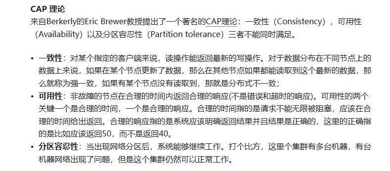

## 使用innodb的表数据结构存储方式

JavaGuide的总结相对较好，直接引用：[MySQL索引详解](https://javaguide.cn/database/mysql/mysql-index.html#%E7%B4%A2%E5%BC%95%E5%BA%95%E5%B1%82%E6%95%B0%E6%8D%AE%E7%BB%93%E6%9E%84%E9%80%89%E5%9E%8B)

## 索引什么时候会失效

- 当我们使用左或者左右模糊匹配的时候，也就是`like %xx` 或者 `like %xx%`这两种方式都会造成索引失效；

- 当我们在查询条件中对索引列使用函数，就会导致索引失效。

- 当我们在查询条件中对索引列进行表达式计算，也是无法走索引的。

- MySQL 在遇到字符串和数字比较的时候，会自动把字符串转为数字，然后再进行比较。如果字符串是索引列，而条件语句中的输入参数是数字的话，那么索引列会发生隐式类型转换，由于隐式类型转换是通过 CAST 函数实现的，等同于对索引列使用了函数，所以就会导致索引失效。

- 联合索引要能正确使用需要遵循最左匹配原则，也就是按照最左优先的方式进行索引的匹配，否则就会导致索引失效。

- 在 WHERE 子句中，如果在 OR 前的条件列是索引列，而在 OR 后的条件列不是索引列，那么索引会失效。

## 一条sql语句的内部执行流程

### MySQL 基本架构概览

- **连接器：** 身份认证和权限相关\(登录 MySQL 的时候\)。

- **查询缓存：** 执行查询语句的时候，会先查询缓存（MySQL 8\.0 版本后移除，因为这个功能不太实用）。

- **分析器：** 没有命中缓存的话，SQL 语句就会经过分析器，分析器说白了就是要先看你的 SQL 语句要干嘛，再检查你的 SQL 语句语法是否正确。

- **优化器：** 按照 MySQL 认为最优的方案去执行。

- **执行器：** 执行语句，然后从存储引擎返回数据。 \-

### **查询**

```SQL
select * from tb_student  A where A.age='18' and A.name=' 张三 ';
```

- 先检查该语句是否有权限，如果没有权限，直接返回错误信息，如果有权限，在 MySQL8\.0 版本以前，会先查询缓存，以这条 SQL 语句为 key 在内存中查询是否有结果，如果有直接缓存，如果没有，执行下一步。

- 通过分析器进行词法分析，提取 SQL 语句的关键元素，比如提取上面这个语句是查询 select，提取需要查询的表名为 tb\_student，需要查询所有的列，查询条件是这个表的 id='1'。然后判断这个 SQL 语句是否有语法错误，比如关键词是否正确等等，如果检查没问题就执行下一步。

- 接下来就是优化器进行确定执行方案，上面的 SQL 语句，可以有两种执行方案：a\.先查询学生表中姓名为“张三”的学生，然后判断是否年龄是 18。b\.先找出学生中年龄 18 岁的学生，然后再查询姓名为“张三”的学生。那么优化器根据自己的优化算法进行选择执行效率最好的一个方案（优化器认为，有时候不一定最好）。那么确认了执行计划后就准备开始执行了。

- 进行权限校验，如果没有权限就会返回错误信息，如果有权限就会调用数据库引擎接口，返回引擎的执行结果。

### **更新**

```Plain Text
update student A set A.age='19' where A.name=' 张三 ';
```

其实这条语句也基本上会沿着上一个查询的流程走，只不过执行更新的时候肯定要记录日志，这就会引入日志模块了，MySQL 自带的日志模块是 **binlog（归档日志）** ，所有的存储引擎都可以使用，我们常用的 InnoDB 引擎还自带了一个日志模块 **redo log（重做日志）**，我们就以 InnoDB 模式下来探讨这个语句的执行流程。流程如下：

- 先查询到张三这一条数据，不会走查询缓存，因为更新语句会导致与该表相关的查询缓存失效。

- 然后拿到查询的语句，把 age 改为 19，然后调用引擎 API 接口，写入这一行数据，InnoDB 引擎把数据保存在内存中，同时记录 redo log，此时 redo log 进入 `prepare` 状态，然后告诉执行器，执行完成了，随时可以提交。

- 执行器收到通知后记录 binlog，然后调用引擎接口，提交 redo log 为提交状态。

- 更新完成。

## 数据库的隔离级别，分别会出现哪些问题

- **READ\-UNCOMMITTED\(读取未提交\)** ：最低的隔离级别，允许读取尚未提交的数据变更，可能会导致脏读、幻读或不可重复读。

- **READ\-COMMITTED\(读取已提交\)** ：允许读取并发事务已经提交的数据，可以阻止脏读，但是幻读或不可重复读仍有可能发生。

- **REPEATABLE\-READ\(可重复读\)** ：对同一字段的多次读取结果都是一致的，除非数据是被本身事务自己所修改，可以阻止脏读和不可重复读，但幻读仍有可能发生。

- **SERIALIZABLE\(可串行化\)** ：最高的隔离级别，完全服从 ACID 的隔离级别。所有的事务依次逐个执行，这样事务之间就完全不可能产生干扰，也就是说，该级别可以防止脏读、不可重复读以及幻读‘

#### 脏读（Dirty read）

一个事务读取数据并且对数据进行了修改，这个修改对其他事务来说是可见的，即使当前事务没有提交。这时另外一个事务读取了这个还未提交的数据，但第一个事务突然回滚，导致数据并没有被提交到数据库，那第二个事务读取到的就是脏数据，这也就是脏读的由来。

例如：事务 1 读取某表中的数据 A=20，事务 1 修改 A=A\-1，事务 2 读取到 A = 19,事务 1 回滚导致对 A 的修改并未提交到数据库， A 的值还是 20。

#### 不可重复读（Unrepeatable read）

指在一个事务内多次读同一数据。在这个事务还没有结束时，另一个事务也访问该数据。那么，在第一个事务中的两次读数据之间，由于第二个事务的修改导致第一个事务两次读取的数据可能不太一样。这就发生了在一个事务内两次读到的数据是不一样的情况，因此称为不可重复读。

例如：事务 1 读取某表中的数据 A=20，事务 2 也读取 A=20，事务 1 修改 A=A\-1，事务 2 再次读取 A =19，此时读取的结果和第一次读取的结果不同。

#### 幻读（Phantom read）

幻读与不可重复读类似。它发生在一个事务读取了几行数据，接着另一个并发事务插入了一些数据时。在随后的查询中，第一个事务就会发现多了一些原本不存在的记录，就好像发生了幻觉一样，所以称为幻读。

例如：事务 2 读取某个范围的数据，事务 1 在这个范围插入了新的数据，事务 2 再次读取这个范围的数据发现相比于第一次读取的结果多了新的数据。

## Mysql Hash索引和B\+树索引的区别

[MySQL索引详解 \| JavaGuide](https://javaguide.cn/database/mysql/mysql-index.html#hash-%E8%A1%A8)

## MySQL中的bin log的作用是什么？

**JavaGuide当中的解析**：[MySQL三大日志\(binlog、redo log和undo log\)详解](https://javaguide.cn/database/mysql/mysql-logs.html)

binlog 是逻辑日志，记录内容是语句的原始逻辑，类似于“给 ID=2 这一行的 c 字段加 1”，属于`MySQL Server`层。MySQL 数据库的**数据备份、主备、主主、主从**都离不开 binlog，需要依靠 binlog 来同步数据，保证数据一致性。

## 介绍下MySql索引？底层是什么？

**索引**是一种用于快速查询和检索数据的数据结构，其本质可以看成是一种排序好的数据结构。

[MySQL索引详解 \| JavaGuide](https://javaguide.cn/database/mysql/mysql-index.html)

## MySQL 索引分类

按照数据结构维度划分：

- BTree 索引：MySQL 里默认和最常用的索引类型。只有叶子节点存储 value，非叶子节点只有指针和 key。存储引擎 MyISAM 和 InnoDB 实现 BTree 索引都是使用 B\+Tree，但二者实现方式不一样（前面已经介绍了）。

- 哈希索引：类似键值对的形式，一次即可定位。

- RTree 索引：一般不会使用，仅支持 geometry 数据类型，优势在于范围查找，效率较低，通常使用搜索引擎如 ElasticSearch 代替。

- 全文索引：对文本的内容进行分词，进行搜索。目前只有 `CHAR`、`VARCHAR` ，`TEXT` 列上可以创建全文索引。一般不会使用，效率较低，通常使用搜索引擎如 ElasticSearch 代替。

按照底层存储方式角度划分：

- **聚簇索引**（聚集索引）：索引结构和数据一起存放的索引，InnoDB 中的主键索引就属于聚簇索引。

- **非聚簇索引**（非聚集索引）：索引结构和数据分开存放的索引，二级索引\(辅助索引\)就属于非聚簇索引。MySQL 的 MyISAM 引擎，不管主键还是非主键，使用的都是非聚簇索引。

按照应用维度划分：

- 主键索引：加速查询 \+ 列值唯一（不可以有 NULL）\+ 表中只有一个。

- 普通索引：仅加速查询。

- 唯一索引：加速查询 \+ 列值唯一（可以有 NULL）。

- 覆盖索引：一个索引包含（或者说覆盖）所有需要查询的字段的值。

- 联合索引：多列值组成一个索引，专门用于组合搜索，其效率大于索引合并。

- 全文索引：对文本的内容进行分词，进行搜索。目前只有 `CHAR`、`VARCHAR` ，`TEXT` 列上可以创建全文索引。一般不会使用，效率较低，通常使用搜索引擎如 ElasticSearch 代替。

- 前缀索引：对文本的前几个字符创建索引，相比普通索引建立的数据更小，因为只取前几个字符。

## 事务的隔离级别？这些隔离级别是怎么保证数据的一致性的？默认的事务隔离级别是啥

- **READ\-UNCOMMITTED\(读取未提交\)** ：最低的隔离级别，允许读取尚未提交的数据变更，可能会导致脏读、幻读或不可重复读。

- **READ\-COMMITTED\(读取已提交\)** ：允许读取并发事务已经提交的数据，可以阻止脏读，但是幻读或不可重复读仍有可能发生。

- **REPEATABLE\-READ\(可重复读\)** ：对同一字段的多次读取结果都是一致的，除非数据是被本身事务自己所修改，可以阻止脏读和不可重复读，但幻读仍有可能发生。

- **SERIALIZABLE\(可串行化\)** ：最高的隔离级别，完全服从 ACID 的隔离级别。所有的事务依次逐个执行，这样事务之间就完全不可能产生干扰，也就是说，该级别可以防止脏读、不可重复读以及幻读‘

默认的隔离级别是 **rr \(可重复读\)**

`InnoDB`存储引擎在 RR 级别下通过 **`MVCC`**和 **`Next-key Lock`** 来解决幻读问题：

**1、执行普通 ****`select`****，此时会以 ****`MVCC`**** 快照读的方式读取数据（也就是快照读）**

在快照读的情况下，RR 隔离级别只会在事务开启后的第一次查询生成 `Read View` ，并使用至事务提交。所以在生成 `Read View` 之后其它事务所做的更新、插入记录版本对当前事务并不可见，实现了可重复读和防止快照读下的 “幻读”

**2、执行 select\.\.\.for update/lock in share mode、insert、update、delete 等当前读**

**在当前读下，读取的都是最新的数据**，如果其它事务有插入新的记录，并且刚好在当前事务查询范围内，就会产生幻读！`InnoDB` 使用 `Next-key Lock` 来防止这种情况。当执行当前读时，会锁定读取到的记录的同时，锁定它们的间隙，防止其它事务在查询范围内插入数据。只要我不让你插入，就不会发生幻读

**MVCC详细解 **[InnoDB存储引擎对MVCC的实现](https://javaguide.cn/database/mysql/innodb-implementation-of-mvcc.html)

## 介绍一下B\+树

（回答的时候可以对比一下B树什么的）

[MySQL索引详解 \| JavaGuide](https://javaguide.cn/database/mysql/mysql-index.html#b-%E6%A0%91-b-%E6%A0%91)

[为什么 MySQL 采用 B\+ 树作为索引？ \| 小林coding \(xiaolincoding\.com\)](https://xiaolincoding.com/mysql/index/why_index_chose_bpuls_tree.html#mysql-%E4%B8%AD%E7%9A%84-b-%E6%A0%91)

## Mysql事务日志是什么

JavaGuide：[MySQL三大日志\(binlog、redo log和undo log\)详解](https://javaguide.cn/database/mysql/mysql-logs.html#redo-log)

#### 前言

事务有4种特性：原子性、一致性、隔离性和持久性。那么事务的四种特性到底是基于什么机制实现呢？

- 事务的隔离性由 锁机制 实现。

- 而事务的原子性、一致性和持久性由事务的 redo 日志和undo 日志来保证。

- REDO LOG 称为 重做日志，提供再写入操作，恢复提交事务修改的页操作，用来保证事务的持久性。

- UNDO LOG 称为 回滚日志 ，回滚行记录到某个特定版本，用来保证事务的原子性。

#### redo日志

**为什么需要REDO日志**

一方面，缓冲池可以帮助我们消除CPU和磁盘之间的鸿沟，checkpoint机制可以保证数据的最终落盘，然而由于checkpoint 并不是每次变更的时候就触发 的，而是master线程隔一段时间去处理的。所以最坏的况就是事务提交后，刚写完缓冲池，数据库宕机了，那么这段数据就是丢失的，无法恢复。

另一方面，事务包含 持久性 的特性，就是说对于一个已经提交的事务，在事务提交后即使系统发生了崩溃，这个事务对数据库中所做的更改也不能丢失。

那么如何保证这个持久性呢？ 一个简单的做法 ：在事务提交完成之前把该事务所修改的所有页面都刷新到磁盘，但是这个简单粗暴的做法有些问题

另一个解决的思路 ：我们只是想让已经提交了的事务对数据库中数据所做的修改永久生效，即使后来系统崩溃，在重启后也能把这种修改恢复出来。所以我们其实没有必要在每次事务提交时就把该事务在内存中修改过的全部页面刷新到磁盘，只需要把 修改 了哪些东西 记录一下 就好。比如，某个事务将系统表空间中 第10号 页面中偏移量为 100 处的那个字节的值 1 改成 2z 。我们只需要记录一下：将第0号表空间的10号页面的偏移量为100处的值更新为 2 。

**REDO日志的好处、特点**

1. 好处

    - redo日志降低了刷盘频率

    - redo日志占用的空间非常小

2. 特点

    - redo日志是顺序写入磁盘的

    - 事务执行过程中，redo log不断记录

#### Undo日志

redo log是事务持久性的保证，undo log是事务原子性的保证。在事务中 更新数据 的 前置操作其实是要先写入一个 undo log 。

**如何理解Undo日志**

事务需要保证 原子性 ，也就是事务中的操作要么全部完成，要么什么也不做。但有时候事务执行到一半会出现一些情况，比如：

1. 情况一：事务执行过程中可能遇到各种错误，比如 服务器本身的错误 ， 操作系统错误，甚至是突然 断电 导致的错误。

2. 情况二：程序员可以在事务执行过程中手动输入 ROLLBACK 语句结束当前事务的执行。

以上情况出现，我们需要把数据改回原先的样子，这个过程称之为 回滚 ，这样就可以造成一个假象：这个事务看起来什么都没做，所以符合 原子性 要求。

**Undo日志的作用**

1. 回滚数据

2. MVCC

**小结**

**undo log是逻辑日志，对事务回滚时，只是将数据库逻辑地恢复到原来的样子。**

**redo log是物理日志，记录的是数据页的物理变化，undo log不是redo log的逆过程。**

## redis    vs    mysql

#### redis 优缺点及使用场景

**redis好处:**

- 速度快，因为数据存在内存中

- 支持丰富数据类型，支持string，list，set，sorted set，hash

- 支持事务，操作都是原子性，所谓的原子性就是对数据的更改要么全部执行，要么全部不执行

- 丰富的特性：可用于缓存，消息，按key设置过期时间，过期后将会自动删除

**redis 最适合的场景:**

- 会话缓存（Session Cache\)

- 队列

- 排行榜、计数器

#### mysql 优缺点及使用场景

**优点**

- 体积小、速度快、总体拥有成本低，开源；

- 支持多种操作系统；

- 是开源数据库，提供的接口支持多种语言连接操作 

**使用场景：**

- 数据仓库系统

- 日志记录系统

- 嵌入式系统

## MySQL索引了解吗？底层数据结构是什么？

[索引常见面试题 \| 小林coding \(xiaolincoding\.com\)](https://xiaolincoding.com/mysql/index/index_interview.html)

## 了解MySQL的日志吗？有哪些日志？前面提到的几个日志中哪几个和MySQL的事务有关？

和事物有关系的只有两个日志，一个是redolog一个是undolog

[MySQL事务的四大特性及其实现方式](https://scn6apkfnf8w.feishu.cn/docx/TgTtdZPo8oGycDxiCvac4q2anrc)

## 了解MySQL底层的架构吗

**连接器：** 身份认证和权限相关\(登录 MySQL 的时候\)。

**查询缓存：** 执行查询语句的时候，会先查询缓存（MySQL 8\.0 版本后移除，因为这个功能不太实用）。

**分析器：** 没有命中缓存的话，SQL 语句就会经过分析器，分析器说白了就是要先看你的 SQL 语句要干嘛，再检查你的 SQL 语句语法是否正确。

**优化器：** 按照 MySQL 认为最优的方案去执行。

**执行器：** 执行语句，然后从存储引擎返回数据。 


## 什么是聚簇索引

**聚簇索引介绍**

聚簇索引（Clustered Index）即索引结构和数据一起存放的索引，并不是一种单独的索引类型。InnoDB 中的主键索引就属于聚簇索引。

在 MySQL 中，InnoDB 引擎的表的 `.ibd`文件就包含了该表的索引和数据，对于 InnoDB 引擎表来说，该表的索引\(B\+树\)的每个非叶子节点存储索引，叶子节点存储索引和索引对应的数据。

**聚簇索引的优缺点**

**优点**：

- **查询速度非常快**：聚簇索引的查询速度非常的快，因为整个 B\+树本身就是一颗多叉平衡树，叶子节点也都是有序的，定位到索引的节点，就相当于定位到了数据。相比于非聚簇索引， 聚簇索引少了一次读取数据的 IO 操作。

- **对排序查找和范围查找优化**：聚簇索引对于主键的排序查找和范围查找速度非常快。

**缺点**：

- **依赖于有序的数据**：因为 B\+树是多路平衡树，如果索引的数据不是有序的，那么就需要在插入时排序，如果数据是整型还好，否则类似于字符串或 UUID 这种又长又难比较的数据，插入或查找的速度肯定比较慢。

- **更新代价大**：如果对索引列的数据被修改时，那么对应的索引也将会被修改，而且聚簇索引的叶子节点还存放着数据，修改代价肯定是较大的，所以对于主键索引来说，主键一般都是不可被修改的。

## **数据库查询什么情况下会回表**

1. **查询字段未被索引覆盖**

当查询的字段不在当前使用的索引中时，数据库引擎需要通过索引找到主键，再回到主键索引（聚集索引）中获取完整数据行

```SQL
SELECT salary FROM employees WHERE name = '张三';
```

如果`name`字段有索引，但`salary`字段不在索引中，则需要回表获取`salary`的值

2. **查询条件涉及非索引字段**

当查询条件中使用了未被索引的字段时，数据库引擎无法通过索引直接定位数据，需要回表查找

```SQL
SELECT * FROM employees WHERE department = '销售';
```

如果`department`字段没有索引，则需要扫描全表或回表。

3. **二级索引查询需要获取完整数据**

二级索引只存储索引列和主键值，当查询需要获取其他字段时，必须通过主键回表到聚集索引中获取完整数据行

```SQL
SELECT * FROM employees WHERE employee_id = 1001;
```

## innodb的自增id是怎么实现的，为什么删除一行数据后，不继续复用该id

首先，InnoDB是MySQL的一个存储引擎，它提供了事务支持、外键约束以及行级锁等特性。在InnoDB中，自增ID是通过一个特殊的机制来实现的。

InnoDB的自增ID是通过一个内部的计数器来实现的，这个计数器会在每次插入新记录时递增。具体来说，当我们向表中插入一条新记录时，InnoDB会：

1. 检查表的自增ID计数器的当前值。

2. 将这个值作为新记录的ID，并将计数器的值加一。

3. 插入新记录。

这个计数器的值是保存在内存中的，并且在数据库重启时会重新初始化。为了确保自增ID的唯一性和连续性，InnoDB会在插入新记录时锁定表，防止并发插入导致ID重复。

当我们删除一行数据后，InnoDB不会复用该行的自增ID。原因主要有以下几点：

1. **保持唯一性和连续性**：自增ID的设计初衷是为了保证每个记录都有一个唯一且连续的标识符。如果删除记录后复用ID，可能会导致数据的不一致性和混乱。例如，假设我们删除了一条记录，然后插入一条新记录并复用了删除记录的ID，这样会导致新记录和旧记录的ID相同，破坏了唯一性。

2. **避免并发问题**：在高并发环境下，如果删除记录后复用ID，可能会导致并发插入时ID重复的问题。为了避免这种情况，InnoDB选择不复用删除记录的ID，而是继续使用自增计数器的当前值。

3. **简化实现**：不复用删除记录的ID可以简化自增ID的实现逻辑。复用ID需要额外的逻辑来跟踪和管理已删除的ID，这会增加系统的复杂性和维护成本。

## VARCHAR和TEXT的区别

首先，`VARCHAR`和`TEXT`都是用于存储可变长度字符串的数据类型，但它们在存储方式、最大长度和使用场景上有一些区别：

1. **存储方式：**

    - `VARCHAR`是将字符串存储在数据表的记录中，并在字符串前面加上一个字节或两个字节来表示字符串的长度。对于长度小于等于255的字符串，使用一个字节表示长度；对于长度大于255的字符串，使用两个字节表示长度。

    - `TEXT`类型的数据存储在单独的区域，表中只存储指向实际数据的指针。由于`TEXT`类型的数据存储在外部，因此在检索时可能会稍微慢一些。

2. **最大长度：**

    - `VARCHAR`的最大长度是65535字节，但实际可用长度会受到其他因素的影响，比如字符集和表的行格式。对于UTF\-8字符集，每个字符可能占用多达3个字节，因此最大字符数会更少。

    - `TEXT`的最大长度是65535字节，适合存储较大的文本数据。

3. **使用场景：**

    - `VARCHAR`适合存储较短的可变长度字符串，比如姓名、地址等。

    - `TEXT`适合存储较长的文本数据，比如文章内容、评论等。

4. **索引限制：**

    - `VARCHAR`**列可以被索引**，并且索引长度可以根据需要指定。

    - `TEXT`**列也可以被索引，但需要指定前缀长度**，因为`TEXT`类型的数据可能非常大，无法直接索引整个字段。

## 给一张表加一列字段的sql怎么写、加一个索引的sql怎么写

**添加一个新列:**

```SQL
ALTER TABLE your_table
ADD COLUMN new_column VARCHAR(255);
```

**添加一个索引**

```SQL
CREATE INDEX index_name ON your_table (new_column);
```

## 水平分表和垂直分表区别

- **水平分表**：按行拆分，将数据分布到多个子表中，主要用于解决单表数据量过大导致的性能问题。

- **垂直分表**：按列拆分，将数据分布到多个子表中，主要用于优化查询性能，减少单表的宽度。

## MySQL怎么优化慢查询的

首先我们分情况讨论，对于我们索引，首先explain打一下查询计划，看看key字段走的是哪个索引，如果出现回表的情况是否可以优化，然后如果是联合索引就看看len字段走了几个索引，当然最重要还是看type字段是否走了索引。然后我们针对性的对索引失效，或者回表等情况优化。

然后深分页也会导致一个慢查询的情况，尤其是limit字段，有两种方式一个是建立子查询先把主键id查出来然后根据id走索引

当然我们数据库的sql语句也可以优化，比如为了方便我们数据库的连接join操作可以先将我们查询的字段先进行限制和投影，减少我们连接操作涉及的字段

==============================================================

1. 开启慢查询日志：MySQL提供了慢查询日志功能，可以记录查询执行时间超过设定阈值的SQL语句。

2. 分析慢查询日志：通过工具如mysqldumpslow可以分析慢查询日志，找出问题SQL。

3. 使用 MySQL 的 EXPLAIN 命令可以分析查询的执行计划。通过查看执行计划，可以确定 MySQL 是否使用了索引以及哪些索引被使用了。

4. 优化SQL语句：优化查询语句本身，如避免全表扫描，减少Join操作，减少子查询等。

5. 建立合适的索引：针对查询语句中的where和order by子句，建立合适的索引可以大幅提高查询效率。

6. 调整MySQL配置：根据系统的实际情况，调整MySQL的配置，如内存分配，索引缓存等。

7. 代码层面优化：比如避免大批量数据一次性查询，可以分批次查询等。 每个步骤都需要根据具体的SQL语句和系统情况进行具体的优化操作。

## 分析下SQL，有a,b的联合索引。 where a between 0 and 1 AND b between 0 and 1能不能用到索引，能用到哪些

数据库可以利用索引的 `a` 列快速定位到 `a` 在 `[0, 1]` 范围内的数据。由于 `a` 是范围查询，`b` 的条件无法直接利用索引的有序性。在找到 `a` 的范围内后，需要逐行检查 `b` 是否满足条件。

## between是开区间还是闭区间

**闭区间**

## 什么是索引下推

**索引下推**是MySQL的一种优化技术，它允许在索引扫描过程中将部分查询条件下推到存储引擎层，从而减少不必要的数据行读取，提高查询性能。

在没有索引下推的情况下，MySQL会先通过索引扫描找到满足索引条件的记录，然后将这些记录返回给MySQL服务器层，再在服务器层进行其他条件的过滤。这可能会导致读取大量不必要的数据行，影响查询性能。

索引下推优化技术允许在索引扫描过程中将部分查询条件下推到存储引擎层，这样存储引擎可以在扫描索引的同时过滤掉不满足条件的记录，从而减少不必要的数据行读取，提高查询性能。

举个例子，假设有一个联合索引 `(a, b)`，查询条件是 `WHERE a = 1 AND b > 5`。在没有索引下推的情况下，MySQL会先通过索引扫描找到所有 `a = 1` 的记录，然后将这些记录返回给服务器层，再在服务器层进行 `b > 5` 的过滤。

有了索引下推优化技术，MySQL可以在索引扫描过程中将 `b > 5` 的条件下推到存储引擎层，这样存储引擎可以在扫描索引的同时过滤掉 `b <= 5` 的记录，从而减少不必要的数据行读取，提高查询性能。

## mysql最多存2000w数据量的计算方式

InnoDB存储引擎最小储存单元是页，一页大小就是`16k`。

B\+树叶子存的是数据，内部节点存的是键值\+指针。索引组织表通过非叶子节点的二分查找法以及指针确定数据在哪个页中，进而再去数据页中找到需要的数据；


假设B\+树的高度为`2`的话，即有一个根结点和若干个叶子结点。这棵B\+树的存放总记录数为=根结点指针数\*单个叶子节点记录行数。

- 如果一行记录的数据大小为1k，那么单个叶子节点可以存的记录数 =16k/1k =16\.

- 非叶子节点内存放多少指针呢？我们假设主键ID为**bigint类型，长度为8字节**\(**面试官问你int类型，一个int就是32位，4字节**\)，而指针大小在InnoDB源码中设置为6字节，所以就是8\+6=14字节，16k/14B =16\*1024B/14B = 1170

因此，一棵高度为2的B\+树，能存放`1170 * 16=18720`条这样的数据记录。同理一棵高度为3的B\+树，能存放`1170 *1170 *16 =21902400`，也就是说，可以存放两千万左右的记录。B\+树高度一般为1\-3层，已经满足千万级别的数据存储。

如果B\+树想存储更多的数据，那树结构层级就会更高，查询一条数据时，需要经历的磁盘IO变多，因此查询性能变慢。

## 快照读为什么无法防止幻读的发生

**注意⚠️⚠️，这里有个点我之前没有注意：**

**在RR隔离级别下，普通的SELECT查询使用快照读（即读取事务开始时的数据快照）。但是，对于UPDATE、DELETE以及加锁的SELECT（如SELECT \.\.\. FOR UPDATE/SHARE），InnoDB会使用当前读（Current Read），即读取最新的已提交数据，并且会对涉及的行加锁。**

快照读是数据库在 `可重复读（Repeatable Read）` 隔离级别下的默认行为：

1. 读取历史版本：事务启动时创建数据快照，后续所有读操作均基于该快照（而非实时数据）。

2. 避免脏读/不可重复读：

    - 不会读取其他事务未提交的数据（防脏读）。

    - 对已存在行的多次读取结果一致（防不可重复读）。

3. 不锁定数据：快照读本身不加锁，允许其他事务并发修改数据。

**场景示例：**

```SQL
-- 事务A（可重复读隔离级别）
START TRANSACTION;
-- 第一次查询（快照读）：返回 id>5 的所有行（假设10行）
SELECT * FROM table WHERE id > 5;

-- 此时事务B插入新数据并提交：
INSERT INTO table (id, ...) VALUES (11, ...);  -- 新增id=11（满足 id>5）

-- 事务A第二次查询（快照读）：仍返回10行（基于快照）
SELECT * FROM table WHERE id > 5;

-- 事务A尝试更新：
UPDATE table SET x=5 WHERE id > 5;  -- 会更新到id=11的新行！

-- 事务A第三次查询（快照读）：发现多出一行（id=11）！
SELECT * FROM table WHERE id > 5;  -- 返回11行（幻读出现）
```

**关键原因：**

1. 快照读不感知新插入的行：

    - 快照读基于事务开始时的数据版本，无法看到其他事务后续插入的新行

    - 因此前两次`SELECT`结果一致（似乎无幻读）。

2. 更新操作破坏快照隔离：

    - 当执行`UPDATE/DELETE`时，数据库会使用当前读（Current Read） 而非快照读：

        - 读取最新数据（包括其他事务已提交的新行）。

        - 对涉及的行加锁（如行锁、间隙锁）。

    - 上例中，`UPDATE`会更新到事务B插入的`id=11`的新行，并将其纳入当前事务的修改范围。

3. 后续查询看到“幻影行”：

    - 事务自身修改的数据（即使最初不在快照中）会对其可见。

    - 第三次`SELECT`时，`id=11`因被当前事务更新过，突然出现在结果集中 → 幻读发生。

## 数据库中`VARCHAR`和`CHAR`的区别是什么？`VARCHAR(100)`中的100指的是什么（字节还是字符）？汉字存储占多少字节？

1. `CHAR`类型：

    - `CHAR`是固定长度的。无论字符串的实际长度是多少，存储时都会占用规定的空间。例如，定义为`CHAR(10)`的字段，无论实际存储的字符串长度是3还是10，都会使用10个字符的空间进行存储，如果字符串长度不足，会在其后面以空格补足。

2. `VARCHAR`类型：

    - `VARCHAR`是可变长度的。它根据实际存储的字符串的长度来占用空间，并在字符串后添加一个字节来记录实际长度。定义为`VARCHAR(100)`表明最多可以存储100个字符，但如果实际存储的字符串只有20个字符，那就只占用20个字符的空间加额外的字节用于长度存储。

    - `VARCHAR(100)`中的100代表最多可以存储100个字符。

## 如果sql已经优化到极致了，偶尔出现比较慢的情况 一般是因为什么

- 数据库资源竞争

    - 锁等待：如行锁、表锁、死锁等，导致SQL等待其他事务释放锁。

    - 并发高峰：并发访问量激增，导致CPU、内存、磁盘IO等资源紧张。

- 临时性系统瓶颈

    - 磁盘IO抖动：磁盘偶尔出现性能抖动，导致数据读取变慢。

    - 网络延迟：数据库与应用服务器之间的网络偶发延迟。

    - CPU突发占用：其他进程或SQL消耗大量CPU，导致资源被抢占。

- 数据分布变化

    - 数据倾斜：某些数据分布异常，导致特定SQL偶尔处理的数据量远超平常。

## 排查慢sql用explain关注哪些字段

**核心必看字段（按优先级排序）：**

1. **`type`** \(或 `access_type`\):

    - 含义： 表示 MySQL 在表中查找所需行采用的访问方式。

    - 关键值（性能从优到劣）：

        - `const` / `system`: 通过主键或唯一索引查找单行，最优。

        - `eq_ref`: 主键或唯一索引关联查询，表间关联时每行只读一次，非常高效（常见于 JOIN 使用主键/唯一索引）。

        - `ref`: 使用非唯一索引查找单值匹配的行（`WHERE column = value`）。

        - `range`: 使用索引检索一定范围的行（`BETWEEN`, `>`, `<`, `IN`, `LIKE 'prefix%'`）。

        - `index`: 全索引扫描。遍历整个索引树（通常比 ALL 快，因为索引文件通常比数据文件小，但如果需要回表也可能很慢）。

        - `ALL`: 全表扫描。性能最差，需扫描整张表。这是需要极力避免的情况！

    - 关注点： 尽量让 `type` 达到 `ref` 或 `range` 及以上。看到 `index` 或 `ALL` 就要警惕，通常是缺少有效索引或索引未被正确使用的信号。

2. `possible_keys` 与 `key`：

    - `possible_keys`: 查询可能使用的索引列表。

    - `key`: 查询实际使用的索引。

    - 关注点：

        - `possible_keys` 有值但 `key` 为 `NULL`：索引失效！ MySQL 优化器认为使用索引不如全表扫描快（常见原因：数据分布不均、索引选择性低、查询条件写得不合理导致无法命中索引、强制类型转换等）。

        - `possible_keys` 和 `key` 都是 `NULL`：没有可用的索引！ 强烈建议为查询条件涉及的列添加合适的索引。

        - `key` 有值：确认使用的索引是否合理（是否覆盖了查询条件、关联条件、排序分组等）。

3. `rows` \(或 `rows_examined_per_scan`\):

    - 含义： MySQL 估计为了找到所需的行，需要扫描的行数（不是返回的行数）。这是一个预估值，但能反映查询的代价。

    - 关注点： 这个值越大，查询效率越低。结合 `type` 看：

        - 如果 `type` 是 `ALL`，`rows` 基本就是全表行数，性能必然差。

        - 如果 `type` 是 `index`/`range`/`ref`，但 `rows` 仍然非常大（比如超过总行数的 20%\-30%），说明索引筛选效率不高（索引选择性差），可能需要优化索引或查询条件。

        - 在 JOIN 查询中，某个表的 `rows` 很大往往是瓶颈所在。

4. `Extra`: ⚠️

    - 含义： 包含 MySQL 解决查询的额外信息。这里经常藏着性能问题的“魔鬼细节”。

    - 关键值（通常表示性能问题）：

        - `Using filesort`: 文件排序。 MySQL 无法利用索引完成排序（`ORDER BY`），需要在内存或磁盘上进行额外的排序操作。开销很大！ 检查 `ORDER BY` 子句是否能用上索引。

        - `Using temporary`: 使用了临时表。 常见于 `GROUP BY`、`DISTINCT`、`UNION` 或一些子查询。临时表通常在内存或磁盘创建，性能开销大。检查 `GROUP BY` 是否能用上索引或优化查询结构。

        - `Using where`: 存储引擎检索行后，服务器层还需要应用额外的 `WHERE` 条件进行过滤。如果 `type` 是 `ALL` 或 `index` 且 `rows` 很大，这表示大量数据在存储引擎返回后被再次过滤，效率低。优化目标是让 `WHERE` 条件能在存储引擎层通过索引完成过滤。

        - `Select tables optimized away`: 通常表示使用了聚合函数和索引（如 `MIN()`/`MAX()` 直接通过索引首尾获取），是好的。

        - `Using index`: 覆盖索引扫描。 查询所需的所有列都包含在使用的索引中，无需回表查数据行。性能最佳！

    - 关注点： 特别警惕 `Using filesort` 和 `Using temporary`。`Using where` 结合 `ALL`/`index` 和大 `rows` 也是问题。`Using index` 是好的信号。

## 很多多余的索引有什么缺点

**1\. 写性能下降（INSERT/UPDATE/DELETE 变慢）**

- 原因：每当你对表进行插入、更新或删除操作时，MySQL 不仅要修改数据行，还必须同步维护所有相关的索引结构。

- 影响：

    - 每多一个索引，写操作的开销就增加一分。

    - 对于高频写入的表（如日志表、订单表），多余的索引会导致明显的性能瓶颈。

> 举例：一张表有 5 个索引，每次 `INSERT` 都要更新 5 棵 B\+ 树。
> 
> 

**2\. 占用更多磁盘空间**

- 原因：每个索引都会在磁盘上存储数据（如 B\+ 树节点、键值和指针）。

- 影响：

    - 冗余索引直接浪费存储空间。

    - 大量索引可能导致表空间急剧膨胀，增加备份和恢复的时间与成本。

**3\. 增加查询优化器的负担**

- 原因：MySQL 查询优化器在执行 SQL 前需要从所有可用索引中选择最优执行计划。

- 影响：

    - 索引越多，优化器的决策路径越复杂，可能导致：

        - 选择错误的索引（非最优路径）

        - 优化阶段耗时变长（尤其复杂查询）

    - 在极端情况下，反而降低查询效率。

## 大表统计多少条数据行满足筛选条件怎么优化

1. **问题分析**

```SQL
SELECT COUNT(*) FROM orders WHERE user_id = 12345;
```

慢的原因通常是：

- 缺少有效索引，导致全表扫描。

- 即使有索引，也可能需要大量回表或扫描过多索引页。

- 数据量大，即使使用索引，扫描的索引条目也很多。

2. **优化策略**

1. 确保有高效的索引（最基础、最重要）

原则：

- 为 `WHERE` 条件中的字段建立合适的索引。

- 优先使用复合索引，避免多个单列索引。

```SQL
-- 查询
SELECT COUNT(*) FROM orders WHERE user_id = 12345 AND status = 'paid';

-- 建立复合索引（注意最左前缀）
CREATE INDEX idx_user_status ON orders(user_id, status);
```

2. 使用近似值（允许一定误差）

如果业务允许近似统计，可以极大提升性能。

**方法 1：使用 ****`EXPLAIN`**** 估算**

```SQL
EXPLAIN SELECT * FROM orders WHERE user_id = 12345;
```

查看 `rows` 字段，这是优化器的估算行数，速度快，但不精确。

**方法 2：采样估算（自定义脚本）**

```SQL
-- 例如：随机取 10% 数据估算总数
SELECT COUNT(*) * 10 FROM orders WHERE user_id = 12345 AND RAND() < 0.1;
```

3. 使用分区表

```SQL
-- 按月分区
CREATE TABLE orders (
    id BIGINT,
    user_id BIGINT,
    created_at DATE
) PARTITION BY RANGE (YEAR(created_at)*100 + MONTH(created_at)) (
    PARTITION p202401 VALUES LESS THAN (202402),
    PARTITION p202402 VALUES LESS THAN (202403),
    ...
);

-- 查询时只扫描相关分区
SELECT COUNT(*) FROM orders 
WHERE user_id = 12345 AND created_at >= '2024-01-01';
```

4. 异步统计

将统计任务交给离线系统（如 Spark、Flink）或定时任务。

**示例：**

- 每天凌晨跑一次统计 job，结果写入报表表。

- 使用 ELK、ClickHouse 等 OLAP 系统做实时分析。

## 在mysql当中，Left Join 和Right Join的区别

1. **`LEFT JOIN`****（左连接）**

- 语法：`SELECT ... FROM table1 LEFT JOIN table2 ON condition`

- 含义：返回左表（`table1`）中的所有记录，即使右表（`table2`）中没有匹配的记录。

- 如果右表中没有匹配的行，则结果中右表的字段值为 `NULL`。

**以左表为主，保留左表所有行。**

2. **`RIGHT JOIN`****（右连接）**

- 语法：`SELECT ... FROM table1 RIGHT JOIN table2 ON condition`

- 含义：返回右表（`table2`）中的所有记录，即使左表（`table1`）中没有匹配的记录。

- 如果左表中没有匹配的行，则结果中左表的字段值为 `NULL`。

**以右表为主，保留右表所有行。**

## 深分页问题优化

1. **什么是深分页问题**

```SQL
-- 查询第 1000001 ~ 1000020 条数据
**SELECT** * **FROM** users **ORDER** **BY** id LIMIT 1000000, 20;
```

- MySQL 需要先扫描并跳过前 1000000 条记录，再取 20 条。

- 即使有索引，`ORDER BY id` 可以快速定位顺序，但跳过大量数据仍耗时。

- `offset` 越大，查询越慢，性能呈线性下降。

2. **优化思路**

**使用索引字段进行“游标分页”**

适用于：按主键或有序字段（如 `id`, `create_time`）分页。

**原理：**

- 记录上一页的最后一个值（如 `id = 1000000`）。

- 下一页查询时，从该值之后开始查。

```SQL
-- 第一页
SELECT * FROM users ORDER BY id LIMIT 20;

-- 第二页：上一页最后一条的 id 是 1000000
SELECT * FROM users WHERE id > 1000000 ORDER BY id LIMIT 20;

-- 第三页：上一页最后一条的 id 是 1000020
SELECT * FROM users WHERE id > 1000020 ORDER BY id LIMIT 20;
```

**延迟关联（Deferred Join）**

适用于：需要按非主键字段排序，但又要关联其他字段。

```SQL
-- 慢查询（深分页）
SELECT * FROM users ORDER BY create_time LIMIT 1000000, 20;

-- 优化：先查出符合条件的 id，再关联原表
SELECT u.* 
FROM users u
INNER JOIN (
    SELECT id 
    FROM users 
    ORDER BY create_time 
    LIMIT 1000000, 20
) AS tmp ON u.id = tmp.id;
```

**使用 ****`IN`**** 替代 ****`OFFSET`****（小范围优化）**

```SQL
-- 已知某范围的 id 列表
SELECT * FROM users 
WHERE id IN (1000001, 1000002, ..., 1000020)
ORDER BY id;
```


# Redis

## redis的持久化方式,两种方式能否保证数据不丢失

[Redis持久化机制详解 \| JavaGuide](https://javaguide.cn/database/redis/redis-persistence.html)

**只有同步到磁盘中才算持久化保存了，否则依然存在数据丢失的风险**，比如说：系统内核缓存区的数据还未同步，磁盘机器就宕机了，那这部分数据就算丢失了。

## redis主从同步的过程

**建议看小林coding**：[主从复制是怎么实现的？](https://xiaolincoding.com/redis/cluster/master_slave_replication.html)

## redis的各种数据结构以及特点

[Redis 数据结构 \| 小林coding \(](https://xiaolincoding.com/redis/data_struct/data_struct.html)[xiaolincoding\.com](https://xiaolincoding.com/redis/data_struct/data_struct.html)[\)](https://xiaolincoding.com/redis/data_struct/data_struct.html)

## zset的的底层实现，查找时间复杂度

[Redis为什么用跳表实现有序集合 \| JavaGuide](https://javaguide.cn/database/redis/redis-skiplist.html)

## 项目中提到了缓存使用，缓存的三大问题分析及解决

### 缓存穿透

#### 什么是缓存穿透？

缓存穿透说简单点就是大量请求的 key 是不合理的，根本不存在于缓存中，也不存在于数据库中。这就导致这些请求直接到了数据库上，根本没有经过缓存这一层，对数据库造成了巨大的压力，可能直接就被这么多请求弄宕机了。


举个例子：某个黑客故意制造一些非法的 key 发起大量请求，导致大量请求落到数据库，结果数据库上也没有查到对应的数据。也就是说这些请求最终都落到了数据库上，对数据库造成了巨大的压力。

#### 有哪些解决办法？

最基本的就是首先做好参数校验，一些不合法的参数请求直接抛出异常信息返回给客户端。比如查询的数据库 id 不能小于 0、传入的邮箱格式不对的时候直接返回错误消息给客户端等等。

1）缓存无效 key

如果缓存和数据库都查不到某个 key 的数据，就写一个到 Redis 中去并设置过期时间，具体命令如下：`SET key value EX 10086`。这种方式可以解决请求的 key 变化不频繁的情况，如果黑客恶意攻击，每次构建不同的请求 key，会导致 Redis 中缓存大量无效的 key。很明显，这种方案并不能从根本上解决此问题。如果非要用这种方式来解决穿透问题的话，尽量将无效的 key 的过期时间设置短一点，比如 1 分钟。

2）布隆过滤器

布隆过滤器是一个非常神奇的数据结构，通过它我们可以非常方便地判断一个给定数据是否存在于海量数据中。我们可以把它看作由二进制向量（或者说位数组）和一系列随机映射函数（哈希函数）两部分组成的数据结构。相比于我们平时常用的 List、Map、Set 等数据结构，它占用空间更少并且效率更高，但是缺点是其返回的结果是概率性的，而不是非常准确的。理论情况下添加到集合中的元素越多，误报的可能性就越大。并且，存放在布隆过滤器的数据不容易删除。

3）接口限流

根据用户或者 IP 对接口进行限流，对于异常频繁的访问行为，还可以采取黑名单机制，例如将异常 IP 列入黑名单。

后面提到的缓存击穿和雪崩都可以配合接口限流来解决，毕竟这些问题的关键都是有很多请求落到了数据库上造成数据库压力过大。

### 缓存击穿

#### 什么是缓存击穿？

缓存击穿中，请求的 key 对应的是 热点数据，该数据 存在于数据库中，但不存在于缓存中（通常是因为缓存中的那份数据已经过期）。这就可能会导致瞬时大量的请求直接打到了数据库上，对数据库造成了巨大的压力，可能直接就被这么多请求弄宕机了。

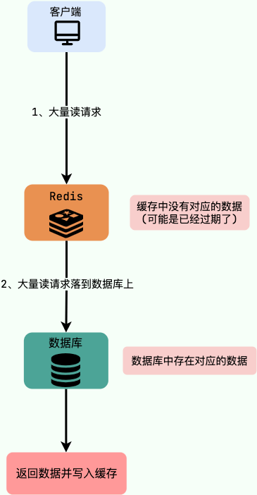

举个例子：秒杀进行过程中，缓存中的某个秒杀商品的数据突然过期，这就导致瞬时大量对该商品的请求直接落到数据库上，对数据库造成了巨大的压力。

#### 解决办法

1. 永不过期（不推荐）：设置热点数据永不过期或者过期时间比较长。

2. 提前预热（推荐）：针对热点数据提前预热，将其存入缓存中并设置合理的过期时间比如秒杀场景下的数据在秒杀结束之前不过期。

3. 加锁（看情况）：在缓存失效后，通过设置互斥锁确保只有一个请求去查询数据库并更新缓存。

#### 缓存穿透和缓存击穿有什么区别？

缓存穿透中，请求的 key 既不存在于缓存中，也不存在于数据库中。

缓存击穿中，请求的 key 对应的是 热点数据 ，该数据 存在于数据库中，但不存在于缓存中（通常是因为缓存中的那份数据已经过期） 。

### 缓存雪崩

#### 什么是缓存雪崩？

缓存在同一时间大面积的失效，导致大量的请求都直接落到了数据库上，对数据库造成了巨大的压力。 这就好比雪崩一样，摧枯拉朽之势，数据库的压力可想而知，可能直接就被这么多请求弄宕机了。

另外，缓存服务宕机也会导致缓存雪崩现象，导致所有的请求都落到了数据库上。

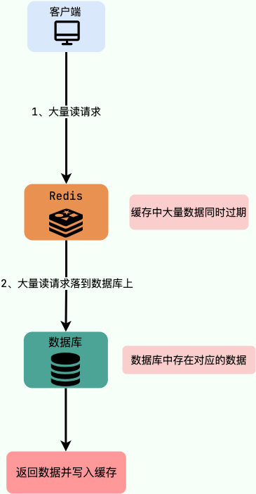

举个例子：缓存中的大量数据在同一时间过期，这个时候突然有大量的请求需要访问这些过期的数据。这就导致大量的请求直接落到数据库上，对数据库造成了巨大的压力。

#### 解决办法

针对 Redis 服务不可用的情况：

1. Redis 集群：采用 Redis 集群，避免单机出现问题整个缓存服务都没办法使用。Redis Cluster 和 Redis Sentinel 是两种最常用的 Redis 集群实现方案，

2. 多级缓存：设置多级缓存，例如本地缓存\+Redis 缓存的二级缓存组合，当 Redis 缓存出现问题时，还可以从本地缓存中获取到部分数据。

针对大量缓存同时失效的情况：

1. 设置随机失效时间（可选）：为缓存设置随机的失效时间，例如在固定过期时间的基础上加上一个随机值，这样可以避免大量缓存同时到期，从而减少缓存雪崩的风险。

2. 提前预热（推荐）：针对热点数据提前预热，将其存入缓存中并设置合理的过期时间，比如秒杀场景下的数据在秒杀结束之前不过期。

3. 持久缓存策略（看情况）：虽然一般不推荐设置缓存永不过期，但对于某些关键性和变化不频繁的数据，可以考虑这种策略。

## redis 内存淘汰策略

Redis 提供了 6 种内存淘汰策略：

1. **volatile\-lru（least recently used）**：从已设置过期时间的数据集（`server.db[i].expires`）中挑选最近最少使用的数据淘汰。

2. **volatile\-ttl**：从已设置过期时间的数据集（`server.db[i].expires`）中挑选将要过期的数据淘汰。

3. **volatile\-random**：从已设置过期时间的数据集（`server.db[i].expires`）中任意选择数据淘汰。

4. **allkeys\-lru（least recently used）**：从数据集（`server.db[i].dict`）中移除最近最少使用的数据淘汰。

5. **allkeys\-random**：从数据集（`server.db[i].dict`）中任意选择数据淘汰。

6. **no\-eviction**（默认内存淘汰策略）：禁止驱逐数据，当内存不足以容纳新写入数据时，新写入操作会报错。

4\.0 版本后增加以下两种：

1. **volatile\-lfu（least frequently used）**：从已设置过期时间的数据集（`server.db[i].expires`）中挑选最不经常使用的数据淘汰。

2. **allkeys\-lfu（least frequently used）**：从数据集（`server.db[i].dict`）中移除最不经常使用的数据淘汰。

`allkeys-xxx` 表示从所有的键值中淘汰数据，而 `volatile-xxx` 表示从设置了过期时间的键值中淘汰数据。

## 过期数据删除策略

1. **惰性删除**：只会在取出/查询 key 的时候才对数据进行过期检查。这种方式对 CPU 最友好，但是可能会造成太多过期 key 没有被删除。

2. **定期删除**：周期性地随机从设置了过期时间的 key 中抽查一批，然后逐个检查这些 key 是否过期，过期就删除 key。相比于惰性删除，定期删除对内存更友好，对 CPU 不太友好。

3. **延迟队列**：把设置过期时间的 key 放到一个延迟队列里，到期之后就删除 key。这种方式可以保证每个过期 key 都能被删除，但维护延迟队列太麻烦，队列本身也要占用资源。

4. **定时删除**：每个设置了过期时间的 key 都会在设置的时间到达时立即被删除。这种方法可以确保内存中不会有过期的键，但是它对 CPU 的压力最大，因为它需要为每个键都设置一个定时器。

Redis 采用的是**定期删除\+惰性/懒汉式删除**

结合的策略，这也是大部分缓存框架的选择。定期删除对内存更加友好，惰性删除对 CPU 更加友好。两者各有千秋，结合起来使用既能兼顾 CPU 友好，又能兼顾内存友好。

## redis使用的业务场景

1. **缓存**

DB缓存，减轻DB服务器压力

提高系统响应

2. **分布式锁**

如今都是分布式的环境下java自带的单体锁已经不适用的。在 Redis 2\.6\.12 版本开始，string的set命令增加了一些参数：

- `EX`：设置键的过期时间（单位为秒）

- `PX`：设置键的过期时间（单位为毫秒）

- `NX` ：只在键不存在时，才对键进行设置操作。 `SET key value NX` 效果等同于 `SETNX key value` 。

- `XX` ：只在键已经存在时，才对键进行设置操作。

3. **全局ID**

int类型，incrby，利用原子性

`incrby userid 1000`

分库分表的场景，一次性拿一段

4. 计数器

int类型，incr方法

例如：文章的阅读量、微博点赞数、允许一定的延迟，先写入Redis再定时同步到数据库

计数功能应该是最适合 Redis 的使用场景之一了，因为它高频率读写的特征可以完全发挥 Redis 作为内存数据库的高效。在 Redis 的数据结构中，`string`、`hash`和`sorted set`都提供了`incr`方法用于原子性的自增操作，下面举例说明一下它们各自的使用场景：

- 如果应用需要显示每天的注册用户数，便可以使用string作为计数器，设定一个名为REGISTERED\_COUNT\_TODAY的 key，并在初始化时给它设置一个到凌晨 0 点的过期时间，每当用户注册成功后便使用incr命令使该 key 增长 1，同时当每天凌晨 0 点后，这个计数器都会因为 key 过期使值清零。

- 每条微博都有点赞数、评论数、转发数和浏览数四条属性，这时用hash进行计数会更好，将该计数器的 key 设为weibo:weibo\_id，hash的 field 为like\_number、comment\_number、forward\_number和view\_number，在对应操作后通过hincrby使hash 中的 field 自增。

- 如果应用有一个发帖排行榜的功能，便选择sorted set吧，将集合的 key 设为POST\_RANK。当用户发帖后，使用zincrby将该用户 id 的 score 增长 1。sorted set会重新进行排序，用户所在排行榜的位置也就会得到实时的更新。

5. 限流

int类型，incr方法\.   以访问者的ip和其他信息作为key，访问一次增加一次计数，超过次数则返回false

6. 排行榜

使用`sorted set`\(有序set\)和一个计算热度的算法便可以轻松打造一个热度排行榜，`zrevrangebyscore`可以得到以分数倒序排列的序列，`zrank`可以得到一个成员在该排行榜的位置（是分数正序排列时的位置，如果要获取倒序排列时的位置需要用`zcard`\-`zrank`）。

## redis的set是否有序是否可重复

无序集合，不重复

## Redis中Set和Sorted Set的区别

[Redis 常见数据类型和应用场景](https://xiaolincoding.com/redis/data_struct/command.html#%E4%BB%8B%E7%BB%8D)

## Redis**为什么用跳表而不用平衡树\(或者B\+\)？**

- B\+树是多叉平衡搜索树，扇出高，只需要3层左右就能存放2kw左右的数据，同样情况下跳表则需要24层左右，假设层高对应磁盘IO，那么B\+树的读性能会比跳表要好，因此mysql选了B\+树做索引。

- redis的读写全在内存里进行操作，不涉及磁盘IO，同时跳表实现简单，相比B\+树、AVL树、少了旋转树结构的开销，因此redis使用跳表来实现ZSET，而不是树结构。

**补充链接：**[Mysql的索引为什么使用B\+树而不使用跳表?\_mysql索引为什么使用b\+树而不是b或跳表\-CSDN博客](https://blog.csdn.net/ilini/article/details/124291866)

## Redis为什么这么快，IO多路复用原理


1. **基于内存实现 **Redis 是基于内存的数据库，那不可避免的就要与磁盘数据库做对比。对于磁盘数据库来说，是需要将数据读取到内存里的，这个过程会受到磁盘 I/O 的限制。而对于内存数据库来说，本身数据就存在于内存里，也就没有了这方面的开销。通过下面的表格我们可以知道读取内存和读取磁盘的性能差距。

2. **高效存储结构 **为了实现从键到值的快速访问，Redis 使用了一个哈希表来保存所有键值对。一个哈希表，其实就是一个数组，数组的每个元素称为一个哈希桶。所以，我们常说，一个哈希表是由多个哈希桶组成的，每个哈希桶中保存了键值对数据。


哈希桶中的 entry 元素中保存了key和value指针，分别指向了实际的键和值，因为其value的多样性，哈希表中存储的并不是具体的值，而是一个内存引用地址，在通过内存引用的地址查找到对应的具体的值。这样一来，即使value是一个集合，也可以通过\*value指针被查找到。因为这个哈希表保存了所有的键值对，所以，我也把它称为全局哈希表。

哈希表的最大好处很明显，就是让我们可以用 O\(1\) 的时间复杂度来快速查找到键值对：我们只需要计算键的哈希值，就可以知道它所对应的哈希桶位置，然后就可以访问相应的 entry 元素。但当你往 Redis 中写入大量数据后，就可能发现操作有时候会突然变慢了。这其实是因为你忽略了一个潜在的风险点，那就是哈希表的冲突问题和 rehash 可能带来的操作阻塞。

当你往哈希表中写入更多数据时，哈希冲突是不可避免的问题。这里的哈希冲突，两个 key 的哈希值和哈希桶计算对应关系时，正好落在了同一个哈希桶中。


Redis 解决哈希冲突的方式，就是链式哈希。链式哈希也很容易理解，就是指同一个哈希桶中的多个元素用一个链表来保存，它们之间依次用指针连接。

3. **单线程避免了上下文前切换    **省去了很多上下文切换的时间以及CPU消耗，不存在竞争条件，不用去考虑各种锁的问题，不存在加锁释放锁操作，也不会出现死锁而导致的性能消耗。

4. **使用基于IO多路复用机制的线程模型，可以处理并发的链接。**Redis采用了epoll 模型进行IO多路复用。Java中也有类似的模型比如NIO,才epoll模型之前还有selector、poll这里不多讲解，epoll模型可以参考下图：


5. **渐进式ReHash**\. Redis是当然如果这个数组一直不变，那么hash冲突会变很多，这个时候检索效率会大打折扣，所以Redis就需要把数组进行扩容（一般是扩大到原来的两倍），但是问题来了，扩容后每个hash桶的数据会分散到不同的位置，这里设计到元素的移动，必定会阻塞IO，所以这个ReHash过程会导致很多请求阻塞。

为了避免这个问题，Redis 采用了渐进式 rehash。

首先、Redis 默认使用了两个全局哈希表：哈希表 1 和哈希表 2。一开始，当你刚插入数据时，默认使用哈希表 1，此时的哈希表 2 并没有被分配空间。随着数据逐步增多，Redis 开始执行 rehash。

- 给哈希表 2 分配更大的空间，例如是当前哈希表 1 大小的两倍

- 把哈希表 1 中的数据重新映射并拷贝到哈希表 2 中

- 释放哈希表 1 的空间

在上面的第二步涉及大量的数据拷贝，如果一次性把哈希表 1 中的数据都迁移完，会造成 Redis 线程阻塞，无法服务其他请求。此时，Redis 就无法快速访问数据了。


  在Redis 开始执行 rehash，Redis仍然正常处理客户端请求，但是要加入一个额外的处理：

- 处理第1个请求时，把哈希表 1中的第1个索引位置上的所有 entries 拷贝到哈希表 2 中

- 处理第2个请求时，把哈希表 1中的第2个索引位置上的所有 entries 拷贝到哈希表 2 中

- 如此循环，直到把所有的索引位置的数据都拷贝到哈希表 2 中。

这样就巧妙地把一次性大量拷贝的开销，分摊到了多次处理请求的过程中，避免了耗时操作，保证了数据的快速访问。

  所以这里基本上也可以确保根据key找value的操作在O（1）左右。

  这里要注意，如果Redis中有海量的key值的话，这个Rehash过程会很长很长，虽然采用渐进式Rehash，但在Rehash的过程中还是会导致请求有不小的卡顿。并且像一些统计命令也会非常卡顿：比如keys

按照Redis的配置每个实例能存储的最大的key的数量为2的32次方,即2\.5亿，但是尽量把key的数量控制在千万以下，这样就可以避免Rehash导致的卡顿问题，如果数量确实比较多，建议采用分区hash存储。

6. **缓存时间戳  **我们平常使用系统时间戳时， 常常是不假思索地使用System\.currentTimeMillis\(\)或者new Date\(\) \.getTime\(\) 来获取系统的毫秒时间戳。但是Redis不能这样做，因为每一次获取系统时间戳都是一次系统调用，而且每次去系统调用是比较费时间的，作为单线程的Redis是无法承受的，所以它需要对于时间戳进行一次缓存，由一个定时任务进行每毫秒更新时间戳，从而获取时间戳都是直接从缓存就取出。

## Redis怎么保证高并发高可用

这里的高并发和高可用可以从几个方面去描述：

1. 高并发：

    - 单线程模型：
    Redis使用单线程处理请求，这样避免了线程切换的开销，并且通过事件驱动机制高效地处理大量连接。虽然是单线程，但通过高效的I/O多路复用（例如使用epoll在Linux上），Redis能够处理成千上万的并发连接。

    - 高效的数据结构：
    Redis提供了一些高效的数据结构（如字符串、列表、集合、有序集合、哈希等），这些数据结构采用优化的算法，使得数据操作非常快速。

    - 内存存储：
    Redis所有数据都存储在内存中，访问速度极快，这使得它非常适合对速度要求高的应用场景。

2. 高可用性：

    - 持久化：
    虽然Redis是一个内存数据库，但它提供了RDB快照和AOF（Append\-Only File）日志两种持久化方案，确保数据不会因为服务器问题而丢失。

    - 复制：
    Redis具有主从复制功能，一个主节点可以复制到多个从节点，从而实现数据冗余。这不仅提高了数据的可用性，还能实现读分离，以提高读操作的吞吐量。

    - 哨兵（Sentinel）：
    Redis Sentinel是一个监控和故障恢复系统。它可以监控主节点和从节点的健康状况，并在主节点故障时自动进行故障转移，将某个从节点提升为新的主节点。

    - 集群（Cluster）：
    Redis Cluster实现了自动分片，使得数据分布在不同的节点上。在某个节点故障时，其他节点依然能够提供服务。集群还支持复制和故障转移机制

**另外要看下主从复制和哨兵机制，熟悉一下**：[主从复制是怎么实现的？](https://xiaolincoding.com/redis/cluster/master_slave_replication.html#%E7%AC%AC%E4%B8%80%E6%AC%A1%E5%90%8C%E6%AD%A5)

## 跳表节点查询过程

查找一个跳表节点的过程时，跳表会从头节点的最高层开始，逐一遍历每一层。在遍历某一层的跳表节点时，会用跳表节点中的 SDS 类型的元素和元素的权重来进行判断，共有两个判断条件：

- 如果当前节点的权重「小于」要查找的权重时，跳表就会访问该层上的下一个节点。

- 如果当前节点的权重「等于」要查找的权重时，并且当前节点的 SDS 类型数据「小于」要查找的数据时，跳表就会访问该层上的下一个节点。

如果上面两个条件都不满足，或者下一个节点为空时，跳表就会使用目前遍历到的节点的 level 数组里的下一层指针，然后沿着下一层指针继续查找，这就相当于跳到了下一层接着查找。

举个例子，下图有个 3 层级的跳表。

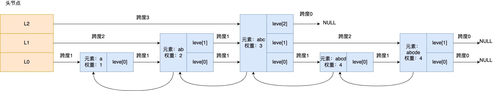

如果要查找「元素：abcd，权重：4」的节点，查找的过程是这样的：

- 先从头节点的最高层开始，L2 指向了「元素：abc，权重：3」节点，这个节点的权重比要查找节点的小，所以要访问该层上的下一个节点；

- 但是该层的下一个节点是空节点（ leve\[2\]指向的是空节点），于是就会跳到「元素：abc，权重：3」节点的下一层去找，也就是 leve\[1\];

- 「元素：abc，权重：3」节点的 leve\[1\] 的下一个指针指向了「元素：abcde，权重：4」的节点，然后将其和要查找的节点比较。虽然「元素：abcde，权重：4」的节点的权重和要查找的权重相同，但是当前节点的 SDS 类型数据「大于」要查找的数据，所以会继续跳到「元素：abc，权重：3」节点的下一层去找，也就是 leve\[0\]；

- 「元素：abc，权重：3」节点的 leve\[0\] 的下一个指针指向了「元素：abcd，权重：4」的节点，该节点正是要查找的节点，查询结束。

## redis 的副本和分片

**副本： **

- 副本是指将数据从主节点复制到一个或多个从节点。主节点负责处理写请求，从节点负责处理读请求。

- 副本可以提高读性能和数据的高可用性，因为读请求可以分散到多个从节点上，同时在主节点故障时，从节点可以接管。

**分片：**

- 分片是指将数据水平拆分到多个节点上，每个节点存储一部分数据。分片可以通过哈希函数或其他分片策略来决定数据存储在哪个节点。

- 分片可以提高写性能和存储容量，因为写请求可以分散到多个节点上，同时每个节点只存储一部分数据。

**解决热key问题：**

- 副本适用于解决读操作频繁的热key问题，通过增加从节点来分散读请求。

- 分片适用于解决写操作频繁的热key问题，通过分片将数据分散到多个节点上。

## 缓存一致性怎么保证\(超级重要，Mysql和redis的数据一致性被问到好几次的场景题‼️\)

**假如面试的时候被问redis缓存设计，5亿的数据量，然后几十万的qps怎么设计缓存可以按照下面的答案，再加上**[场景题](https://scn6apkfnf8w.feishu.cn/docx/Svgmd7Nzxo4rhfxPHOncD0DhnRb#share-WszrdNeuMoSBcHx3AAZcXPUInPe)**这里的缓存系统设计➕缓存淘汰策略就可以了。**

从三个方面进行回答，**读操作**、**写操作**以及**并发控制**

1. **读操作策略：确保数据最新**

**Cache\-Aside（旁路缓存）**

- **流程**：

    1. 读请求优先查询缓存，命中则直接返回。

    2. 未命中时查询数据库，回填缓存后返回数据。

- **优点**：简单易实现，缓存不承载数据加载逻辑。

- **风险**：

    - **缓存穿透**：恶意请求不存在的Key，压垮数据库。

        - **解决方案**：布隆过滤器拦截非法Key，或缓存空值（TTL缩短）。

    - **缓存击穿**：热点Key过期瞬间高并发请求涌入数据库。

        - **解决方案**：互斥锁（Redis `SETNX`）或永不过期\+异步刷新。

**Read\-Through（读穿透）**

- **流程**：缓存内置数据加载逻辑，对应用透明。

- **优点**：业务代码简洁，适合标准化查询场景。

- **缺点**：灵活性较低，难以处理复杂回填逻辑。

2. **写操作策略：同步或异步更新**

**Write\-Through（写穿透）**

**流程**：先更新数据库，再同步更新缓存。

- **优点**：强一致性，缓存与数据库实时一致。

- **缺点**：写入延迟高，吞吐量受限于数据库。

**Write\-Behind（异步批量写）**

- **流程**：先更新缓存，异步批量提交数据库。

    - 通过消息队列（如Kafka）缓冲写操作，合并后批量执行。

- **优点**：高吞吐，适合写入密集型场景（如点击计数）。

- **缺点**：数据丢失风险（队列未持久化时宕机），需结合WAL日志。

**Delete\-Then\-Update（延迟双删）**

- **流程**：

    1. 先删除缓存 → 更新数据库 → 延迟数百毫秒 → 再次删除缓存。

    2. 第二次删除应对并发读导致的脏数据回填。

- **优点**：降低脏数据时间窗口。

- **缺点**：依赖延迟时间估算，需结合业务调整。

3. **并发控制：解决竞态条件**

**分布式锁**

- **场景**：防止多个线程同时回填同一Key的缓存。

- **缺点**：锁粒度需精细，避免性能瓶颈。

**版本号控制**

- **流程**：

    1. 数据写入时附带版本号（如时间戳或CAS值）。

    2. 读缓存时校验版本，若落后则触发更新。

    - **优点**：无锁化，适合高并发场景。

- **实现**：Redis Hash结构存储数据和版本号。

**消息队列顺序消费**

- **场景**：确保数据库与缓存的更新顺序一致。

    - 如使用RocketMQ的顺序消息，按Key Hash到同一队列。

- **案例**：订单状态变更需严格按序更新缓存。

## 大key问题

简单来说，如果一个 key 对应的 value 所占用的内存比较大，那这个 key 就可以看作是 bigkey。具体多大才算大呢？有一个不是特别精确的参考标准：

- String 类型的 value 超过 1MB

- 复合类型（List、Hash、Set、Sorted Set 等）的 value 包含的元素超过 5000 个（不过，对于复合类型的 value 来说，不一定包含的元素越多，占用的内存就越多）。

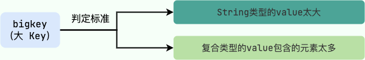

**bigkey 是怎么产生的？有什么危害？**

bigkey 通常是由于下面这些原因产生的：

- 程序设计不当，比如直接使用 String 类型存储较大的文件对应的二进制数据。

- 对于业务的数据规模考虑不周到，比如使用集合类型的时候没有考虑到数据量的快速增长。

- 未及时清理垃圾数据，比如哈希中冗余了大量的无用键值对。

bigkey 除了会消耗更多的内存空间和带宽，还会对性能造成比较大的影响。

1. 客户端超时阻塞：由于 Redis 执行命令是单线程处理，然后在操作大 key 时会比较耗时，那么就会阻塞 Redis，从客户端这一视角看，就是很久很久都没有响应。

2. 网络阻塞：每次获取大 key 产生的网络流量较大，如果一个 key 的大小是 1 MB，每秒访问量为 1000，那么每秒会产生 1000MB 的流量，这对于普通千兆网卡的服务器来说是灾难性的。

3. 工作线程阻塞：如果使用 del 删除大 key 时，会阻塞工作线程，这样就没办法处理后续的命令。

**解决方案：**

**数据分片（Sharding）**

- 适用场景：大 Hash、大 List、大 Set 等。

- 实现方式：

    - Hash 分片：将单个 Hash 拆分为多个子 Hash。

    ```Java
    -- 原始 Key: user:1000:cart
    -- 分片后: user:1000:cart:shard1, user:1000:cart:shard2
    HMSET user:1000:cart:shard1 product1 10 product2 20
    HMSET user:1000:cart:shard2 product3 30
    
    ```

List/Set 分片：按元素数量或范围拆分。

```Java
-- 原始 Key: post:2000:comments
-- 分片后: post:2000:comments:part1, post:2000:comments:part2
RPUSH post:2000:comments:part1 "comment1" "comment2"
RPUSH post:2000:comments:part2 "comment3"
```

**数据归档与冷热分离**

- 热数据：保留在 Redis 中。

- 冷数据：归档到数据库（如 MySQL）或持久化存储（如 HBase）。

- 实现方式：

    - 定时任务将历史数据迁移到数据库。

    - 使用 Redis 的 `EXPIRE` 设置合理过期时间。

场景说明：

**场景 1：用户购物车（大 Hash）**

- 问题：`user:1000:cart` 存储 10 万条商品数据。

- 解决方案：

    - 分片存储：按商品分类或哈希分片。

    - 冷热分离：将 3 个月前的购物车数据归档到数据库。

**场景 2：社交媒体粉丝列表（大 Set）**

- 问题：`user:5000:followers` 存储 100 万粉丝 ID。

- 解决方案：

    - 分片存储：按粉丝 ID 范围分片到多个 Set。

    - 转存为布隆过滤器：若仅需判断是否存在，使用布隆过滤器节省内存。

## Redis 慢查询可能是啥原因引起的？

Redis 虽然是内存数据库，性能极高，但**慢查询**依然可能发生。当 Redis 响应变慢时，会影响整个系统的性能，尤其是在高并发场景下。

**Redis 慢查询的定义**

Redis 默认将执行时间超过 `10ms` 的命令记录为**慢查询**（可通过 `slowlog-log-slower-than` 配置）。

你可以通过以下命令查看慢查询日志：

```Bash
# 查看最近的慢查询
SLOWLOG GET 10

# 查看慢查询总数
SLOWLOG LEN

# 重置慢查询日志
SLOWLOG RESET
```

**常见原因及解决方案**

1. **使用了复杂度过高的命令（最常见）**

**问题命令：**

- `KEYS *`：全量扫描键空间，O\(N\)，**严禁在生产使用**

- `SMEMBERS`, `HGETALL`, `LRANGE`, `ZRANGE` 等：对大集合操作，O\(N\)

- `FLUSHALL`, `FLUSHDB`：清空所有数据，阻塞主线程

解决方案：

- 用 `SCAN` 替代 `KEYS`

    ```Bash
    SCAN 0 MATCH user:* COUNT 100
    ```

- 避免对大 `Hash`、`ZSet`、`List` 进行全量读取

- 分批读取：`LRANGE key 0 99`, `LRANGE key 100 199`

> 💡 建议：单个 key 的 value 大小不要超过 10KB，集合元素不要超过 1 万。
> 
> 

2. **大 Key（Big Key）问题**

什么是大 Key？

- 单个 `String` 超过 10MB

- `Hash`、`List`、`Set`、`ZSet` 元素超过 1 万，或总大小超过 10MB

**影响：**

- 网络传输慢

- 主线程阻塞（Redis 单线程处理命令）

- RDB/AOF 持久化慢

- 主从同步延迟

**解决方案：**

- **拆分大 Key**：

    - `Hash` 拆成 `user:1001:field1`, `user:1001:field2`

    - `List` 按时间分片：`logs:20250831`, `logs:20250901`

- 使用 `MEMORY USAGE key` 查看 key 大小

- 使用 `redis-cli --bigkeys` 扫描大 key

3. **慢速网络或客户端问题**

可能原因：

- 客户端与 Redis 服务器跨机房、跨地域

- 网络抖动、带宽不足

- 客户端使用同步阻塞模式，批量操作未 pipeline

解决方案：

- 同机房部署，减少网络延迟

- 使用 `Pipeline` 批量发送命令

- 使用 `Redis Cluster` 分片，减少单节点压力

- 启用 `TCP_NODELAY`，减少小包延迟

4. **持久化阻塞（RDB / AOF）**

问题：

- `fork()` 子进程时，如果内存大（如 20GB），`fork` 时间长（几百毫秒），主线程阻塞

- AOF `fsync` 策略为 `everysec` 或 `always`，磁盘 I/O 高时延迟

解决方案：

- 控制单实例内存大小（建议 \< 10GB）

- 使用 `no-appendfsync-on-write`（但有丢数据风险）

- 将 RDB/AOF 备份放到低峰期

- 使用 `AOF + RDB` 混合持久化（Redis 4\.0\+）

5. **CPU 瓶颈或竞争**

可能原因：

- Redis 实例 CPU 使用率 100%

- 与其他进程共用机器，CPU 被抢占

- Redis 6\.0\+ 虽然支持多线程 I/O，但**命令执行仍是单线程**

解决方案：

- 为 Redis 分配独占 CPU 核

- 升级 CPU 性能

- 使用 `INFO cpu` 查看 CPU 使用情况

- 使用 `Redis Cluster` 拆分负载

6\. **内存不足导致 Swap**

问题：

- Redis 内存超过物理内存 → 触发 Swap → 性能暴跌（从内存访问变磁盘访问）

解决方案：

- 监控 `used_memory` 和 `used_memory_rss`

- 设置 `maxmemory` 限制内存使用

- 启用 LRU/LFU 淘汰策略：

    ```Bash
    maxmemory-policy allkeys-lru
    ```

- 使用 `INFO memory` 查看内存状态

6. **过期 Key 的清除策略**

Redis 使用两种策略清理过期 key：

1. **惰性删除**：访问时才检查是否过期

2. **定期删除**：随机抽样一批 key 清理

问题：

- 如果大量 key 同时过期，定期删除可能占用较多 CPU

- 惰性删除导致内存短期“虚高”

**解决方案：**

- 避免批量设置相同过期时间（加随机抖动）

    ```Python
    expire_time = base_time + random.randint(0, 300)
    ```

- 使用 `EXPIRE key seconds` 而不是 `EXPIREAT timestamp`

**总结：Redis 慢查询原因速查表**

|原因|排查命令|优化方案|
|---|---|---|
|复杂命令|`SLOWLOG GET`|用 `SCAN` 替代 `KEYS`|
|大 Key|`--bigkeys`, `MEMORY USAGE`|拆分、压缩|
|网络慢|`PING`, `INFO clients`|同机房、Pipeline|
|持久化阻塞|`INFO persistence`|控制内存、优化 `fsync`|
|内存不足|`INFO memory`|设置 `maxmemory` \+ 淘汰策略|
|CPU 瓶颈|`INFO cpu`|升级、隔离|
|Lua 脚本|`SLOWLOG`|避免长循环|
|过期策略|`INFO stats`|加随机过期时间|

核心原则：

> Redis 是单线程处理命令的，任何耗时操作都会阻塞整个实例。  
> 
> 所以避免大 key、避免复杂命令，是保证 Redis 高性能的关键。
> 
> 

## 分布式ID生成方案有哪些

在分布式系统中，为了确保数据的唯一性和可扩展性，生成全局唯一的ID（也称为分布式ID）是一个常见的需求。以下是几种主流的分布式ID生成方案：

**1\. UUID**

**原理**：基于时间、节点MAC地址、随机数等信息生成一个128位的全局唯一标识符。

- **优点**：

    - 实现简单，无需中心化服务。

    - 全局唯一，几乎不会重复。

- **缺点**：

    - 长度较长（通常为36位字符串），占用存储空间大。

    - 无序，不利于数据库索引（可能导致B\+树分裂）。

    - 可读性差。

- **适用场景**：对ID长度和顺序不敏感的场景，如日志追踪、会话ID等。

**2\. 数据库自增主键 \+ 步长（Step）**

**原理**：使用数据库的自增ID机制，但通过设置不同的步长和起始值，让多个实例生成不冲突的ID。

- 例如：有2个服务实例，步长为2，一个从1开始（生成1,3,5\.\.\.），另一个从2开始（生成2,4,6\.\.\.）。

- **优点**：

    - 实现简单，ID有序。

- **缺点**：

    - 依赖数据库，存在单点故障风险。

    - 扩展性差，需提前规划步长。

    - 数据库性能瓶颈。

- **适用场景**：小规模分布式系统，或作为临时方案。

**3\. Snowflake 算法（雪花算法）**

**原理**：由Twitter提出，生成一个64位的整数ID，结构如下：

```Plain Text
1位符号位 + 41位时间戳 + 10位机器ID + 12位序列号
```

- **优点**：

    - ID有序递增，适合数据库索引。

    - 高性能，本地生成，无需远程调用。

    - 占用空间小（8字节）。

- **缺点**：

    - 依赖系统时钟，时钟回拨可能导致ID重复。

    - 需要管理机器ID的分配。

- **变种**：美团的Leaf\-snowflake、百度的UidGenerator等。

- **适用场景**：高并发、低延迟的分布式系统，如订单系统、消息ID等。

**4\. Redis 自增ID**

**原理**：利用Redis的`INCR`或`INCRBY`命令生成全局唯一ID。

- **优点**：

    - 性能高（内存操作）。

    - 支持按步长分配，减少请求次数（如`INCRBY 1000`）。

- **缺点**：

    - 依赖Redis，存在单点风险（可通过集群解决）。

    - 需网络通信，延迟高于本地生成。

- **适用场景**：已有Redis基础设施的系统，对ID有序性有要求。

## Redis里面有1 亿个key，里面有 10 万个 key 是以某个固定前缀开头的，如何能把它们找出来

在 Redis 中，如果有 **1 亿个 key**，其中有 **10 万个 key** 是以某个固定前缀开头（例如 `prefix:*`），要找出这些 key 不能使用 **`KEYS`** 命令，因为：


- `KEYS prefix:*` 会遍历所有 key，导致** Redis 阻塞**，在 1 亿 key 的场景下可能卡住几十秒甚至几分钟，生产环境绝对禁止使用。

**正确的解决方案：使用 ****`SCAN`**** 命令**

Redis 提供了 **`SCAN`** 命令，用于**安全、渐进式地遍历 key 空间**，不会阻塞服务器。

**推荐方法：****`SCAN`**** \+ ****`MATCH`**** 模式匹配**

```Bash
SCAN cursor MATCH prefix:* COUNT count
```

- `cursor`：游标，从 0 开始，每次返回一个新游标，直到返回 0 表示完成。

- `MATCH prefix:*`：只匹配以 `prefix` 开头的 key。

- `COUNT`：建议数量（非精确），可控制每次返回的 key 数量，避免网络压力。

**注意事项**

1. **SCAN 不保证一次性返回所有结果**，需要循环调用。

2. **SCAN 可能重复返回 key**（但概率低），应用层注意去重（如果关键）。

3. **MATCH 是 glob 风格**，不是正则：

    - `*` 匹配任意字符

    - `?` 匹配单个字符

    - `[a-z]` 字符范围

4. **性能**：即使有 1 亿 key，`SCAN` \+ `MATCH` 也能在几分钟内完成（取决于网络、硬件、COUNT 大小）。

5. **不要在主节点高峰时段执行大量 SCAN**，可考虑在从节点执行。


# Linux

## 讲一讲你用过的linux命令

[Linux 基础知识总结 \| JavaGuide](https://javaguide.cn/cs-basics/operating-system/linux-intro.html#linux-%E5%B8%B8%E7%94%A8%E5%91%BD%E4%BB%A4)

## 怎么查看cpu使用率、内存使用率

#### 查看CPU使用率

1. top 命令

```yaml
[root@sss ~]# top
top - 16:54:38 up 7 days,  5:13,  3 users,  load average: 0.00, 0.01, 0.05
Tasks:  77 total,   2 running,  75 sleeping,   0 stopped,   0 zombie
%Cpu(s):  0.7 us,  0.3 sy,  0.0 ni, 99.0 id,  0.0 wa,  0.0 hi,  0.0 si,  0.0 st
KiB Mem :  1882232 total,   813020 free,   330164 used,   739048 buff/cache
KiB Swap:        0 total,        0 free,        0 used.  1386608 avail Mem 

  PID USER      PR  NI    VIRT    RES    SHR S %CPU %MEM     TIME+ COMMAND                                                                                                                                        
17215 root       0 -20  127504  12176   9560 S  0.7  0.6  21:46.45 AliYunDun                                                                                                                                      
 2770 root      20   0  573932  17232   6088 S  0.3  0.9   1:11.38 tuned                                                                                                                                          
    1 root      20   0   43548   3844   2588 S  0.0  0.2   0:06.54 systemd                                                                                                                                        
    2 root      20   0       0      0      0 S  0.0  0.0   0:00.00 kthreadd                                                                                                                                       
    3 root      20   0       0      0      0 S  0.0  0.0   0:08.75 ksoftirqd/0                                                                                                                                    
    5 root       0 -20       0      0      0 S  0.0  0.0   0:00.00 kworker/0:0H              
... ...                                                                                                                                 
```

top命令可以看到总体的系统运行状态和cpu的使用率 。

```Plain Text
%us：表示用户空间程序的cpu使用率（没有通过nice调度）
%sy：表示系统空间的cpu使用率，主要是内核程序。
%ni：表示用户空间且通过nice调度过的程序的cpu使用率。
%id：空闲cpu
%wa：cpu运行时在等待io的时间
%hi：cpu处理硬中断的数量
%si：cpu处理软中断的数量
%st：被虚拟机偷走的cpu
注：99.0 id，表示空闲CPU，即CPU未使用率，100%-99.0%=1%，即系统的cpu使用率为1%。
```

2. vmstat

[vmstat命令参数及其介绍\_vmstat cs参数\-CSDN博客](https://blog.csdn.net/wujizhishui/article/details/89333991)

#### 查看内存使用率

1. top命令


2. free命令

free命令可以显示Linux系统中空闲的、已用的物理内存及swap内存,及被内核使用的buffer。在Linux系统监控的工具中，free命令是最经常使用的命令之一。

## 怎么查看某个进程使用的端口

可以使用以下六种方法查看端口信息。

- `ss`：可以用于转储套接字统计信息。

- `netstat`：可以显示打开的套接字列表。

- `lsof`：可以列出打开的文件。

#### 使用ss命令

**通过进程名或 PID 过滤**

```Bash
ss -tulnp | grep <进程名或 PID>
```

比如查询mysql的端口号

```Bash
ss -tulnp | grep mysql
```

#### 使用`netstat`命令

```Bash
netstat -tulnp | grep <进程名或 PID>
```

查找 PID 为 `5678` 的进程

```Bash
netstat -tulnp | grep 5678
```

#### 使用`lsof`命令

**通过进程名查找端口**

```Bash
lsof -i -n -P | grep <进程名>
```

查找 `nginx` 进程使用的端口

```Bash
lsof -i -n -P | grep nginx
```

**通过端口号查找端口**

```Bash
lsof -i -n -P -p <PID>
```

查找 PID 为 `1234` 的进程使用的端口

```Bash
lsof -i -n -P -p 1234
```

**命令说明  **`grep`

**它用来在文件中搜索符合特定模式的行。**

举个很简单的例子，也是我最近用的最频繁的命令，因为在实际开发当中需要看main\.log日志排查问题，所以我一般是用下面这个命令

```Bash
tail -f main.log | grep  "数据发现"
```

**\(因为main的日志很多，所以我一般打日志的话就会在日志前面加上标识，比如加数据发现，这样就只打印这次写的日志了\)**

一般的用法：

查找 `example.txt` 文件中包含 "error" 的行。

```Bash
grep "error" example.txt
```

## 怎么搜索出某个目录下所有包含某个字符串的所有文件

**查找当前目录下，包含“Hello”字符串的所有文件**

**【方式1】**（其中，**r** 表示**递归**， **n **表示查询结果显示**行号**）：

```Bash
grep -rn "Hello" ./
```

**【方式2 】**

如果不知道文件所在的大致目录，知道文件的类型（例如文本类型 txt），可以在root根目录 / 下根据特定字符串进行查找：

```Bash
find / -type f -name "*.txt" | xargs grep "Hello"
```

## 怎么对比两个文件的差异

比较文件差异的话使用`diff`命令，`diff` 命令用于比较两个文件的内容差异，显示添加、删除和修改的部分

**比较两个文件**

```Bash
diff file1.txt file2.txt
```

忽略空格和制表符的变化，仅比较实际内容。

**简要比较**

```Bash
diff --brief file1.txt file2.txt
```

## linux里，如果我要统计一个日志文件的error数量用什么命令

```java
grep -i "error" your_log_file.log | wc -l
```

`-i`选项表示忽略大小写

`wc -l`：`wc`命令用于统计字数、行数等。`-l`选项表示统计行数。

## linux中，假设输入指令ls，linux底层发生了什么（要熟悉了解）

### 终端输入与Shell解析

- 用户输入：用户在终端输入`ls`并按下回车键。

- 终端处理：终端将输入传递给Shell（如Bash、Zsh等）。

- Shell解析：

    - 分词：Shell将输入拆分为命令（`ls`）和可能的参数（如`-l`）。

    - 检查别名：若用户定义了`ls`的别名（如`alias ls='ls --color=auto'`），Shell会先替换别名。

    - 判断是否为内置命令：若`ls`是Shell内置命令（如`cd`），直接执行；否则进入外部命令流程。

### 查找可执行文件

- PATH环境变量：Shell通过`PATH`变量指定的目录列表（如`/usr/bin:/bin`）搜索`ls`的可执行文件。

    ```Bash
    # 示例PATH变量
    echo $PATH  # 输出：/usr/local/sbin:/usr/local/bin:/usr/sbin:/usr/bin
    ```

- 查找过程：

    - 依次检查`/usr/local/sbin/ls`、`/usr/local/bin/ls`等目录。

    - 找到`ls`的实际路径（通常为`/usr/bin/ls`）。

### 创建子进程

- fork\(\)系统调用：Shell通过`fork()`创建一个子进程，复制父进程（Shell）的内存、文件描述符等。

    - 子进程与父进程几乎完全相同，但PID（进程ID）不同。

- execve\(\)系统调用：子进程调用`execve()`加载并执行`/usr/bin/ls`程序。

    - 替换子进程的代码段和数据段为`ls`的代码。

    - 继承父进程的环境变量和文件描述符（如标准输入、输出、错误流）。

### 执行`ls`程序

- 内核加载程序：内核将`ls`的可执行文件从磁盘加载到内存。

- 动态链接：若`ls`依赖共享库（如`libc.so`），动态链接器（`ld-linux.so`）会加载这些库。

- 程序初始化：`ls`初始化运行环境（如解析命令行参数）。

### 文件系统交互

- 打开当前目录：`ls`通过`open()`系统调用打开当前工作目录（如`.`）。

- 读取目录条目：使用`getdents()`（或`readdir()`库函数）读取目录内容。

    - 内核返回目录中的文件/子目录元数据（如文件名、inode号、类型等）。

- 权限检查：内核验证进程是否有权限读取目录内容（依赖文件系统的ACL或Unix权限）。

### 格式化输出

- 排序与过滤：`ls`按需对条目排序（默认按名称）并过滤隐藏文件（如忽略以`.`开头的文件）。

- 格式化显示：根据参数（如`-l`、`-h`）格式化输出（如长格式、人类可读大小）。

- 写入标准输出：通过`write()`系统调用将结果输出到终端（文件描述符`STDOUT_FILENO=1`）。

### 进程终止

- 退出状态：`ls`执行完毕后，调用`exit()`系统调用返回退出码（成功为0，失败为非零）。

- 父进程回收：Shell（父进程）通过`waitpid()`回收子进程资源，获取退出状态。

- 提示符就绪：Shell打印新的提示符，等待下一个命令。

# 计算机网络

## http和https的区别 


**端口号**：HTTP 默认是 80，HTTPS 默认是 443。

**URL 前缀**：HTTP 的 URL 前缀是 `http://`，HTTPS 的 URL 前缀是 `https://`。

**安全性和资源消耗**：HTTP 协议运行在 TCP 之上，所有传输的内容都是明文，客户端和服务器端都无法验证对方的身份。HTTPS 是运行在 SSL/TLS 之上的 HTTP 协议，SSL/TLS 运行在 TCP 之上。所有传输的内容都经过加密，加密采用对称加密，但对称加密的密钥用服务器方的证书进行了非对称加密。所以说，HTTP 安全性没有 HTTPS 高，但是 HTTPS 比 HTTP 耗费更多服务器资源。

**SEO（搜索引擎优化）**：搜索引擎通常会更青睐使用 HTTPS 协议的网站，因为 HTTPS 能够提供更高的安全性和用户隐私保护。使用 HTTPS 协议的网站在搜索结果中可能会被优先显示，从而对 SEO 产生影响。

## https怎样加密

内容加密采用对称加密，但对称加密的密钥用服务器方的证书进行了非对称加密

## 输入url到界面渲染的过程

1. 在浏览器中输入指定网页的 URL。

2. 浏览器通过 DNS 协议，获取域名对应的 IP 地址。

3. 浏览器根据 IP 地址和端口号，向目标服务器发起一个 TCP 连接请求。

4. 浏览器在 TCP 连接上，向服务器发送一个 HTTP 请求报文，请求获取网页的内容。

5. 服务器收到 HTTP 请求报文后，处理请求，并返回 HTTP 响应报文给浏览器。

6. 浏览器收到 HTTP 响应报文后，解析响应体中的 HTML 代码，渲染网页的结构和样式，同时根据 HTML 中的其他资源的 URL（如图片、CSS、JS 等），再次发起 HTTP 请求，获取这些资源的内容，直到网页完全加载显示。

7. 浏览器在不需要和服务器通信时，可以主动关闭 TCP 连接，或者等待服务器的关闭请求。

[访问网页的全过程（知识串联） \| JavaGuide](https://javaguide.cn/cs-basics/network/the-whole-process-of-accessing-web-pages.html)

## Http1\.1和2\.0的区别


**多路复用（Multiplexing）**：HTTP/2\.0 在同一连接上可以同时传输多个请求和响应（可以看作是 HTTP/1\.1 中长链接的升级版本），互不干扰。HTTP/1\.1 则使用串行方式，每个请求和响应都需要独立的连接，而浏览器为了控制资源会有 6\-8 个 TCP 连接的限制。这使得 HTTP/2\.0 在处理多个请求时更加高效，减少了网络延迟和提高了性能。

**二进制帧（Binary Frames）**：HTTP/2\.0 使用二进制帧进行数据传输，而 HTTP/1\.1 则使用文本格式的报文。二进制帧更加紧凑和高效，减少了传输的数据量和带宽消耗。

**头部压缩（Header Compression）**：HTTP/1\.1 支持`Body`压缩，`Header`不支持压缩。HTTP/2\.0 支持对`Header`压缩，使用了专门为`Header`压缩而设计的 HPACK 算法，减少了网络开销。

**服务器推送（Server Push）**：HTTP/2\.0 支持服务器推送，可以在客户端请求一个资源时，将其他相关资源一并推送给客户端，从而减少了客户端的请求次数和延迟。而 HTTP/1\.1 需要客户端自己发送请求来获取相关资源。

## 那解释一下服务器上很多time\_wait是什么意思？会带来什么后果？怎么解决？

- 服务器端允许 time\_wait 状态的 socket 被重用

- 缩减 time\_wait 时间，设置为 1 MSL（即，2 mins）

#### 大量的time\_wait出现

##### 1\.1 出现的原因

- 高并发短连接的服务器上会出现这样的情况，导致创建大量的tcp连接然后close，出现大量的连接出现time\_wait的状态。

##### 1\.2\.大量time\_wait的危害

- 在socket的TIME\_WAIT状态结束之前，该socket所占用的本地端口号将一直无法释放

- 在高并发（每秒几万qps）并且采用短连接方式进行交互的系统中运行一段时间后，系统中就会存在大量的time\_wait状态，如果time\_wait状态把系统所有可用端口都占完了且尚未被系统回收时，就会出现无法向服务端创建新的socket连接的情况。此时系统几乎停转，任何链接都不能建立。

- 大量的time\_wait状态也会系统一定的fd，内存和cpu资源，当然这个量一般比较小，并不是主要危害

##### 1\.3\.大量time\_wait解决方案

**改短连接为长连接**

- 短连接和长连接工作方式的区别：

**短连接：**

- 连接\-\>传输数据\-\>关闭连接

- HTTP是无状态的，浏览器和服务器每进行一次HTTP操作，就建立一次连接，但任务结束就中断连接。

- 也可以这样说：短连接是指SOCKET连接后发送后接收完数据后马上断开连接。

**长连接：**

- 连接\-\>传输数据\-\>保持连接 \-\> 传输数据\-\> 。。。\-\>关闭连接。

- 长连接指建立SOCKET连接后不管是否使用都保持连接，但安全性较差。

**从区别上可以看出，长连接比短连接从根本上减少了关闭连接的次数，减少了TIME\_WAIT状态的产生数量，在高并发的系统中，这种方式的改动非常有效果，可以明显减少系统TIME\_WAIT的数量。**

## HTTP工作在哪一层？TCP呢？

应用层，传输层

## TCP和UDP的区别

- **是否面向连接**：UDP 在传送数据之前不需要先建立连接。而 TCP 提供面向连接的服务，在传送数据之前必须先建立连接，数据传送结束后要释放连接。

- **是否是可靠传输**：远地主机在收到 UDP 报文后，不需要给出任何确认，并且不保证数据不丢失，不保证是否顺序到达。TCP 提供可靠的传输服务，TCP 在传递数据之前，会有三次握手来建立连接，而且在数据传递时，有确认、窗口、重传、拥塞控制机制。通过 TCP 连接传输的数据，无差错、不丢失、不重复、并且按序到达。

- **是否有状态**：这个和上面的“是否可靠传输”相对应。TCP 传输是有状态的，这个有状态说的是 TCP 会去记录自己发送消息的状态比如消息是否发送了、是否被接收了等等。为此 ，TCP 需要维持复杂的连接状态表。而 UDP 是无状态服务，简单来说就是不管发出去之后的事情了。

- **传输效率**：由于使用 TCP 进行传输的时候多了连接、确认、重传等机制，所以 TCP 的传输效率要比 UDP 低很多。

- **传输形式**：TCP 是面向字节流的，UDP 是面向报文的。

- **首部开销**：TCP 首部开销（20 ～ 60 字节）比 UDP 首部开销（8 字节）要大。

- **是否提供广播或多播服务**：TCP 只支持点对点通信，UDP 支持一对一、一对多、多对一、多对多；

## TCP的流量控制是由发送方和接收方哪一方来控制的，同问TCP的拥塞控制

TCP 的流量控制和拥塞控制都由发送方来控制。

1. **流量控制：**

    - **发送方控制：** TCP 的流量控制是由发送方控制的。发送方会根据接收方的接收窗口大小（即接收缓冲区的剩余空间）来控制发送数据的速率。如果接收方的接收窗口变小，发送方会减小发送速率以避免数据溢出接收方的缓冲区，从而保证数据的可靠传输。

2. **拥塞控制：**

    - **发送方控制：** TCP 的拥塞控制同样由发送方来控制。发送方通过监测网络的拥塞情况来调整发送速率，以避免过多的数据包导致网络拥塞而丢失或延迟过高。TCP 使用了一系列的拥塞控制算法，如慢启动、拥塞避免、快速重传和快速恢复等，来动态地调整发送速率，以适应当前的网络环境。

## 介绍一下慢启动（拥塞控制算法）

[计算机网络: TCP的拥塞控制，四种拥塞算法\_tcp拥塞控制算法\-CSDN博客](https://blog.csdn.net/love_668/article/details/116913790)

## TCP的缺点

速度慢，效率低，占用系统资源高，易被攻击。TCP在传递数据之前，要先建连接，这会消耗时间，而且在数据传递时，确认机制，重传机制，拥塞机制等都会消耗大量的时间，而且要在每台设备上维护所有的传输连接，事实上，每个连接都会占用系统的CPU，内存等硬件资源。而且，因为TCP有确认机制，三次握手机制，这些也导致TCP容易被人利用，实现DOS，DDOS，CC等攻击

## **TCP 三次握手和四次挥手（传输层）**

#### 三次握手


建立一个 TCP 连接需要“三次握手”，缺一不可：

- **一次握手**:客户端发送带有 SYN（SEQ=x） 标志的数据包 \-\> 服务端，然后客户端进入 **SYN\_SEND** 状态，等待服务端的确认；

- **二次握手**:服务端发送带有 SYN\+ACK\(SEQ=y,ACK=x\+1\) 标志的数据包 –\> 客户端,然后服务端进入 **SYN\_RECV** 状态；

- **三次握手**:客户端发送带有 ACK\(ACK=y\+1\) 标志的数据包 –\> 服务端，然后客户端和服务端都进入**ESTABLISHED** 状态，完成 TCP 三次握手。

**三次握手的目的**是建立可靠的通信信道，说到通讯，简单来说就是数据的发送与接收，而三次握手最主要的目的就是双方确认自己与对方的发送与接收是正常的。

1. **第一次握手**：Client 什么都不能确认；Server 确认了对方发送正常，自己接收正常

2. **第二次握手**：Client 确认了：自己发送、接收正常，对方发送、接收正常；Server 确认了：对方发送正常，自己接收正常

3. **第三次握手**：Client 确认了：自己发送、接收正常，对方发送、接收正常；Server 确认了：自己发送、接收正常，对方发送、接收正常

三次握手就能确认双方收发功能都正常，缺一不可。

#### 四次挥手

1. **第一次挥手**：客户端发送一个 FIN（SEQ=x） 标志的数据包\-\>服务端，用来关闭客户端到服务端的数据传送。然后客户端进入 **FIN\-WAIT\-1** 状态。

2. **第二次挥手**：服务端收到这个 FIN（SEQ=X） 标志的数据包，它发送一个 ACK （ACK=x\+1）标志的数据包\-\>客户端 。然后服务端进入 **CLOSE\-WAIT** 状态，客户端进入 **FIN\-WAIT\-2** 状态。

3. **第三次挥手**：服务端发送一个 FIN \(SEQ=y\)标志的数据包\-\>客户端，请求关闭连接，然后服务端进入 **LAST\-ACK** 状态。

4. **第四次挥手**：客户端发送 ACK \(ACK=y\+1\)标志的数据包\-\>服务端，然后客户端进入**TIME\-WAIT**状态，服务端在收到 ACK \(ACK=y\+1\)标志的数据包后进入 CLOSE 状态。此时如果客户端等待 **2MSL** 后依然没有收到回复，就证明服务端已正常关闭，随后客户端也可以关闭连接了。**（2MSL是一个发送一个回复所需要的最大时间，如果2MSL后Client依旧没有收到服务端的FIN，就代表Server已经收到ACK，可以结束连接；不然就代表上一个ACK没有到达Server端，Server要重发FIN，Client收到FIN后，进入新一轮的计时阶段）**

**只要四次挥手没有结束，客户端和服务端就可以继续传输数据！**

#### 补充

1. **TIME\_WAIT**

**TIME\_WAIT状态需要经过2MSL\(最大报文段生存时间\)才能返回到CLOSE状态，这是因为我们必须假想网络是不可靠的，有可能最后一个ACK丢失。所以TIME\_WAIT状态就是用来重发可能丢失的ACK报文。在客户端发送出最后的ACK回复，但该ACK可能丢失。服务端如果没有收到ACK，将不断重复发送FIN片段。所以客户端不能立即关闭，它必须确认服务端接收到了该ACK。Client会在发送出ACK之后进入到TIME\_WAIT状态。**

2. **退化问题**

在TCP协议的四次挥手过程中，**退化（即减少挥手次数）**通常发生在特定场景下，以下是可能触发退化的两种情况：

1\. 同时关闭

- 何时发生：当通信双方同时主动发起关闭连接时（即双方几乎在同一时间发送`FIN`报文），四次挥手会退化为三次挥手。

- 过程：

    1. 双方同时发送`FIN`报文（进入`FIN_WAIT_1`状态）。

    2. 双方收到对方的`FIN`后，直接回复`ACK`（进入`CLOSING`状态，而非`FIN_WAIT_2`）。

    3. 双方收到对方的`ACK`后，直接进入`TIME_WAIT`状态。

- 结果：原本的4次交互合并为3次（两个`FIN`和一个合并的`ACK`）。

2\. FIN与ACK合并

- 何时发生：当被动关闭方没有待发送的数据，且收到主动方的`FIN`时，可以立即将自己的`FIN`和`ACK`合并为一个报文发送。

- 过程：

    1. 主动方发送`FIN`（进入`FIN_WAIT_1`）。

    2. 被动方直接回复`FIN + ACK`（合并报文，进入`LAST_ACK`）。

    3. 主动方回复`ACK`（进入`TIME_WAIT`）。

- 结果：四次挥手变为三次（`FIN` → `FIN+ACK` → `ACK`）。

## 为什么挥手需要四次，而握手只需三次？

核心原因在于 TCP连接的全双工特性 和 关闭时序的异步性：

3. 握手只需三次：

    - 第二次握手时，服务器将 `SYN`（建立己方发送通道）和 `ACK`（确认客户端通道）合并发送，一次报文完成双向通道建立。

    - 本质是双方同时确认对方的发送能力，无需分步操作。

4. 挥手需四次：

    - 主动方发送 `FIN` 仅关闭己方发送通道（第一次挥手），被动方需先回复 `ACK`（第二次挥手）确认收到，但此时被动方可能仍有数据待发送，无法立即关闭己方通道。

    - 待被动方数据发送完毕，再独立发送 `FIN` 关闭己方通道（第三次挥手），主动方最后回复 `ACK`（第四次挥手）。

    - 关键差异：挥手时，`ACK`（确认对方关闭）和 `FIN`（关闭己方通道）因数据处理延迟无法合并。

> 简化理解：握手是双向建路“同时开工”，挥手是双向拆路“先确认对方停工，再停己方工”。
> 
> 


## osi七层模型及其作用


**1\.物理层**

物理层的主要功能是透明地完成相邻节点之间原始**比特流**的传输。其中“透明”的意思是指物理层并不需要关心比特代表的具体含义，而要考虑的是如何发送“0”和“1”，以及接收端如何识别。物理层在传输介质上作为系统和通讯介质的接口，为数据链路层提供服务。解决两个硬件之间的通信。

**2\.数据链路层**

数据链路层负责在两个相邻节点之间的线路上无差错地传送以**帧**为单位的数据，通过流量控制和差错控制，将原始不可靠的物理层连接变成无差错的数据通道，并解决多用户竞争问题，使之对网络层显现一条可靠的链路。

**3\.****网络层**

网络层是通讯子网的最高层，其主要任务是在数据链路层服务的基础上，实现整个通讯子网内的连接，并通过网络连接交换网络服务**数据单元（packet）**。它主要解决数据传输单元分组在通信子网中的路由选择、拥塞控制和多个网络互连的问题。网络层建立网络连接为传输层提供服务。

**4\.传输层**

传输层既是负责数据通讯的最高层，又是面向网络通信的低三层（物理层、数据链路层和网络层）和面向信息处理的高三层（会话层。表示层、应用层）之间的中间层，是资源子网和通信子网的桥梁，**其主要任务是为两台计算机的通信提供可靠的端到端的数据传输服务**。传输层反映并扩展了网络层子系统的服务功能，并通过传输层地址为高层提供传输数据的通信接口，使系统之间高层资源的共享不必考虑数据通信方面的问题。

**5\.会话层**

会话层利用传输层提供的端到端数据传输服务，具体实施服务请求者与服务提供者之间的通信、组织和同步它们的会话活动，并管理它们的数据交换过程。会话层提供服务通常需要经过建立连接、数据传输和释放连接三个阶段。会话层是最薄的一层，常被省略。作用：**建立和管理应用程序之间的通信。**

**6\.表示层**

负责**数据格式的转换**，将应用处理的信息转换为适合网络传输的格式，或者将来自下一层的数据转换为上层能处理的格式。表示层处理的是用户信息的表示问题。端用户（应用进程）之间传送的数据包含“语义”和“语法”两个方面。语义是数据的内容及其含义，它由应用层负责处理；语法是与数据表示形式有关的方面，例如，数据的格式、编码和压缩等。表示层主要用于处理应用实体面向交换的信息的表示方法，包括用户数据的结构和在传输时的比特流（或字节流）的表示，这样，即使每个应用系统有各自的信息表示法，但被交换的信息类型和数值仍能用一种共同的方法来描述。

**7\.****应用层**

作用是**负责给应用程序提供统一的接口**。应用层是直接面向用户的一层，是计算机网络与最终用户之间的界面，在实际应用中，通常把会话层和表示层归入到应用层，使OSI/RM成为一个简化的五层模型。

**更简单一些的表述：**

- 应用层，负责给应用程序提供统一的接口；

- 表示层，负责把数据转换成兼容另一个系统能识别的格式；

- 会话层，负责建立、管理和终止表示层实体之间的通信会话；

- 传输层，负责端到端的数据传输；

- 网络层，负责数据的路由、转发、分片；

- 数据链路层，负责数据的封帧和差错检测，以及 MAC 寻址；

- 物理层，负责在物理网络中传输数据帧；

## 四层模型及其作用

- 应用层，负责向用户提供一组应用程序，比如 HTTP、DNS、FTP 等;

- 传输层，负责端到端的通信，比如 TCP、UDP 等；

- 网络层，负责网络包的封装、分片、路由、转发，比如 IP、ICMP 等；

- 网络接口层，负责网络包在物理网络中的传输，比如网络包的封帧、 MAC 寻址、差错检测，以及通过网卡传输网络帧等；

## Http

### HTTP 是什么？

HTTP 是超文本传输协议

针对 HTTP 协议，我们可以这么理解。

HTTP 是一个用在计算机世界里的协议。它使用计算机能够理解的语言确立了一种计算机之间交流通信的规范（两个以上的参与者），以及相关的各种控制和错误处理方式（行为约定和规范）。

HTTP 协议是一个双向协议。

我们在上网冲浪时，浏览器是请求方 A，百度网站就是应答方 B。双方约定用 HTTP 协议来通信，于是浏览器把请求数据发送给网站，网站再把一些数据返回给浏览器，最后由浏览器渲染在屏幕，就可以看到图片、视频了。

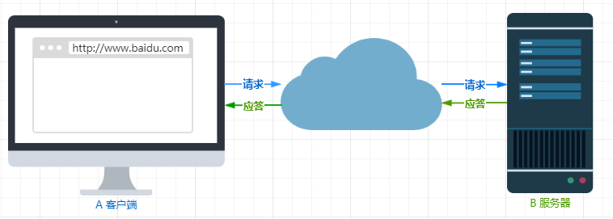

### HTTP/1\.1、HTTP/2、HTTP/3 演变

#### HTTP/1\.1 相比 HTTP/1\.0 提高了什么性能？

HTTP/1\.1 相比 HTTP/1\.0 性能上的改进：

- 使用长连接的方式改善了 HTTP/1\.0 短连接造成的性能开销。

- 支持管道（pipeline）网络传输，只要第一个请求发出去了，不必等其回来，就可以发第二个请求出去，可以减少整体的响应时间。

但 HTTP/1\.1 还是有性能瓶颈：

- 请求 / 响应头部（Header）未经压缩就发送，首部信息越多延迟越大。只能压缩 `Body` 的部分；

- 发送冗长的首部。每次互相发送相同的首部造成的浪费较多；

- 服务器是按请求的顺序响应的，如果服务器响应慢，会招致客户端一直请求不到数据，也就是队头阻塞；

- 没有请求优先级控制；

- 请求只能从客户端开始，服务器只能被动响应。

#### HTTP/2 做了什么优化？

HTTP/2 协议是基于 HTTPS 的，所以 HTTP/2 的安全性也是有保障的。

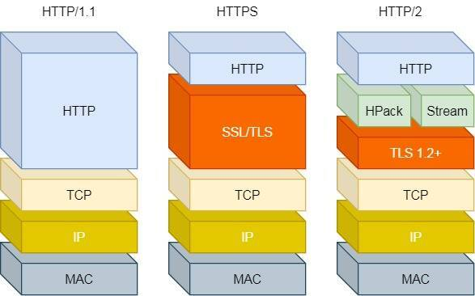

那 HTTP/2 相比 HTTP/1\.1 性能上的改进：

- 头部压缩

- 二进制格式

- 并发传输

- 服务器主动推送资源

1. *头部压缩*

HTTP/2 会压缩头（Header）如果你同时发出多个请求，他们的头是一样的或是相似的，那么，协议会帮你消除重复的部分。

这就是所谓的 `HPACK` 算法：在客户端和服务器同时维护一张头信息表，所有字段都会存入这个表，生成一个索引号，以后就不发送同样字段了，只发送索引号，这样就提高速度了。

2. *二进格式*

HTTP/2 不再像 HTTP/1\.1 里的纯文本形式的报文，而是全面采用了二进制格式，头信息和数据体都是二进制，并且统称为帧（frame）：头信息帧（Headers Frame）和数据帧（Data Frame）。

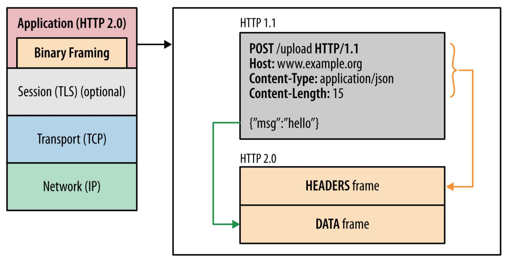

这样虽然对人不友好，但是对计算机非常友好，因为计算机只懂二进制，那么收到报文后，无需再将明文的报文转成二进制，而是直接解析二进制报文，这增加了数据传输的效率。

比如状态码 200 ，在 HTTP/1\.1 是用 '2''0''0' 三个字符来表示（二进制：00110010 00110000 00110000），共用了 3 个字节

3. *并发传输*

我们都知道 HTTP/1\.1 的实现是基于请求\-响应模型的。同一个连接中，HTTP 完成一个事务（请求与响应），才能处理下一个事务，也就是说在发出请求等待响应的过程中，是没办法做其他事情的，如果响应迟迟不来，那么后续的请求是无法发送的，也造成了队头阻塞的问题。

而 HTTP/2 就很牛逼了，引出了 Stream 概念，多个 Stream 复用在一条 TCP 连接。

从上图可以看到，1 个 TCP 连接包含多个 Stream，Stream 里可以包含 1 个或多个 Message，Message 对应 HTTP/1 中的请求或响应，由 HTTP 头部和包体构成。Message 里包含一条或者多个 Frame，Frame 是 HTTP/2 最小单位，以二进制压缩格式存放 HTTP/1 中的内容（头部和包体）。

针对不同的 HTTP 请求用独一无二的 Stream ID 来区分，接收端可以通过 Stream ID 有序组装成 HTTP 消息，不同 Stream 的帧是可以乱序发送的，因此可以并发不同的 Stream ，也就是 HTTP/2 可以并行交错地发送请求和响应。

比如下图，服务端并行交错地发送了两个响应： Stream 1 和 Stream 3，这两个 Stream 都是跑在一个 TCP 连接上，客户端收到后，会根据相同的 Stream ID 有序组装成 HTTP 消息。

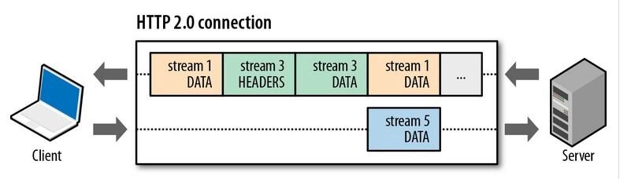

*4、服务器推送*

HTTP/2 还在一定程度上改善了传统的「请求 \- 应答」工作模式，服务端不再是被动地响应，可以主动向客户端发送消息。

客户端和服务器双方都可以建立 Stream， Stream ID 也是有区别的，客户端建立的 Stream 必须是奇数号，而服务器建立的 Stream 必须是偶数号。

比如下图，Stream 1 是客户端向服务端请求的资源，属于客户端建立的 Stream，所以该 Stream 的 ID 是奇数（数字 1）；Stream 2 和 4 都是服务端主动向客户端推送的资源，属于服务端建立的 Stream，所以这两个 Stream 的 ID 是偶数（数字 2 和 4）。

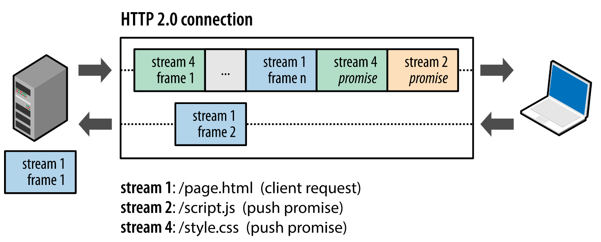

再比如，客户端通过 HTTP/1\.1 请求从服务器那获取到了 HTML 文件，而 HTML 可能还需要依赖 CSS 来渲染页面，这时客户端还要再发起获取 CSS 文件的请求，需要两次消息往返，如下图左边部分：

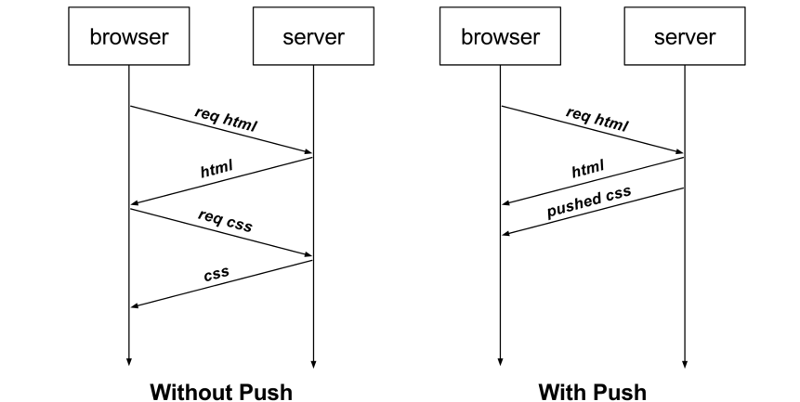

如上图右边部分，在 HTTP/2 中，客户端在访问 HTML 时，服务器可以直接主动推送 CSS 文件，减少了消息传递的次数。

> HTTP/2 有什么缺陷？
> 
> 

HTTP/2 通过 Stream 的并发能力，解决了 HTTP/1 队头阻塞的问题，看似很完美了，但是 HTTP/2 还是存在“队头阻塞”的问题，只不过问题不是在 HTTP 这一层面，而是在 TCP 这一层。

HTTP/2 是基于 TCP 协议来传输数据的，TCP 是字节流协议，TCP 层必须保证收到的字节数据是完整且连续的，这样内核才会将缓冲区里的数据返回给 HTTP 应用，那么当「前 1 个字节数据」没有到达时，后收到的字节数据只能存放在内核缓冲区里，只有等到这 1 个字节数据到达时，HTTP/2 应用层才能从内核中拿到数据，这就是 HTTP/2 队头阻塞问题。

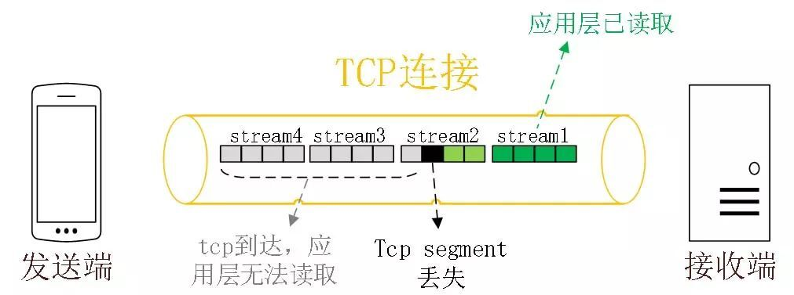

举个例子，如下图：

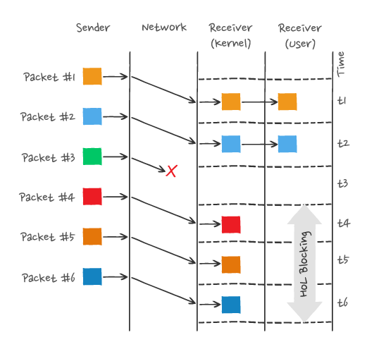

图中发送方发送了很多个 packet，每个 packet 都有自己的序号，你可以认为是 TCP 的序列号，其中 packet 3 在网络中丢失了，即使 packet 4\-6 被接收方收到后，由于内核中的 TCP 数据不是连续的，于是接收方的应用层就无法从内核中读取到，只有等到 packet 3 重传后，接收方的应用层才可以从内核中读取到数据，这就是 HTTP/2 的队头阻塞问题，是在 TCP 层面发生的。

所以，一旦发生了丢包现象，就会触发 TCP 的重传机制，这样在一个 TCP 连接中的所有的 HTTP 请求都必须等待这个丢了的包被重传回来。

#### HTTP/3 做了哪些优化？

前面我们知道了 HTTP/1\.1 和 HTTP/2 都有队头阻塞的问题：

- HTTP/1\.1 中的管道（ pipeline）虽然解决了请求的队头阻塞，但是没有解决响应的队头阻塞，因为服务端需要按顺序响应收到的请求，如果服务端处理某个请求消耗的时间比较长，那么只能等响应完这个请求后， 才能处理下一个请求，这属于 HTTP 层队头阻塞。

- HTTP/2 虽然通过多个请求复用一个 TCP 连接解决了 HTTP 的队头阻塞 ，但是一旦发生丢包，就会阻塞住所有的 HTTP 请求，这属于 TCP 层队头阻塞。

HTTP/2 队头阻塞的问题是因为 TCP，所以 HTTP/3 把 HTTP 下层的 TCP 协议改成了 UDP！

UDP 发送是不管顺序，也不管丢包的，所以不会出现像 HTTP/2 队头阻塞的问题。大家都知道 UDP 是不可靠传输的，但基于 UDP 的 QUIC 协议 可以实现类似 TCP 的可靠性传输。

QUIC 有以下 3 个特点。

- 无队头阻塞

- 更快的连接建立

- 连接迁移

*1、无队头阻塞*

QUIC 协议也有类似 HTTP/2 Stream 与多路复用的概念，也是可以在同一条连接上并发传输多个 Stream，Stream 可以认为就是一条 HTTP 请求。

QUIC 有自己的一套机制可以保证传输的可靠性的。当某个流发生丢包时，只会阻塞这个流，其他流不会受到影响，因此不存在队头阻塞问题。这与 HTTP/2 不同，HTTP/2 只要某个流中的数据包丢失了，其他流也会因此受影响。

所以，QUIC 连接上的多个 Stream 之间并没有依赖，都是独立的，某个流发生丢包了，只会影响该流，其他流不受影响。

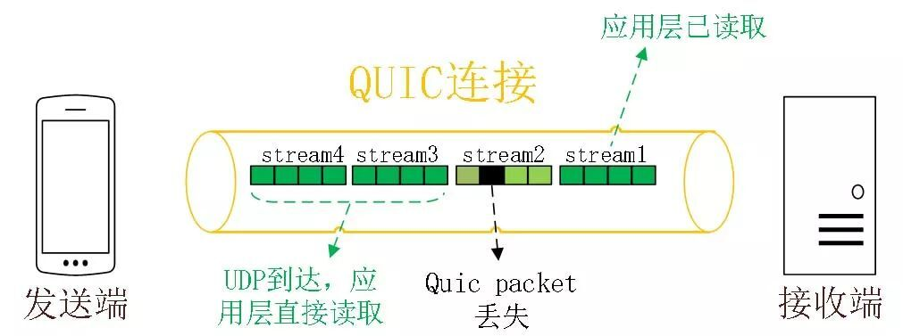

*2、更快的连接建立*

对于 HTTP/1 和 HTTP/2 协议，TCP 和 TLS 是分层的，分别属于内核实现的传输层、openssl 库实现的表示层，因此它们难以合并在一起，需要分批次来握手，先 TCP 握手，再 TLS 握手。

HTTP/3 在传输数据前虽然需要 QUIC 协议握手，但是这个握手过程只需要 1 RTT，握手的目的是为确认双方的「连接 ID」，连接迁移就是基于连接 ID 实现的。

但是 HTTP/3 的 QUIC 协议并不是与 TLS 分层，而是 QUIC 内部包含了 TLS，它在自己的帧会携带 TLS 里的“记录”，再加上 QUIC 使用的是 TLS/1\.3，因此仅需 1 个 RTT 就可以「同时」完成建立连接与密钥协商，如下图：

甚至，在第二次连接的时候，应用数据包可以和 QUIC 握手信息（连接信息 \+ TLS 信息）一起发送，达到 0\-RTT 的效果。

如下图右边部分，HTTP/3 当会话恢复时，有效负载数据与第一个数据包一起发送，可以做到 0\-RTT（下图的右下角）：

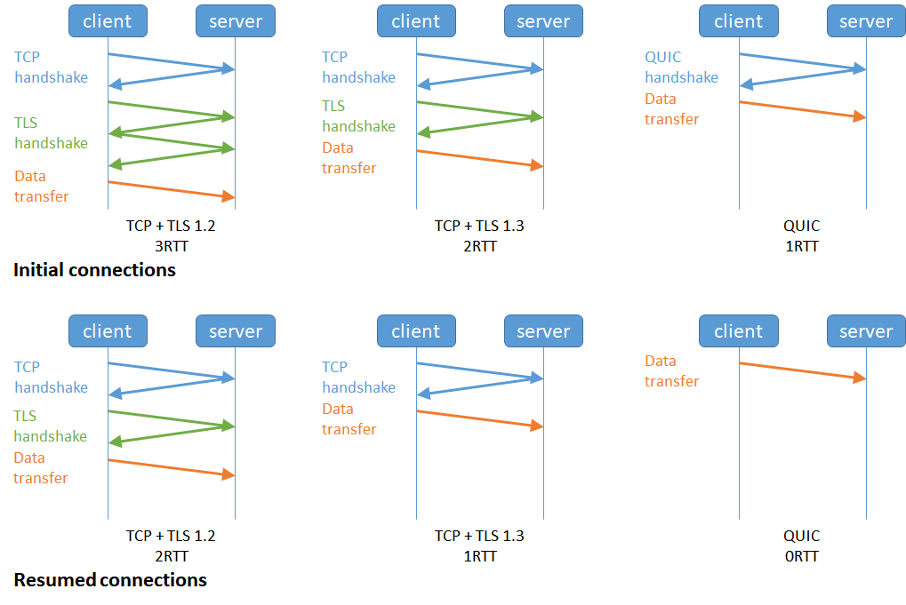

*3、连接迁移*

基于 TCP 传输协议的 HTTP 协议，由于是通过四元组（源 IP、源端口、目的 IP、目的端口）确定一条 TCP 连接。

那么当移动设备的网络从 4G 切换到 WIFI 时，意味着 IP 地址变化了，那么就必须要断开连接，然后重新建立连接。而建立连接的过程包含 TCP 三次握手和 TLS 四次握手的时延，以及 TCP 慢启动的减速过程，给用户的感觉就是网络突然卡顿了一下，因此连接的迁移成本是很高的。

而 QUIC 协议没有用四元组的方式来“绑定”连接，而是通过连接 ID 来标记通信的两个端点，客户端和服务器可以各自选择一组 ID 来标记自己，因此即使移动设备的网络变化后，导致 IP 地址变化了，只要仍保有上下文信息（比如连接 ID、TLS 密钥等），就可以“无缝”地复用原连接，消除重连的成本，没有丝毫卡顿感，达到了连接迁移的功能。

所以， QUIC 是一个在 UDP 之上的伪 TCP \+ TLS \+ HTTP/2 的多路复用的协议。

QUIC 是新协议，对于很多网络设备，根本不知道什么是 QUIC，只会当做 UDP，这样会出现新的问题，因为有的网络设备是会丢掉 UDP 包的，而 QUIC 是基于 UDP 实现的，那么如果网络设备无法识别这个是 QUIC 包，那么就会当作 UDP包，然后被丢弃。

## TCP粘包问题详解和解决方案

**TCP粘包概念 **TCP 是一种面向连接的、可靠的、基于字节流的传输协议，它保证了数据的可靠性和顺序性。然而，由于TCP是基于字节流而不是消息的，因此在传输过程中可能会出现粘包（Packing）和拆包（Unpacking）问题。

粘包问题（TCP粘包现象）指的是发送方在传输数据时，TCP协议把多个发送的小数据包“粘”在一起，形成一个大的数据包发送；或者接收方在接收数据时，多个小的数据包被“粘”在一起，形成一个大的数据包接收。这种现象的发生是由于TCP协议的工作机制导致的。

**原因和机制 ：**

1. **TCP工作方式**：TCP是基于字节流的协议，它并不了解上层应用发送的消息边界（Message Boundary）。它只负责把接收到的字节流按照顺序交给应用层，因此多个发送的小数据包在传输过程中有可能会被合并成一个大的数据包发送，或者一个大的数据包被拆分成多个小数据包接收。

2. **发送端的粘包：1\. **发送端应用程序往往会先把数据放入TCP发送缓冲区，然后TCP根据自身的发送策略（如Nagle算法等）进行发送，可能会合并多个数据包一起发送，以提高网络利用率和性能。2\. 如果发送端应用程序发送的消息比较小，并且发送速率较快，这些小消息在TCP层可能会被合并成一个大的数据包发送，导致接收方接收到的数据出现粘包现象。

3. **接收端的粘包：1\. **接收端应用程序从TCP接收缓冲区中读取数据时，由于TCP层不了解应用层的消息边界，可能一次性把多个发送的小数据包“粘”在一起交给应用层处理。2\. 如果接收端应用程序处理消息的速度跟不上数据的接收速度，会导致接收到的数据出现粘包现象。

**解决方案：**

1. **消息边界标记**：在发送的消息中加入特定的消息边界标记（如换行符 \\n），接收端根据消息边界标记来分割接收到的数据，从而识别出完整的消息。有缺陷: 效率低, 需要一个字节一个字节接收, 接收一个字节判断一次, 判断是不是那个特殊字符串

2. **消息长度固定**：发送端将每个消息的长度固定，接收端根据固定长度来分割接收到的数据，从而确保每个接收到的数据包含完整的消息。缺点：容易造成空间浪费

3. **消息头部长度字段**：发送端在每个消息前加入一个固定长度的消息头部，包含消息的长度信息，接收端根据头部长度字段来读取对应长度的消息数据。这时候数据由两部分组成：数据头\+数据块，数据头：存储当前数据包的总字节数，接收端先接收数据头，然后在根据数据头接收对应大小的字节，数据块：当前数据包的内容

4. **使用标准的应用层协议**（比如：http、https）来封装要传输的不定长的数据包

## TCP保证可靠性的原理

回答的话可以从下面几个方向回答

- tcp的三次握手和四次挥手

- 流量控制

- 拥塞控制

- 确认应答机制（也就是接收方收到消息之后会给一个ack确认）

- 序列号与按序交付  每个数据包分配唯一序列号，接收方按顺序重组数据，避免乱序问题，同时识别重复或丢失的包。

**详细的过程**：[4\.2 TCP 重传、滑动窗口、流量控制、拥塞控制](https://xiaolincoding.com/network/3_tcp/tcp_feature.html#%E9%87%8D%E4%BC%A0%E6%9C%BA%E5%88%B6)

## 有哪些协议是基于TCP的

1. **FTP**（File Transfer Protocol）：用于文件传输。

2. **SMTP**（Simple Mail Transfer Protocol）：用于电子邮件的发送。

3. **POP3**（Post Office Protocol version 3）：用于电子邮件的接收。

4. **IMAP**（Internet Message Access Protocol）：用于电子邮件的接收和管理。

5. **SSH**（Secure Shell）：用于安全远程登录和其他安全网络服务。

## **TCP 和 UDP 可以使用同一个端口吗**

TCP和UDP可以使用同一个端口号，因为它们是两种不同的协议，操作在不同的网络层。在网络中，一个端口号的唯一性是由**IP地址、端口号以及协议**三者共同决定的。这意味着TCP和UDP各自可以绑定相同的端口号，而不会产生冲突，因为协议类型（TCP或UDP）作为区分。这种机制允许应用程序同时或分别监听相同的端口号上的TCP和UDP流量。

举例来说，DNS服务就是一个典型的例子，它通常同时在UDP和TCP的53端口上监听。对于大多数查询，DNS使用UDP协议，因为它更快，且DNS请求和响应通常都很小，适合UDP。然而，当DNS响应数据较大时，超过了UDP的限制，就会改用TCP协议，以确保数据的完整性和可靠性。

## HTTP 常见的状态码


`1xx` 类状态码属于提示信息，是协议处理中的一种中间状态，实际用到的比较少。

`2xx` 类状态码表示服务器成功处理了客户端的请求，也是我们最愿意看到的状态。

- 「200 OK」是最常见的成功状态码，表示一切正常。如果是非 `HEAD` 请求，服务器返回的响应头都会有 body 数据。

- 「204 No Content」也是常见的成功状态码，与 200 OK 基本相同，但响应头没有 body 数据。

- 「206 Partial Content」是应用于 HTTP 分块下载或断点续传，表示响应返回的 body 数据并不是资源的全部，而是其中的一部分，也是服务器处理成功的状态。

`3xx` 类状态码表示客户端请求的资源发生了变动，需要客户端用新的 URL 重新发送请求获取资源，也就是重定向。

- 「301 Moved Permanently」表示永久重定向，说明请求的资源已经不存在了，需改用新的 URL 再次访问。

- 「302 Found」表示临时重定向，说明请求的资源还在，但暂时需要用另一个 URL 来访问。

301 和 302 都会在响应头里使用字段 `Location`，指明后续要跳转的 URL，浏览器会自动重定向新的 URL。

- 「304 Not Modified」不具有跳转的含义，表示资源未修改，重定向已存在的缓冲文件，也称缓存重定向，也就是告诉客户端可以继续使用缓存资源，用于缓存控制。

`4xx` 类状态码表示客户端发送的报文有误，服务器无法处理，也就是错误码的含义。

- 「400 Bad Request」表示客户端请求的报文有错误，但只是个笼统的错误。

- 「403 Forbidden」表示服务器禁止访问资源，并不是客户端的请求出错。

- 「404 Not Found」表示请求的资源在服务器上不存在或未找到，所以无法提供给客户端。

`5xx` 类状态码表示客户端请求报文正确，但是服务器处理时内部发生了错误，属于服务器端的错误码。

- 「500 Internal Server Error」与 400 类型，是个笼统通用的错误码，服务器发生了什么错误，我们并不知道。

- 「501 Not Implemented」表示客户端请求的功能还不支持，类似“即将开业，敬请期待”的意思。

- 「502 Bad Gateway」通常是服务器作为网关或代理时返回的错误码，表示服务器自身工作正常，访问后端服务器发生了错误。

- 「503 Service Unavailable」表示服务器当前很忙，暂时无法响应客户端，类似“网络服务正忙，请稍后重试”的意思。

## GET 和 POST 区别

GET 的语义是请求获取指定的资源。GET 方法是安全、幂等、可被缓存的。

POST 的语义是根据请求负荷（报文主体）对指定的资源做出处理，具体的处理方式视资源类型而不同。POST 不安全，不幂等，（大部分实现）不可缓存。

## TCP nagle算法

Nagle算法通过将小的数据包进行聚合，然后尽量以较大的数据包发送。这对于应用程序频繁发送小数据包的情况来说，可以显著降低网络拥塞和提高吞吐量。

1. **数据缓冲**：当应用程序发送数据时，TCP协议会将数据放入缓冲区中，而不是立即发送。

2. **积累数据**：如果有未确认的数据包（未收到ACK），TCP会继续积累传输的数据。

3. **发送条件**：

    - 收到对先前发送数据的ACK。

    - 缓冲区中积累的数据达到一定大小（通常是最大报文段MSS）。

这样，Nagle算法有效地将多个小数据包合并为一个大数据包进行发送，减少网络开销。

# 操作系统

## 进程间的通信方式有哪些

- **管道/匿名管道\(Pipes\)** ：用于具有亲缘关系的父子进程间或者兄弟进程之间的通信。

- **有名管道\(Named Pipes\)** : 匿名管道由于没有名字，只能用于亲缘关系的进程间通信。为了克服这个缺点，提出了有名管道。有名管道严格遵循 **先进先出\(First In First Out\)** 。有名管道以磁盘文件的方式存在，可以实现本机任意两个进程通信。

- **信号\(Signal\)** ：信号是一种比较复杂的通信方式，用于通知接收进程某个事件已经发生；

- **消息队列\(Message Queuing\)** ：消息队列是消息的链表,具有特定的格式,存放在内存中并由消息队列标识符标识。管道和消息队列的通信数据都是先进先出的原则。与管道（无名管道：只存在于内存中的文件；命名管道：存在于实际的磁盘介质或者文件系统）不同的是消息队列存放在内核中，只有在内核重启\(即，操作系统重启\)或者显式地删除一个消息队列时，该消息队列才会被真正的删除。消息队列可以实现消息的随机查询,消息不一定要以先进先出的次序读取,也可以按消息的类型读取\.比 FIFO 更有优势。消息队列克服了信号承载信息量少，管道只能承载无格式字 节流以及缓冲区大小受限等缺点。

- **信号量\(Semaphores\)** ：信号量是一个计数器，用于多进程对共享数据的访问，信号量的意图在于进程间同步。这种通信方式主要用于解决与同步相关的问题并避免竞争条件。

- **共享内存\(Shared memory\)** ：使得多个进程可以访问同一块内存空间，不同进程可以及时看到对方进程中对共享内存中数据的更新。这种方式需要依靠某种同步操作，如互斥锁和信号量等。可以说这是最有用的进程间通信方式。

- **套接字\(Sockets\)** : 此方法主要用于在客户端和服务器之间通过网络进行通信。套接字是支持 TCP/IP 的网络通信的基本操作单元，可以看做是不同主机之间的进程进行双向通信的端点，简单的说就是通信的两方的一种约定，用套接字中的相关函数来完成通信过程。

## 用户态和内核态

#### 什么是用户态和内核态？

根据进程访问资源的特点，我们可以把进程在系统上的运行分为两个级别：

- **用户态\(User Mode\)** : 用户态运行的进程可以直接读取用户程序的数据，拥有较低的权限。当应用程序需要执行某些需要特殊权限的操作，例如读写磁盘、网络通信等，就需要向操作系统发起系统调用请求，进入内核态。

- **内核态\(Kernel Mode\)**：内核态运行的进程几乎可以访问计算机的任何资源包括系统的内存空间、设备、驱动程序等，不受限制，拥有非常高的权限。当操作系统接收到进程的系统调用请求时，就会从用户态切换到内核态，执行相应的系统调用，并将结果返回给进程，最后再从内核态切换回用户态。

内核态相比用户态拥有更高的特权级别，因此能够执行更底层、更敏感的操作。不过，由于进入内核态需要付出较高的开销（需要进行一系列的上下文切换和权限检查），应该尽量减少进入内核态的次数，以提高系统的性能和稳定性。

#### 为什么要有用户态和内核态？只有一个内核态不行么？

- 在 CPU 的所有指令中，有一些指令是比较危险的比如内存分配、设置时钟、IO 处理等，如果所有的程序都能使用这些指令的话，会对系统的正常运行造成灾难性地影响。因此，我们需要限制这些危险指令只能内核态运行。这些只能由操作系统内核态执行的指令也被叫做 **特权指令** 。

- 如果计算机系统中只有一个内核态，那么所有程序或进程都必须共享系统资源，例如内存、CPU、硬盘等，这将导致系统资源的竞争和冲突，从而影响系统性能和效率。并且，这样也会让系统的安全性降低，毕竟所有程序或进程都具有相同的特权级别和访问权限。

因此，同时具有用户态和内核态主要是为了保证计算机系统的安全性、稳定性和性能。

## 避免死锁的方法

[5\.4 怎么避免死锁？ \| 小林coding \(](https://xiaolincoding.com/os/4_process/deadlock.html#%E6%AD%BB%E9%94%81%E7%9A%84%E6%A6%82%E5%BF%B5)[xiaolincoding\.com](https://xiaolincoding.com/os/4_process/deadlock.html#%E6%AD%BB%E9%94%81%E7%9A%84%E6%A6%82%E5%BF%B5)[\)](https://xiaolincoding.com/os/4_process/deadlock.html#%E6%AD%BB%E9%94%81%E7%9A%84%E6%A6%82%E5%BF%B5)

## 进程线程协程区别

- 线程是进程划分成的更小的运行单位,一个进程在其执行的过程中可以产生多个线程。

- 线程和进程最大的不同在于基本上各进程是独立的，而各线程则不一定，因为同一进程中的线程极有可能会相互影响。

- 线程执行开销小，但不利于资源的管理和保护；而进程正相反。

- **协程（Coroutine）** 是一种比线程更轻量级的执行单元，它是由程序自身控制的调度单位，而不依赖于操作系统的调度。协程不需要像线程一样切换上下文，不需要操作系统内核参与，而是由程序代码自己控制任务的切换。

补充：[https://javaguide\.cn/cs\-basics/operating\-system/operating\-system\-basic\-questions\-01\.html\#](https://javaguide.cn/cs-basics/operating-system/operating-system-basic-questions-01.html#%E8%BF%9B%E7%A8%8B%E5%92%8C%E7%BA%BF%E7%A8%8B)[进程和线程](https://javaguide.cn/cs-basics/operating-system/operating-system-basic-questions-01.html#%E8%BF%9B%E7%A8%8B%E5%92%8C%E7%BA%BF%E7%A8%8B)

## 进程的状态及其状态之间的转化

**创建状态\(new\)**：进程正在被创建，尚未到就绪状态。

**就绪状态\(ready\)**：进程已处于准备运行状态，即进程获得了除了处理器之外的一切所需资源，一旦得到处理器资源\(处理器分配的时间片\)即可运行。

**运行状态\(running\)**：进程正在处理器上运行\(单核 CPU 下任意时刻只有一个进程处于运行状态\)。

**阻塞状态\(waiting\)**：又称为等待状态，进程正在等待某一事件而暂停运行如等待某资源为可用或等待 IO 操作完成。即使处理器空闲，该进程也不能运行。

**结束状态\(terminated\)**：进程正在从系统中消失。可能是进程正常结束或其他原因中断退出运行。

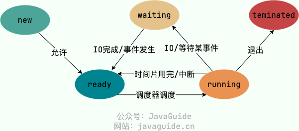

## 操作系统中的LRU算法如何实现的

操作系统中的最近最少使用（LRU）算法是通过维护一个链表来实现的。当一个数据第一次进入缓存时，将此数据添加到链表的头部。当需要从缓存中访问数据时，如果数据已经在链表中，就把数据移动到链表头部。如果数据不在链表中，有两种情况需要考虑：

1. 如果此时缓存未满，就直接在链表头部添加数据。

2. 如果此时缓存已满，就删除链表尾部的数据，然后再在链表头部添加数据。

这样，当缓存达到最大值时，最近最少使用的数据就在链表的尾部，可以被直接淘汰。链表的头部则是最近最频繁使用的数据。

## 操作系统中的进程调度

**这里可以看小林coding总结的，相对更加清楚：**

[进程的调度算法](https://xiaolincoding.com/os/4_process/process_base.html#%E8%B0%83%E5%BA%A6%E7%AE%97%E6%B3%95)

## 操作系统中进程之间常用的通信方式

**详细了解**：[https://xiaolincoding\.com/os/4\_process/process\_commu\.html\#\_5\-2\-](https://xiaolincoding.com/os/4_process/process_commu.html#_5-2-%E8%BF%9B%E7%A8%8B%E9%97%B4%E6%9C%89%E5%93%AA%E4%BA%9B%E9%80%9A%E4%BF%A1%E6%96%B9%E5%BC%8F)[进程间有哪些通信方式](https://xiaolincoding.com/os/4_process/process_commu.html#_5-2-%E8%BF%9B%E7%A8%8B%E9%97%B4%E6%9C%89%E5%93%AA%E4%BA%9B%E9%80%9A%E4%BF%A1%E6%96%B9%E5%BC%8F)

1. **匿名管道**顾名思义，它没有名字标识，匿名管道是特殊文件只存在于内存，没有存在于文件系统中，shell 命令中的「`|`」竖线就是匿名管道，通信的数据是**无格式的流并且大小受限**，通信的方式是**单向**的，数据只能在一个方向上流动，如果要双向通信需要创建两个管道，再来**匿名管道是只能用于存在父子关系的进程间通信**，匿名管道的生命周期随着进程创建而建立，随着进程终止而消失。

2. **命名管道**突破了匿名管道只能在亲缘关系进程间的通信限制，因为使用命名管道的前提，需要在文件系统创建一个类型为 p 的设备文件，那么毫无关系的进程就可以通过这个设备文件进行通信。另外，不管是匿名管道还是命名管道，进程写入的数据都是**缓存在内核**中，另一个进程读取数据时候自然也是从内核中获取，同时通信数据都遵循**先进先出**原则，不支持 lseek 之类的文件定位操作。

3. **消息队列**克服了管道通信的数据是无格式的字节流的问题，消息队列实际上是保存在内核的「消息链表」，消息队列的消息体是可以用户自定义的数据类型，发送数据时，会被分成一个一个独立的消息体，当然接收数据时，也要与发送方发送的消息体的数据类型保持一致，这样才能保证读取的数据是正确的。消息队列通信的速度不是最及时的，毕竟**每次数据的写入和读取都需要经过用户态与内核态之间的拷贝过程。**

4. **共享内存**可以解决消息队列通信中用户态与内核态之间数据拷贝过程带来的开销，**它直接分配一个共享空间，每个进程都可以直接访问**，就像访问进程自己的空间一样快捷方便，不需要陷入内核态或者系统调用，大大提高了通信的速度，享有**最快**的进程间通信方式之名。但是便捷高效的共享内存通信，**带来新的问题，多进程竞争同个共享资源会造成数据的错乱。**

5. 那么，就需要**信号量**来保护共享资源，以确保任何时刻只能有一个进程访问共享资源，这种方式就是互斥访问。**信号量不仅可以实现访问的互斥性，还可以实现进程间的同步**，信号量其实是一个计数器，表示的是资源个数，其值可以通过两个原子操作来控制，分别是 **P 操作和 V 操作**。

6. 与信号量名字很相似的叫**信号**，它俩名字虽然相似，但功能一点儿都不一样。信号是**异步通信机制**，信号可以在应用进程和内核之间直接交互，内核也可以利用信号来通知用户空间的进程发生了哪些系统事件，信号事件的来源主要有硬件来源（如键盘 Cltr\+C ）和软件来源（如 kill 命令），一旦有信号发生，**进程有三种方式响应信号 1\. 执行默认操作、2\. 捕捉信号、3\. 忽略信号**。有两个信号是应用进程无法捕捉和忽略的，即 `SIGKILL` 和 `SIGSTOP`，这是为了方便我们能在任何时候结束或停止某个进程。

7. **Socket 通信** 如果**要与不同主机的进程间通信，那么就需要 Socket 通信了**。Socket 实际上不仅用于不同的主机进程间通信，还可以用于本地主机进程间通信，可根据创建 Socket 的类型不同，分为三种常见的通信方式，一个是基于 TCP 协议的通信方式，一个是基于 UDP 协议的通信方式，一个是本地进程间通信方式。

## **解释一下什么叫虚拟内存？****页一般来说是有多大？这个页过大或过小或怎么样？Linux你能想到多少个命令和内存有关？**

虚拟内存是一种内存管理技术，通过将物理内存（RAM）与磁盘空间结合使用，使程序能够使用比实际物理内存更大的地址空间。默认页大小通常为4KB

补充：虚拟内存是操作系统管理内存的一种技术，核心作用是让应用程序认为自己拥有连续的、足够大的内存空间，而实际内存由物理内存和磁盘空间共同组成。

与内存相关的命令：

1. **`free`**：查看物理内存和交换空间的使用情况，包括总内存、已用、空闲等**3**。

2. **`top`****/****`htop`**：实时监控进程的内存占用（如RES、VIRT字段）。

3. **`vmstat`**：统计虚拟内存状态，包括内存、交换、缺页频率等指标**2**。

4. **`pmap`**：分析进程的内存映射，显示各段内存的用途（如堆、栈、共享库）**3**。

5. **`sar`**：生成系统活动报告，包括内存使用历史数据。

6. **`swapon`****/****`swapoff`**：启用或禁用交换分区/文件**3**。

7. **`sysctl`**：调整内核参数（如`vm.swappiness`控制交换倾向）

## 进程切换时要恢复哪些东西

上下文切换是指操作系统从**一个正在运行的进程或线程切换到另一个进程或线程的过程**。在上下文切换的过程中，操作系统会保存当前进程或线程的运行状态（也称为上下文），并将其恢复到下一个要执行的进程或线程中。

在上下文切换的过程中，操作系统需要保存和恢复的信息包括：

1. **CPU 寄存器的值**：包括程序计数器、堆栈指针、通用寄存器等。

2. **进程或线程的状态信息**：包括进程或线程的标识符、优先级、状态等。

3. **内存管理信息**：包括进程或线程的地址空间信息、页表等。

4. **文件描述符和其他资源信息**：包括打开的文件、网络连接、定时器等。

## IO多路复用


一个进程虽然任一时刻只能处理一个请求，但是处理每个请求的事件时，耗时控制在 1 毫秒以内，这样 1 秒内就可以处理上千个请求，把时间拉长来看，多个请求复用了一个进程，这就是多路复用，这种思想很类似一个 CPU 并发多个进程，所以也叫做时分多路复用。

我们熟悉的 select/poll/epoll 内核提供给用户态的多路复用系统调用，进程可以通过一个系统调用函数从内核中获取多个事件。

select/poll/epoll 是如何获取网络事件的呢？在获取事件时，先把所有连接（文件描述符）传给内核，再由内核返回产生了事件的连接，然后在用户态中再处理这些连接对应的请求即可。

#### select/poll

select 实现多路复用的方式是，将已连接的 Socket 都放到一个**文件描述符集合**，然后调用 select 函数将文件描述符集合**拷贝**到内核里，让内核来检查是否有网络事件产生，检查的方式很粗暴，就是通过遍历文件描述符集合的方式，当检查到有事件产生后，将此 Socket 标记为可读或可写， 接着再把整个文件描述符集合拷贝回用户态里，然后用户态还需要再通过**遍历**的方法找到可读或可写的 Socket，然后再对其处理。

所以，对于 select 这种方式，需要进行** 2 次「遍历」文件描述符集合**，一次是在内核态里，一个次是在用户态里 ，而且还会发生** 2 次「拷贝」文件描述符集合**，先从用户空间传入内核空间，由内核修改后，再传出到用户空间中。

select 使用固定长度的 BitsMap，表示文件描述符集合，而且所支持的文件描述符的个数是有限制的，在 Linux 系统中，由内核中的 FD\_SETSIZE 限制， 默认最大值为 `1024`，只能监听 0\~1023 的文件描述符。

poll 不再用 BitsMap 来存储所关注的文件描述符，取而代之用**动态数组**，以**链表**形式来组织，突破了 select 的文件描述符个数限制，当然还会受到系统文件描述符限制。

但是 poll 和 select 并没有太大的本质区别，**都是使用「线性结构」存储进程关注的 Socket 集合，因此都需要遍历文件描述符集合来找到可读或可写的 Socket，时间复杂度为 O\(n\)，而且也需要在用户态与内核态之间拷贝文件描述符集合**，这种方式随着并发数上来，性能的损耗会呈指数级增长。

#### Epoll

epoll 通过两个方面，很好解决了 select/poll 的问题。

***第一点***，epoll 在内核里使用**红黑树来跟踪进程所有待检测的文件描述字**，把需要监控的 socket 通过 `epoll_ctl()` 函数加入内核中的红黑树里，红黑树是个高效的数据结构，增删改一般时间复杂度是 `O(logn)`。而 select/poll 内核里没有类似 epoll 红黑树这种保存所有待检测的 socket 的数据结构，所以 select/poll 每次操作时都传入整个 socket 集合给内核，而 epoll 因为在内核维护了红黑树，可以保存所有待检测的 socket ，所以只需要传入一个待检测的 socket，减少了内核和用户空间大量的数据拷贝和内存分配。

***第二点***， epoll 使用**事件驱动**的机制，内核里**维护了一个链表来记录就绪事件**，当某个 socket 有事件发生时，通过回调函数内核会将其加入到这个就绪事件列表中，当用户调用 `epoll_wait()` 函数时，只会返回有事件发生的文件描述符的个数，不需要像 select/poll 那样轮询扫描整个 socket 集合，大大提高了检测的效率。

从下图可以看到 epoll 相关的接口作用：


epoll 的方式即使监听的 Socket 数量越多的时候，效率不会大幅度降低，能够同时监听的 Socket 的数目也非常的多了，上限就为系统定义的进程打开的最大文件描述符个数。因而，epoll 被称为解决 C10K 问题的利器。

##### 边缘触发和水平触发（换个问法，io多路复用的边界条件）

epoll 支持两种事件触发模式，分别是边缘触发（*edge\-triggered，ET*）和水平触发（*level\-triggered，LT*）。

- 使用边缘触发模式时，当被监控的 Socket 描述符上有可读事件发生时，服务器端只会从 epoll\_wait 中苏醒一次，即使进程没有调用 read 函数从内核读取数据，**也依然只苏醒一次**，因此我们程序要保证一次性将内核缓冲区的数据读取完；

- 使用水平触发模式时，当被监控的 Socket 上有可读事件发生时，服务器端不断地从 epoll\_wait 中苏醒，直到内核缓冲区数据被 read 函数读完才结束，目的是告诉我们有数据需要读取；


举个例子，你的快递被放到了一个快递箱里，如果快递箱只会通过短信通知你一次，即使你一直没有去取，它也不会再发送第二条短信提醒你，这个方式就是边缘触发；如果快递箱发现你的快递没有被取出，它就会不停地发短信通知你，直到你取出了快递，它才消停，这个就是水平触发的方式。


这就是两者的区别，水平触发的意思是只要满足事件的条件，比如内核中有数据需要读，就一直不断地把这个事件传递给用户；而边缘触发的意思是只有第一次满足条件的时候才触发，之后就不会再传递同样的事件了。


如果使用水平触发模式，当内核通知文件描述符可读写时，接下来还可以继续去检测它的状态，看它是否依然可读或可写。所以在收到通知后，没必要一次执行尽可能多的读写操作。


如果使用边缘触发模式，I/O 事件发生时只会通知一次，而且我们不知道到底能读写多少数据，所以在收到通知后应尽可能地读写数据，以免错失读写的机会。因此，我们会循环从文件描述符读写数据，那么如果文件描述符是阻塞的，没有数据可读写时，进程会阻塞在读写函数那里，程序就没办法继续往下执行。所以，边缘触发模式一般和非阻塞 I/O 搭配使用，程序会一直执行 I/O 操作，直到系统调用（如 `read` 和 `write`）返回错误，错误类型为 `EAGAIN` 或 `EWOULDBLOCK`。


一般来说，边缘触发的效率比水平触发的效率要高，因为边缘触发可以减少 epoll\_wait 的系统调用次数，系统调用也是有一定的开销的的，毕竟也存在上下文的切换。

select/poll 只有水平触发模式，epoll 默认的触发模式是水平触发，但是可以根据应用场景设置为边缘触发模式。

## 缓存淘汰策略

1. **LRU（Least Recently Used）**：最近最少使用策略。该策略会移除最近最少使用的数据，假设最近使用的数据在未来仍会被使用。

2. **LFU（Least Frequently Used）**：最不经常使用策略。该策略会移除使用频率最低的数据，假设使用频率高的数据在未来仍会被使用。

3. **FIFO（First In First Out）**：先进先出策略。该策略会移除最早进入缓存的数据，不考虑数据的使用频率或最近使用时间。

4. **MRU（Most Recently Used）**：最近最多使用策略。与LRU相反，该策略会移除最近使用的数据，适用于某些特定场景。

5. **Random**：随机淘汰策略。随机选择缓存中的数据进行移除，简单但不一定高效。

**扩展问题**

**LRU和LFU的区别以及适用场景：**

- LRU策略基于数据的最近使用时间来决定淘汰哪些数据。它会移除最近最少使用的数据，假设最近使用的数据在未来仍会被使用。

- LFU策略基于数据的使用频率来决定淘汰哪些数据。它会移除使用频率最低的数据，假设使用频率高的数据在未来仍会被使用。

- LRU适用于数据访问具有时间局部性特征的场景，即最近访问的数据很可能在不久的将来再次被访问。例如，操作系统的内存管理、Web浏览器的缓存等。

- LFU适用于数据访问具有频率局部性特征的场景，即某些数据被频繁访问，而其他数据很少被访问。例如，数据库的缓存系统中，某些查询结果可能被频繁请求。

# Spring

## **Spring IOC容器的创建**


## Spring中的事务的隔离级别，事务的传播行为？（spring事务）

[Spring常见面试题总结 \| JavaGuide](https://javaguide.cn/system-design/framework/spring/spring-knowledge-and-questions-summary.html#spring-%E4%BA%8B%E5%8A%A1%E4%B8%AD%E7%9A%84%E9%9A%94%E7%A6%BB%E7%BA%A7%E5%88%AB%E6%9C%89%E5%93%AA%E5%87%A0%E7%A7%8D)

[Spring常见面试题总结 \| JavaGuide](https://javaguide.cn/system-design/framework/spring/spring-knowledge-and-questions-summary.html#spring-%E4%BA%8B%E5%8A%A1%E4%B8%AD%E5%93%AA%E5%87%A0%E7%A7%8D%E4%BA%8B%E5%8A%A1%E4%BC%A0%E6%92%AD%E8%A1%8C%E4%B8%BA)

[Spring之事务详解\_spring propagation\-CSDN博客](https://blog.csdn.net/u012060033/article/details/87911330?ops_request_misc=&request_id=&biz_id=102&utm_term=%E8%AF%B7%E4%BB%8B%E7%BB%8D%E4%B8%80%E4%B8%8Bspring%E4%BA%8B%E5%8A%A1&utm_medium=distribute.pc_search_result.none-task-blog-2~all~sobaiduweb~default-0-87911330.142%5Ev100%5Epc_search_result_base9&spm=1018.2226.3001.4187)

## AOP 原理

AOP（Aspect Oriented Programming）即面向切面编程，AOP 是 OOP（面向对象编程）的一种延续，二者互补，并不对立。

AOP 的目的是将横切关注点（如日志记录、事务管理、权限控制、接口限流、接口幂等等）从核心业务逻辑中分离出来，通过动态代理、字节码操作等技术，实现代码的复用和解耦，提高代码的可维护性和可扩展性。OOP 的目的是将业务逻辑按照对象的属性和行为进行封装，通过类、对象、继承、多态等概念，实现代码的模块化和层次化（也能实现代码的复用），提高代码的可读性和可维护性

AOP 可以将横切关注点（如日志记录、事务管理、权限控制、接口限流、接口幂等等）从 **核心业务逻辑（core concerns，核心关注点）** 中分离出来，实现关注点的分离。 以日志记录为例进行介绍，假如我们需要对某些方法进行统一格式的日志记录，没有使用 AOP 技术之前，我们需要挨个写日志记录的逻辑代码，全是重复的的逻辑。

使用 AOP 技术之后，我们可以将日志记录的逻辑封装成一个切面，然后通过切入点和通知来指定在哪些方法需要执行日志记录的操作。

AOP 的常见实现方式有动态代理、字节码操作等方式。Spring AOP 就是基于动态代理的，如果要代理的对象，实现了某个接口，那么 Spring AOP 会使用**JDK Proxy**，去创建代理对象，而对于没有实现接口的对象，就无法使用 JDK Proxy 去进行代理了，这时候 Spring AOP 会使用**Cglib**生成一个被代理对象的子类来作为代理

[Spring学习笔记—JDK动态代理 \- 掘金 \(](https://juejin.cn/post/7293728293769363491?searchId=20240420200929F4524612F418E7F8449B)[juejin\.cn](https://juejin.cn/post/7293728293769363491?searchId=20240420200929F4524612F418E7F8449B)[\)](https://juejin.cn/post/7293728293769363491?searchId=20240420200929F4524612F418E7F8449B)

[Spring5学习笔记—CGlib动态代理 \- 掘金 \(](https://juejin.cn/post/7294453574645366784?searchId=20240420200929F4524612F418E7F8449B)[juejin\.cn](https://juejin.cn/post/7294453574645366784?searchId=20240420200929F4524612F418E7F8449B)[\)](https://juejin.cn/post/7294453574645366784?searchId=20240420200929F4524612F418E7F8449B)

[JDK动态代理和CGLIB动态代理 \- 掘金 \(](https://juejin.cn/post/7011357346018361375)[juejin\.cn](https://juejin.cn/post/7011357346018361375)[\)](https://juejin.cn/post/7011357346018361375)

## spring 哪里用到反射

[java反射在spring ioc和aop中的应用 \- 知乎 \(](https://zhuanlan.zhihu.com/p/599212779)[zhihu\.com](https://zhuanlan.zhihu.com/p/599212779)[\)](https://zhuanlan.zhihu.com/p/599212779)

## Springboot自动装配用哪个注解

**EnableAutoConfiguration**

## 取一个自己设置好的变量用哪个注解

**@Value**

[spring的@Value注解使用\-CSDN博客](https://blog.csdn.net/woheniccc/article/details/79804600)

## springboot注解大全

[学习Spring Boot 注解，这一篇就够了（附带部分注解实例讲解）\_springboot注解 举例\-CSDN博客](https://blog.csdn.net/houpeibin2012/article/details/104433871)

## Spring事务失效的场景


[spring 事务失效的 12 种场景\_spring 截获duplicatekeyexception 不抛异常\-CSDN博客](https://blog.csdn.net/hanjiaqian/article/details/120501741)

## 依赖注入是什么，注入有哪些方式

依赖注入\(Dependency Injection, DI\)是一种设计模式，也是Spring框架的核心概念之一。其作用是去除Java类之间的依赖关系，实现松耦合，以便于开发测试。为了更好地理解DI，先了解DI要解决的问题。

[什么是DI（依赖注入），依赖注入的原理\-CSDN博客](https://blog.csdn.net/weixin_43888891/article/details/108653411)

- 构造函数注入

- setter注入

- 接口注入

## Bean的生命周期

在 Spring 框架中，Bean 的生命周期主要包括以下阶段：

1. **实例化（Instantiation）**：

    - 当 Spring 容器启动时，会根据配置信息实例化所需的 Bean。实例化可以通过构造函数进行，或者通过工厂方法创建实例。

2. **属性设置（Properties Setting）**：

    - 在实例化完成后，Spring 容器会注入配置的属性值或引用到 Bean 中，可以通过构造函数注入或者 setter 方法注入。

3. **初始化（Initialization）**：

    - 在 Bean 实例化并设置好属性后，Spring 容器会调用特定的初始化方法来执行一些定制化的初始化操作。这个初始化方法可以通过实现 InitializingBean 接口的 afterPropertiesSet\(\) 方法或者在配置文件中指定的 init\-method 属性来定义。

4. **使用（In Use）**：

    - 初始化完成后，Bean 就可以被应用程序使用了。在这个阶段，Bean 会一直处于容器的管理之下，随时可以被其他 Bean 或者应用程序引用和调用。

5. **销毁（Destruction）**：

    - 当 Spring 容器关闭时，会调用 Bean 的销毁方法来释放资源或者执行清理操作。这个销毁方法可以通过实现 DisposableBean 接口的 destroy\(\) 方法或者在配置文件中指定的 destroy\-method 属性来定义。

总的来说，Spring Bean 的生命周期可以简化为实例化、属性设置、初始化、使用和销毁这几个阶段。通过钩子方法（例如初始化方法和销毁方法）以及 Spring 容器的管理，可以在这些阶段进行定制化的操作，满足不同的业务需求。

# 消息队列

## kafka教程（notion里的这个笔记还没时间整理，先放在这里，有需要的话可以直接看）：

https://stealth\-rabbit\-944\.notion\.site/kafka\-19c45ad78d4e808eafe6ef0f8d16506a

## RabbitMQ\-如何保证消息不丢失

第一个是开启生产者确认机制，确保生产者的消息能到达队列，如果报错可以先记录到日志中，再去修复数据。

第二个是开启持久化功能，确保消息未消费前在队列中不会丢失，其中的交换机、队列、和消息都要做持久化。

第三个是开启消费者确认机制为auto，由spring确认消息处理成功后完成 ack，当然也需要设置一定的重试次数。

## RabbitMQ消息的重复消费问题如何解决的

消费者是设置了自动确认机制，当服务还没来得及给MQ确认的时候，服务宕机了，导致服务重启之后，又消费了一次消息。这样就是重复消费。

因为我们当时处理的支付（订单\|业务唯一标识），它有一个业务的唯一标识，我们再处理消息时，先到数据库查询一下，这个数据是否存在，如果不存在，说明没有处理过，这个时候就可以正常处理这个消息了。如果已经存在这个数据了，就说明消息重复消费了，我们就不需要再消费了

## RabbitMQ中死信交换机 ? （RabbitMQ延迟队列有了解过嘛）

如果消息超时未消费就会变成死信，在RabbitMQ中如果消息成为死信，队列可以绑定一个死信交换机，在死信交换机上可以绑定其他队列，在我们发消息的时候可以按照需求指定TTL的时间，这样就实现了延迟队列的功能了。

## 如果有100万消息堆积在MQ , 如何解决 ?

第一:提高消费者的消费能力 ,可以使用多线程消费任务

第二：增加更多消费者，提高消费速度使用工作队列模式, 设置多个消费者消费消费同一个队列中的消息

第三：扩大队列容积，提高堆积上限，可以使用RabbitMQ惰性队列，惰性队列的好处主要是 ①接收到消息后直接存入磁盘而非内存 ②消费者要消费消息时才会从磁盘中读取并加载到内存 ③支持数百万条的消息存储

## RabbitMQ的高可用机制有了解过嘛

Rabbit MQ有三种模式\*\*：**`单机模式`**\-（d**emo级别的，生产很少使用，这里就无需再说啦**）、**`普通集群模式`****以及****`镜像集群模式`**** 简单说一下****`普通集群模式`****：它是****`非分布式非高可用`****。意思就是在多个机器上启动多个Rabbit MQ实例，每个机器启动一个，但是你创建的queue只会放在一个Rabbit MQ实例上，但是每个实例都去同步queue的元数据。这样在你消费的时候实际上如果连接到了另外一个实例，那么这个实例会去queue所在的实例上将数据拉取过来。这种方式很麻烦并且没有做到所谓的分布式，就是普通的集群。这样会导致**要么消费者每次随机连接一个实例然后拉取数据\*\*，**要么就固定连接那个queue的实例消费数据，前者有数据拉取的开销，后者导致单实例的瓶颈。** • 接着说一下`镜像集群模式`**简单如图所示**

这种模式才是所谓的Rabbit MQ真正的高可用模式，与普通集群模式不同的是：你创建的queue无论是元数据还是queue的消息会存在于多个实例上，每次写消息到queue的时候，都会自动把消息与多个实例的queue进行消息同步。 它的优点就是**其中某个机器宕机了，别的机器还可以继续提供服务。缺点：这个性能相比较而言开销较大，消息需要同步所有消息。导致网络带宽压力和消耗很重。还有一点就是所谓的扩展性几乎没有，因为假设某个queue的数据负载很重，加机器无法线性去扩展queue。**

## Kafka是如何保证消息不丢失

这个保证机制很多，在发送消息到消费者接收消息，在每个阶段都有可能会丢失消息，所以我们解决的话也是从多个方面考虑。

第一个是生产者发送消息的时候，可以使用异步回调发送，如果消息发送失败，我们可以通过回调获取失败后的消息信息，可以使用重试机制来解决

第二个在broker中消息有可能会丢失，我们可以通过kafka的复制机制来确保消息不丢失，在生产者发送消息的时候，可以设置一个acks，就是确认机制。我们可以设置参数为all，这样的话，当生产者发送消息到了分区之后，不仅仅只在leader分区保存确认，在follwer分区也会保存确认，只有当所有的副本都保存确认以后才算是成功发送了消息，所以，这样设置就很大程度了保证了消息不会在broker丢失。

第三个有可能是在消费者端丢失消息，kafka消费消息都是按照offset进行标记消费的，消费者默认是自动按期提交已经消费的偏移量，默认是每隔5s提交一次，如果出现重平衡的情况，可能会重复消费或丢失数据。我们一般都会禁用掉自动提价偏移量，改为手动提交，当消费成功以后再报告给broker消费的位置，这样就可以避免消息丢失和重复消费了。

## Kafka中消息的重复消费问题如何解决的

kafka消费消息都是按照offset进行标记消费的，消费者默认是自动按期提交已经消费的偏移量，默认是每隔5s提交一次，如果出现重平衡的情况，可能会重复消费或丢失数据。我们一般都会禁用掉自动提价偏移量，改为手动提交，当消费成功以后再报告给broker消费的位置，这样就可以避免消息丢失和重复消费了。

## Kafka是如何保证消费的顺序性

kafka默认存储和消费消息，是不能保证顺序性的，因为一个topic数据可能存储在不同的分区中，每个分区都有一个按照顺序的存储的偏移量，如果消费者关联了多个分区不能保证顺序性如果有这样的需求的话，我们是可以解决的，把消息都存储同一个分区下就行了，有两种方式都可以进行设置，第一个是发送消息时指定分区号，第二个是发送消息时按照相同的业务设置相同的key，因为默认情况下分区也是通过key的hashcode值来选择分区的，hash值如果一样的话，分区肯定也是一样的。

## Kafka的高可用机制有了解过嘛

主要是有两个层面，**第一个是集群**，**第二个是提供了复制机制**。kafka集群指的是由多个broker实例组成，即使某一台宕机，也不耽误其他broker继续对外提供服务。复制机制是可以保证kafka的高可用的，一个topic有多个分区，每个分区有多个副本，有一个leader，其余的是follower，副本存储在不同的broker中；所有的分区副本的内容是都是相同的，如果leader发生故障时，会自动将其中一个follower提升为leader，保证了系统的容错性、高可用性

## 解释一下复制机制中的ISR

ISR的意思是in\-sync replica，就是需要同步复制保存的follower其中分区副本有很多的follower，分为了两类，一个是ISR，与leader副本同步保存数据，另外一个普通的副本，是异步同步数据，当leader挂掉之后，会优先从ISR副本列表中选取一个作为leader，因为ISR是同步保存数据，数据更加的完整一些，所以优先选择ISR副本列表

## Kafka数据清理机制了解过嘛

Kafka中topic的数据存储在分区上，分区如果文件过大会分段存储segment每个分段都在磁盘上以索引\(xxxx\.index\)和日志文件\(xxxx\.log\)的形式存储，这样分段的好处是，第一能够减少单个文件内容的大小，查找数据方便，第二方便kafka进行日志清理。在kafka中提供了两个日志的清理策略： 第一，根据消息的保留时间，当消息保存的时间超过了指定的时间，就会触发清理，默认是168小时（ 7天）第二是根据topic存储的数据大小，当topic所占的日志文件大小大于一定的阈值，则开始删除最久的消息。这个默认是关闭的这两个策略都可以通过kafka的broker中的配置文件进行设置

## Kafka中实现高性能的设计有了解过嘛

Kafka 高性能，是多方面协同的结果，包括宏观架构、分布式存储、ISR 数据同步、以及高效的利用磁盘、操作系统特性等。主要体现有这么几点：

- 消息分区：不受单台服务器的限制，可以不受限的处理更多的数据 

- 顺序读写：磁盘顺序读写，提升读写效率 

- 页缓存：把磁盘中的数据缓存到内存中，把对磁盘的访问变为对内存的访问

- 零拷贝：减少上下文切换及数据拷贝 

- 消息压缩：减少磁盘IO和网络IO

- 分批发送：将消息打包批量发送，减少网络开销

*详细答案：*

[https://blog\.csdn\.net/weixin\_43145146/article/details/96114840](https://blog.csdn.net/weixin_43145146/article/details/96114840)

## kafka实现延时队列

Kafka 本身**不支持原生的延迟消息**（不像 RocketMQ 内置了延迟队列），但可以通过**多种方式**来实现延迟消息。常见的方案如下：

1. 使用不同的 Topic 分区（最常见）

**思路：**

- 创建多个延迟队列 Topic，比如 `delay-5s`、`delay-10s`、`delay-30s`，代表不同延迟时间的队列。

- 生产者按延迟时间把消息发送到对应的 Topic。

- 消费者监听并处理这些 Topic，延迟对应的秒数之后【线程睡眠 `Thread.sleep(delay)`】转发到真正的业务主题 `real-topic`。

- **适用于**：固定延迟时间的场景，比如 `5s、10s、30s`。

- **优点**：简单易用，不需要额外组件。

- **缺点**：如果延迟时间种类很多，Topic 可能会很多，管理复杂。

2. 采用[定时任务](https://so.csdn.net/so/search?q=%E5%AE%9A%E6%97%B6%E4%BB%BB%E5%8A%A1&spm=1001.2101.3001.7020) \+ 数据库存储

**思路：**

- 生产者把消息存到 **数据库（如 MySQL）或者 Redis**，并记录**目标执行时间**。

- 定时任务（如 Quartz、XXL\-JOB）轮询数据库，判断是否到时间，然后再投递到 Kafka 进行消费。

## **rocketmq如何实现的延时队列**

1. **延时消息的存储**

RocketMQ 的延时消息并不是直接存储在普通的消息队列中，而是通过将消息存储在特殊的延时队列中来实现的。具体过程如下：

- 当生产者发送一条延时消息时，会指定一个延时时间（例如 10 分钟后投递）。

- RocketMQ 会将这条消息标记为延时消息，并将其存储到内部的延时队列中，而不是直接投递到目标 Topic 的队列中。

2. **延时队列的分级存储**

RocketMQ 的延时消息支持 18 个固定的延时级别（如 1s、5s、10s、30s、1h、2h 等）。每个延时级别对应一个独立的延时队列。例如：

- 延时 1s 的消息会被存储到延时级别 1 的队列中。

- 延时 5s 的消息会被存储到延时级别 2 的队列中。

这种分级存储的设计可以提高延时消息的处理效率。

3. **延时消息的投递**

RocketMQ 会定期检查延时队列中的消息是否已经到达投递时间。

- RocketMQ 的 Broker 会启动一个定时任务，扫描延时队列中的消息。

- 当某个延时消息的投递时间到达时，RocketMQ 会将其从延时队列中移动到目标 Topic 的普通队列中。

- 消费者从普通队列中消费这条消息，从而实现延时投递的效果。

## Kafka当中的零拷贝技术

零拷贝是一种计算机操作系统中的优化技术，用于减少数据在内存中的拷贝次数，从而提高数据传输效率。在Kafka中，零拷贝技术是其实现高吞吐量和低延迟的关键特性之一。需要注意的是，零拷贝并非完全没有拷贝，而是通过减少拷贝次数达到"接近零拷贝"的效果。

在传统文件传输方式中\(如Java的FileInputStream\)，数据需要经历以下步骤：

1. **磁盘 → 内核缓冲区**\(Page Cache\) \(DMA拷贝，无需CPU参与\)

2. **内核缓冲区 → 用户缓冲区 **\(CPU拷贝，上下文切换：内核态 → 用户态\)

3. **用户缓冲区 → Socket缓冲区 **\(CPU拷贝，上下文切换：用户态 → 内核态\)

4. **Socket缓冲区 → 网卡**\(NIC\) \(DMA拷贝\)

这种传统方式存在以下问题：

- 2次CPU拷贝\(内核态 ↔ 用户态\)

- 4次上下文切换\(系统调用开销\)

- 大量数据传输时性能瓶颈明显

Kafka主要使用`sendfile`系统调用实现零拷贝技术，具体流程如下：

1. 磁盘 → 内核缓冲区\(Page Cache\)‌：通过DMA\(Direct Memory Access\)技术直接将数据从磁盘读取到内核缓冲区，无需CPU参与

2. 内核缓冲区 → Socket缓冲区‌：数据在内核空间内直接拷贝到Socket缓冲区，由**CPU完成**但无需切换到用户态

3. Socket缓冲区 → 网卡‌：再次通过DMA技术将数据从Socket缓冲区传输到网卡

相比传统方式，Kafka零拷贝技术主要减少了以下拷贝步骤：

1. **避免了数据从内核缓冲区到用户缓冲区的拷贝‌**：传统方式的第2步被完全跳过

2. **避免了数据从用户缓冲区回到内核缓冲区的拷贝‌**：传统方式的第3步被跳过

3. **减少了上下文切换次数‌**：从4次减少到2次

**零拷贝的实质**：

- 跳过了用户空间，避免了用户态和内核态之间的数据拷贝

- 减少了不必要的中间拷贝，而非完全消除所有拷贝

# 设计模式部分

[设计模式](https://scn6apkfnf8w.feishu.cn/docx/ILkwdacUyoFtD3xf6MkcKAAKnje)

# 面试题

[面试题](https://scn6apkfnf8w.feishu.cn/docx/NSrRdZjN8oDkDYx58KFcriu4nbf)

# 黑马点评面试问题

[黑马点评面试题\(3\.10左右更新完\)](https://scn6apkfnf8w.feishu.cn/docx/VHtzdtD6foTktkxWALac5IQxnab)

# hot100\+补充算法题

[ho t100\+补充算法 ](https://scn6apkfnf8w.feishu.cn/docx/ZBjsdC1Cuo6JOWx58Yyc0PAEncb)

# 智力题

[智力题](https://scn6apkfnf8w.feishu.cn/docx/KHPzdJqcKoyRFnxI4G5c8ABLn6f)

# 场景题\(八月底之前更新20道\)

[场景题](https://scn6apkfnf8w.feishu.cn/docx/Svgmd7Nzxo4rhfxPHOncD0DhnRb)

# 其它资料

[v4\.0\-JavaGuide面试突击版\.pdf](https://scn6apkfnf8w.feishu.cn/file/M5z3bMDh1o7hZpx6U8lcUD0lnJe)


